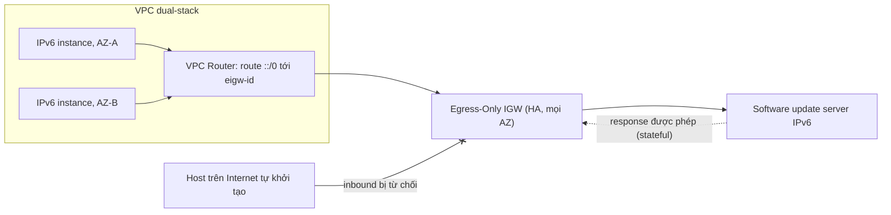

# Egress-Only Internet Gateway

> **TL;DR:** Egress-Only Internet Gateway (EIGW) là internet gateway **chỉ dành cho IPv6** và **chỉ cho kết nối khởi tạo từ trong VPC ra ngoài** (cùng response quay về). Kết nối do Internet khởi tạo bị **drop ngay tại EIGW**, không tới instance. Đây là bản thay thế cho [[NAT Gateway]] trong thế giới IPv6: IPv6 publicly routable nên không cần NAT để ra ngoài (NAT64 của NAT Gateway là chuyện khác: cho IPv6-only nói chuyện với IPv4-only).

## 🖼️ Sơ đồ
![[Egress-Only Internet Gateway.excalidraw]]
*Mở bằng plugin Excalidraw để chỉnh sửa · ảnh tĩnh: [[Egress-Only Internet Gateway.svg]]*

## Khái niệm cốt lõi

### Vì sao cần EIGW
- **IPv4** trong AWS có hai loại địa chỉ, private và public, nên dễ kiểm soát hướng kết nối:
  - Instance có public IPv4: đi ra và nhận kết nối vào đều được (nếu không có SG/NACL chặn).
  - Instance chỉ có private IPv4: không ra ngoài trực tiếp được. Đi qua [[NAT Gateway]] thì **ra được và nhận được response**, nhưng **Internet không khởi tạo kết nối vào được**.
- NAT Gateway thực ra làm hai việc mà người ta hay gộp làm một: (1) cho private IP ra ngoài, (2) chặn mọi kết nối inbound chưa được khởi tạo từ trong.
- **IPv6**: **mọi địa chỉ IPv6 trong AWS đều publicly routable** theo mặc định, nên không cần NAT để dịch private sang public. Gắn một [[VPC Routing and Internet Gateway|Internet Gateway]] thường thì instance IPv6 vừa ra được vừa có thể bị Internet kết nối vào (nếu không có lọc). Đây là "lỗ hổng chức năng": thiếu cách cho IPv6 **ra ngoài mà không bị gọi vào**.
  - Có tồn tại NAT cho IPv6: **NAT64** của [[NAT Gateway]], nhưng nó để workload **IPv6-only nói chuyện với dịch vụ IPv4-only**, **không** dùng để làm IPv6 → IPv6 outbound-only, và không cần cho IPv6 ra Internet.
- EIGW lấp đúng lỗ đó: IPv6 instance khởi tạo ra ngoài được, response quay về được, **kết nối khởi tạo từ ngoài vào bị từ chối**.

### Đặc điểm
- **Kiến trúc giống hệt Internet Gateway thường**:
  - Tạo rồi **attach vào một VPC**.
  - **Highly available theo mặc định** trên mọi AZ mà VPC dùng trong region; **tự scale** theo lưu lượng.
  - Không đặt vào subnet, không phải chọn AZ.
  - Khác IGW ở **cách dùng**, không khác ở kiến trúc.
- **Stateful**: EIGW theo dõi các kết nối đi ra, nên response của chúng được cho vào.
- **Inbound bị từ chối tuyệt đối**: mọi kết nối khởi tạo từ ngoài bị **drop ngay tại EIGW**, không bao giờ tới instance. Vì vậy **không thể** mở inbound bằng Security Group như với IGW thường (với IGW thường, SG quyết định cái gì được vào).
- **Chỉ IPv6**, không dùng được với IPv4. Với IPv4 dùng NAT Gateway (hoặc NAT instance).
- **Không bắt buộc**: có instance IPv6 không có nghĩa là phải dùng EIGW. Nhưng nếu chỉ dùng IGW thường thì Internet khởi tạo kết nối vào instance IPv6 được (đúng vấn đề EIGW giải quyết).
- **EIGW chạy một mình được**, không cần IGW. VPC có cả IPv4 và IPv6 thì dùng **cả IGW lẫn EIGW**; chỉ cần đặt default route đúng: `::/0` → EIGW cho IPv6, `0.0.0.0/0` → IGW (hoặc NAT Gateway) cho IPv4.
- IGW thường vẫn dùng được cho cả IPv4 public và IPv6, nhưng khi đó traffic **hai chiều**.
- (Ngoài khóa học: EIGW không tính phí theo giờ như NAT Gateway, chỉ có phí data transfer.)

## Cách hoạt động / Kiến trúc

Các bước cấu hình:
1. Tạo Egress-Only Internet Gateway, gắn vào VPC.
2. Trên route table của các subnet cần dùng, thêm **default route IPv6 `::/0`** với **target là EIGW** (`eigw-...`).
3. Instance cần có địa chỉ IPv6 (VPC và subnet đã được cấp IPv6 CIDR).

## Bảng so sánh / số liệu

| | Internet Gateway | Egress-Only IGW | NAT Gateway |
|---|---|---|---|
| IP version | IPv4 (public) + IPv6 | **Chỉ IPv6** | **Chỉ IPv4** |
| Hướng kết nối | Hai chiều | Chỉ khởi tạo từ trong ra | Chỉ khởi tạo từ trong ra |
| Vị trí | Gắn VPC | Gắn VPC | **Zonal**: đặt trong **public subnet** của một AZ; **regional**: chọn VPC (xem [[NAT Gateway]]) |
| Resilience | HA mặc định, mọi AZ | HA mặc định, mọi AZ | Zonal: AZ-resilient, cần 1 cái mỗi AZ; regional: AWS trải qua các AZ |
| Default route | `0.0.0.0/0` và/hoặc `::/0` | `::/0` | `0.0.0.0/0` |
| Có dịch địa chỉ | Static NAT cho IPv4 public | Không | IP masquerading (thêm NAT64 cho IPv6-only → IPv4) |
| Inbound khởi tạo từ ngoài | Được, SG/NACL lọc | **Drop tại EIGW**, SG không mở được | Không |

## Demo / Lab
Phần 3 của chuỗi demo web store Aus-E-Mart (phần 1: interface endpoint cho S3 ở [[Interface VPC Endpoints]], phần 2: gateway endpoint ở [[Gateway VPC Endpoints]]):
- Instance backend nằm trong app subnet, chỉ có **private IPv4 và một địa chỉ IPv6**; subnet không có route ra ngoài. Phần đổi giá AUD sang USD của web store cần backend gọi dịch vụ tỷ giá trên Internet.
- VPC → **Egress-only internet gateways** → Create `aem-vpc1-egw`, gắn vào VPC Aus-E-Mart. Thế là xong phần tạo.
- Vào backend bằng **EC2 Instance Connect** (private IP, qua EC2 Instance Connect Endpoint của stack), chạy `ping -6 ipv6.google.com`: **vẫn lỗi**, vì gateway đã gắn VPC nhưng **chưa subnet nào có route** tới nó (route table của subnet-a chỉ có local IPv4 và local IPv6).
- Sửa route table của subnet backend (bảng này dùng chung cho nhiều subnet): **Add route** `::/0` (default route IPv6) → target **Egress Only Internet Gateway** → chọn `aem-vpc1-egw`. Mọi subnet dùng bảng này và có IPv6 đều ra Internet được theo kiểu outbound-only.
- Ping lại thì chạy. Web store hiện được giá **USD** nhờ backend gọi được dịch vụ tỷ giá. Thử kết nối vào backend bằng public IP thì **không được**: chỉ có chiều ra.
- Bài học: tạo và gắn gateway thôi là chưa đủ; **phải có route** thì VPC router mới đẩy traffic tới gateway. Nhiều chức năng VPC dựa vào routing: gateway endpoint là route tới S3, EIGW là route `::/0`.
- Dọn dẹp: xóa EIGW, xóa các endpoint tạo tay (không xóa EC2 Instance Connect Endpoint do stack tạo), rồi xóa stack.

*(Bản khóa cũ nêu, bài mới không làm)*: demo cũ dùng VPC `a4l-secret`, EIGW `a4l-ipv6`, thêm route `::/0` vào **main route table** (bảng đã có prefix list S3 từ phần 1); dọn dẹp xóa S3 gateway endpoint, SNS interface endpoint, empty bucket; số điện thoại đã verify trong SNS sandbox phải chờ 24 giờ mới xóa được, origination number trong Pinpoint tốn khoảng 2 USD/tháng.

## 🎯 Mẹo thi SAA-C03
- "**IPv6** instance cần ra Internet (tải update) nhưng **không cho Internet kết nối vào**" → **Egress-Only Internet Gateway**. Đây gần như là câu duy nhất về EIGW.
- Bẫy: chọn NAT Gateway cho IPv6. **NAT Gateway không xử lý IPv6 outbound-only**; IPv6 dùng EIGW. (Tính năng NAT64 của NAT Gateway là để workload IPv6-only nói chuyện với đích IPv4, mục đích khác hẳn.)
- Bẫy: chọn Internet Gateway thường cho yêu cầu "outbound only" với IPv6. IGW cho phép cả inbound.
- EIGW **drop mọi kết nối từ ngoài** ngay tại gateway: không có cách "mở thêm" inbound bằng SG. Cần nhận inbound IPv6 thì dùng IGW thường + SG.
- VPC dual-stack: **IGW (hoặc NAT Gateway) cho IPv4, EIGW cho IPv6**, hai default route riêng.
- Câu hỏi về **kiến trúc/HA của EIGW** → trả lời như IGW: gắn vào VPC, HA trên mọi AZ, tự scale.
- Route cần có: `::/0` → `eigw-id`.

## Liên kết
- Tiên quyết: [[VPC Routing and Internet Gateway]], [[NAT Gateway]], [[NAT Fundamentals]], [[Custom VPC]]
- Liên quan: [[VPC Subnets]], [[Security Groups]], [[NACL]], [[Stateful vs Stateless Firewalls]], [[Gateway VPC Endpoints]], [[Interface VPC Endpoints]]
- Phân biệt với: [[NAT Gateway]] (IPv4), Internet Gateway trong [[VPC Routing and Internet Gateway]] (hai chiều)
- Section: [[_MOC 16 Advanced VPC Networking]]
