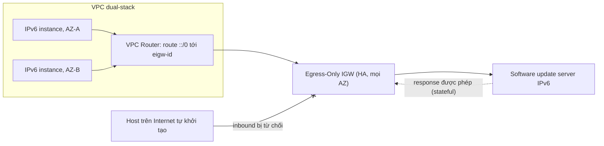

# Egress-Only Internet Gateway

> **TL;DR:** Egress-Only Internet Gateway (EIGW) là internet gateway **chỉ dành cho IPv6** và **chỉ cho kết nối khởi tạo từ trong VPC ra ngoài** (cùng response quay về). Internet không thể khởi tạo kết nối vào. Đây là bản thay thế cho [[NAT Gateway]] trong thế giới IPv6, vì IPv6 không dùng NAT.

## 🖼️ Sơ đồ
![[Egress-Only Internet Gateway.excalidraw]]
*Mở bằng plugin Excalidraw để chỉnh sửa · ảnh tĩnh: [[Egress-Only Internet Gateway.svg]]*

## Khái niệm cốt lõi

### Vì sao cần EIGW
- **IPv4** trong AWS có hai loại địa chỉ, private và public, nên dễ kiểm soát hướng kết nối:
  - Instance có public IPv4: đi ra và nhận kết nối vào đều được (nếu không có SG/NACL chặn).
  - Instance chỉ có private IPv4: không ra ngoài trực tiếp được. Đi qua [[NAT Gateway]] thì **ra được và nhận được response**, nhưng **Internet không khởi tạo kết nối vào được**.
- NAT Gateway thực ra làm hai việc mà người ta hay gộp làm một: (1) cho private IP ra ngoài, (2) chặn mọi kết nối inbound chưa được khởi tạo từ trong.
- **IPv6**: NAT **không dùng** với IPv6, và **mọi địa chỉ IPv6 trong AWS đều publicly routable**. Gắn một [[VPC Routing and Internet Gateway|Internet Gateway]] thường thì instance IPv6 vừa ra được vừa có thể bị Internet kết nối vào (nếu không có lọc). Đây là "lỗ hổng chức năng": thiếu cách cho IPv6 **ra ngoài mà không bị gọi vào**.
- EIGW lấp đúng lỗ đó: IPv6 instance khởi tạo ra ngoài được, response quay về được, **kết nối khởi tạo từ ngoài vào bị từ chối**.

### Đặc điểm
- **Kiến trúc giống hệt Internet Gateway thường**:
  - Tạo rồi **attach vào một VPC**.
  - **Highly available theo mặc định** trên mọi AZ mà VPC dùng trong region; **tự scale** theo lưu lượng.
  - Không đặt vào subnet, không phải chọn AZ.
  - Khác IGW ở **cách dùng**, không khác ở kiến trúc.
- **Stateful**: mọi loại internet gateway đều theo dõi trạng thái luồng, nên response của kết nối đi ra được cho vào.
- **Chỉ IPv6**. Với IPv4 dùng NAT Gateway (hoặc NAT instance).
- IGW thường vẫn dùng được cho cả IPv4 public và IPv6, nhưng khi đó traffic **hai chiều**.
- (Ngoài khóa học: EIGW không tính phí theo giờ như NAT Gateway, chỉ có phí data transfer. SG và NACL vẫn áp dụng như bình thường.)

## Cách hoạt động / Kiến trúc

Các bước cấu hình:
1. Tạo Egress-Only Internet Gateway, gắn vào VPC.
2. Trên route table của các subnet cần dùng, thêm **default route IPv6 `::/0`** với **target là EIGW** (`eigw-...`).
3. Instance cần có địa chỉ IPv6 (VPC và subnet đã được cấp IPv6 CIDR).

## Bảng so sánh / số liệu

| | Internet Gateway | Egress-Only IGW | NAT Gateway |
|---|---|---|---|
| IP version | IPv4 (public) + IPv6 | **Chỉ IPv6** | **Chỉ IPv4** |
| Hướng kết nối | Hai chiều | Chỉ khởi tạo từ trong ra | Chỉ khởi tạo từ trong ra |
| Vị trí | Gắn VPC | Gắn VPC | Đặt trong **public subnet** của một AZ |
| Resilience | HA mặc định, mọi AZ | HA mặc định, mọi AZ | AZ-resilient, cần 1 cái mỗi AZ |
| Default route | `0.0.0.0/0` và/hoặc `::/0` | `::/0` | `0.0.0.0/0` |
| Có dịch địa chỉ | Static NAT cho IPv4 public | Không | IP masquerading |

## Demo / Lab
Phần 3 của chuỗi demo "A4L secret VPC" (phần 1 là gateway endpoint, phần 2 là interface endpoint):
- Instance private đã có địa chỉ IPv6. Chạy `ping -6 ipv6.google.com` thì không có phản hồi vì VPC chưa có gateway IPv6.
- Tạo EIGW `a4l-ipv6`, gắn vào VPC `a4l-secret`. Ping **vẫn chưa** chạy vì chưa có route.
- Sửa **main route table** của VPC (bảng đã có prefix list S3 từ phần 1): thêm route `::/0` → EIGW. Route này là catch-all cho IPv6 khi không có route IPv6 nào cụ thể hơn.
- Ping lại thì có phản hồi. EIGW stateful nên response được cho vào.
- Bài học: tạo và gắn gateway thôi là chưa đủ; **phải có route** thì VPC router mới đẩy traffic tới gateway.
- Dọn dẹp: xóa S3 gateway endpoint và SNS interface endpoint tạo tay, empty bucket, xóa EIGW, xóa stack CloudFormation. Số điện thoại đã verify trong SNS sandbox thì phải chờ 24 giờ mới xóa được (không mất phí). Origination number trong Pinpoint tốn khoảng 2 USD/tháng.

## 🎯 Mẹo thi SAA-C03
- "**IPv6** instance cần ra Internet (tải update) nhưng **không cho Internet kết nối vào**" → **Egress-Only Internet Gateway**. Đây gần như là câu duy nhất về EIGW.
- Bẫy: chọn NAT Gateway cho IPv6. **NAT Gateway không xử lý IPv6 outbound-only**; IPv6 dùng EIGW. (Tính năng NAT64 của NAT Gateway là để workload IPv6-only nói chuyện với đích IPv4, mục đích khác hẳn.)
- Bẫy: chọn Internet Gateway thường cho yêu cầu "outbound only" với IPv6. IGW cho phép cả inbound.
- Câu hỏi về **kiến trúc/HA của EIGW** → trả lời như IGW: gắn vào VPC, HA trên mọi AZ, tự scale.
- Route cần có: `::/0` → `eigw-id`.

## Liên kết
- Tiên quyết: [[VPC Routing and Internet Gateway]], [[NAT Gateway]], [[NAT Fundamentals]], [[Custom VPC]]
- Liên quan: [[VPC Subnets]], [[Security Groups]], [[NACL]], [[Stateful vs Stateless Firewalls]], [[Gateway VPC Endpoints]], [[Interface VPC Endpoints]]
- Phân biệt với: [[NAT Gateway]] (IPv4), Internet Gateway trong [[VPC Routing and Internet Gateway]] (hai chiều)
- Section: [[_MOC 16 Advanced VPC Networking]]
