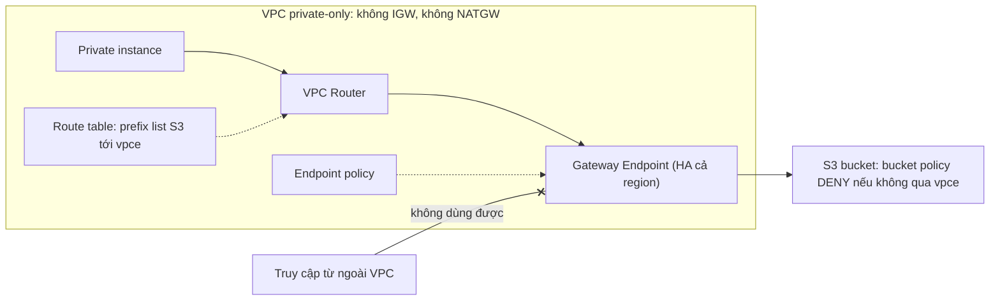

# Gateway VPC Endpoints

> **TL;DR:** Gateway endpoint cho resource private (hoặc cả một VPC không có Internet) truy cập **S3 và DynamoDB** mà không cần public IP, Internet Gateway hay NAT Gateway. Nó hoạt động bằng **routing**: AWS thêm một **prefix list** của dịch vụ vào route table của subnet, target là gateway endpoint. Endpoint này **HA theo mặc định** trong region, **chỉ cùng region** và **chỉ dùng được từ bên trong VPC chứa nó**.

## 🖼️ Sơ đồ
![[Gateway VPC Endpoints.excalidraw]]
*Mở bằng plugin Excalidraw để chỉnh sửa · ảnh tĩnh: [[Gateway VPC Endpoints.svg]]*

## Khái niệm cốt lõi
- **Dịch vụ hỗ trợ**: chỉ **S3** và **DynamoDB** (đây là điều cần nhớ khi thi). Về kỹ thuật còn có một gateway endpoint service riêng cho **S3 Express One Zone directory bucket**.
- **Vấn đề cần giải quyết**: S3 và DynamoDB là **public service** (xem [[AWS Public vs Private Services]]). Bình thường muốn gọi chúng từ VPC thì phải có Internet Gateway, rồi cấp cho resource public IPv4, IPv6, hoặc đi qua [[NAT Gateway]]. Như vậy resource cũng có luôn đường ra Internet, điều mà VPC bảo mật cao hoặc ngành bị quản lý chặt (regulated) không muốn.
- **Tạo theo từng service, từng region**. Ví dụ: một gateway endpoint cho S3 ở `us-east-1`.
- **Gắn với VPC và chọn route table** (không chọn subnet, không có Private DNS như interface endpoint). Tạo gateway endpoint **không provision gì vào subnet**: endpoint **không nằm trong subnet hay AZ nào**. Subnet nào dùng route table đã chọn thì có đường private qua endpoint.
  - Muốn chỉ **một vài subnet** dùng endpoint thì tạo **route table riêng**, associate với đúng các subnet đó, rồi chỉ gắn endpoint vào route table này.
- **Prefix list**: một đối tượng logic đại diện cho dải IP của dịch vụ (S3 hoặc DynamoDB), **do AWS cập nhật**. Khi gắn endpoint, AWS tự thêm route:
  - Destination = prefix list (ví dụ `pl-xxxx` của `com.amazonaws.us-east-1.s3`)
  - Target = gateway endpoint (`vpce-...`)
  - Route này do AWS quản lý, bạn không sửa được.
- **Highly available theo mặc định**, chạy trên mọi AZ của VPC, giống Internet Gateway. Không phải lo đặt endpoint vào AZ nào.
- **Ứng dụng không cần sửa gì**: ứng dụng vẫn gọi tên DNS mặc định của S3/DynamoDB. Chỉ có **đường đi của traffic** thay đổi.
- **Endpoint policy**: một resource policy (JSON) gắn lên endpoint, giới hạn **endpoint được dùng để truy cập cái gì**. Ví dụ chỉ cho truy cập một vài bucket thay vì toàn bộ S3.
- **Chỉ cùng region**: endpoint ở `us-east-1` không truy cập được bucket ở `ap-southeast-2`.
- **Chỉ truy cập được từ bên trong VPC đó**. Đây là gateway logic của VPC; không dùng được từ VPC peer, từ on-premises qua VPN/Direct Connect, hay từ nơi khác.
- **Không tốn phí** (bài demo nhấn mạnh "no cost" so với interface endpoint), tạo xong gần như **available ngay** vì việc duy nhất của nó là cập nhật route. Đây là lý do hay được chọn khi đề nói "tiết kiệm chi phí".

## Cách hoạt động / Kiến trúc

**Không có gateway endpoint**: instance public đi qua VPC router → IGW → S3. Instance private đi qua NAT Gateway (lấy public IPv4 của NATGW) → IGW → S3. Cả hai đều có luôn đường ra Internet.

**Có gateway endpoint**:

- Hình dung endpoint như một "đường hầm" từ trong VPC tới dịch vụ public: dữ liệu đi bằng private IP, không cần public addressing.
- VPC trong hình không có IGW, không có NATGW. Instance private **chỉ** tới được S3, không tới được gì khác.

### Hai use case chính
1. **VPC private muốn dùng S3/DynamoDB**. Ví dụ: để bản cập nhật phần mềm trong S3, cho một VPC "siêu bảo mật" tải về mà không mở Internet. Kết hợp endpoint policy để chỉ cho đọc đúng bucket đó.
2. **Private-only bucket (chống leaky bucket)**: viết **bucket policy** chỉ nhận thao tác đến từ một gateway endpoint cụ thể (điều kiện `aws:SourceVpce`). Cách bài giảng mô tả: **explicit deny** các action S3 **trừ khi** request đi qua đúng endpoint đó; explicit deny thắng mọi allow, nên kể cả principal có quyền trong identity policy cũng không vào được bucket từ ngoài endpoint. Xem [[S3 Security]].

### Hai lớp kiểm soát
| Lớp | Gắn ở đâu | Kiểm soát |
|---|---|---|
| Endpoint policy | Gateway endpoint | Endpoint **được dùng để truy cập** bucket/table nào |
| Bucket policy | S3 bucket | Bucket **chấp nhận** request từ đâu (ví dụ chỉ từ `vpce-...`) |

Gateway endpoint **không có Security Group** vì nó không phải network interface.

## Demo / Lab
Phần 2 của chuỗi demo web store Aus-E-Mart (phần 1 ở [[Interface VPC Endpoints]]: cài backend thất bại vì interface endpoint S3 không bật Private DNS):
- Stack `Endpoints` có VPC `AEM-VPC1`: web subnet public, app subnet private không có đường ra Internet; vào instance backend bằng **EC2 Instance Connect** qua **EC2 Instance Connect Endpoint** do stack tạo (`Connect using a private IP`).
- VPC → Endpoints → Create endpoint `AEM-S3-GW-Endpoint`, AWS services, dịch vụ `com.amazonaws.us-east-1.s3`, chọn loại **Gateway**, VPC `AEM-VPC1`.
- Khác interface endpoint: **không chọn subnet**, **không có Private DNS**; thay vào đó **chọn route table**. VPC có hai route table: một bảng chỉ cho 3 web subnet (không đụng tới), một bảng dùng cho các app subnet (và vài subnet khác) → chỉ chọn bảng này. Policy để mặc định.
- Endpoint **available gần như ngay** (interface endpoint mất vài phút). Xem route table của app subnet: có thêm route **destination là prefix list của S3**, target là endpoint; mở prefix list thấy toàn dải IP của S3 trong region.
- Chạy lại `sudo bash install.sh` trên backend: lần này **thành công rất nhanh**, ứng dụng không phải đổi DNS gì vì gateway endpoint chỉ dựa vào **routing**, trong suốt với ứng dụng. Web store hiện đủ danh sách sản phẩm.
- Giảng viên nhắc: interface endpoint vẫn có ưu điểm riêng (Security Group, truy cập qua VPN/Direct Connect); cần đơn giản thì dùng gateway endpoint.
- Giá chỉ hiện AUD, phần đổi sang USD cần Internet outbound → phần 3 ở [[Egress-Only Internet Gateway]]. Xóa gateway endpoint (không xóa EC2 Instance Connect Endpoint).

*(Bản khóa cũ nêu, bài mới không làm)*: demo cũ là phần 1 của chuỗi "A4L secret VPC": VPC private hoàn toàn (không IGW), kết nối instance bằng **Session Manager** (chạy được nhờ interface endpoint của SSM có sẵn), `ping 1.1.1.1` timeout, `aws s3 ls` treo; tạo gateway endpoint S3 gắn main route table; sau đó `aws s3 ls` và `aws s3 cp s3://<bucket>/supersecret.txt .` chạy được.

## 🎯 Mẹo thi SAA-C03
- "Instance private / VPC không có Internet cần truy cập **S3 hoặc DynamoDB**, không qua Internet, rẻ nhất" → **Gateway endpoint**.
- Gateway endpoint **không nằm trong subnet/AZ**, **HA theo mặc định**. Nếu đáp án nói "tạo gateway endpoint ở mỗi AZ" là sai.
- Cơ chế = **prefix list trong route table**. Nhắc tới route table → gateway endpoint. Nhắc tới DNS/ENI/private IP → interface endpoint.
- **Không truy cập được từ ngoài VPC** (on-premises qua VPN/DX, VPC peer). Nếu on-premises cần truy cập S3 riêng tư → dùng **interface endpoint** cho S3.
- **Chỉ cùng region**. Bucket ở region khác thì gateway endpoint không giúp được.
- Giới hạn bucket mà VPC truy cập được → **endpoint policy**. Bắt bucket chỉ nhận traffic từ VPC → **bucket policy với `aws:SourceVpce`**.
- Không có Security Group trên gateway endpoint.
- Chỉ một số subnet được dùng gateway endpoint → gắn endpoint vào **route table riêng** của các subnet đó (endpoint gắn theo route table, không theo subnet).
- So sánh đầy đủ: [[Compare - Gateway vs Interface Endpoints]].

## Liên kết
- Tiên quyết: [[VPC Routing and Internet Gateway]], [[NAT Gateway]], [[AWS Public vs Private Services]], [[VPC Subnets]]
- Liên quan: [[S3 Security]], [[S3 Basics]], [[DynamoDB Architecture]], [[IAM Identity Policies]], [[Egress-Only Internet Gateway]]
- Phân biệt với: [[Interface VPC Endpoints]], [[Compare - Gateway vs Interface Endpoints]], [[S3 Access Points]]
- Section: [[_MOC 16 Advanced VPC Networking]]
