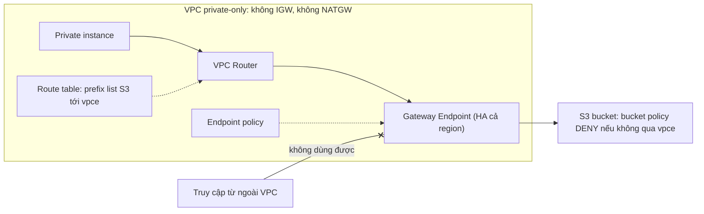

# Gateway VPC Endpoints

> **TL;DR:** Gateway endpoint cho resource private (hoặc cả một VPC không có Internet) truy cập **S3 và DynamoDB** mà không cần public IP, Internet Gateway hay NAT Gateway. Nó hoạt động bằng **routing**: AWS thêm một **prefix list** của dịch vụ vào route table của subnet, target là gateway endpoint. Endpoint này **HA theo mặc định** trong region, **chỉ cùng region** và **chỉ dùng được từ bên trong VPC chứa nó**.

## 🖼️ Sơ đồ
![[Gateway VPC Endpoints.excalidraw]]
*Mở bằng plugin Excalidraw để chỉnh sửa · ảnh tĩnh: [[Gateway VPC Endpoints.svg]]*

## Khái niệm cốt lõi
- **Dịch vụ hỗ trợ**: chỉ **S3** và **DynamoDB**.
- **Vấn đề cần giải quyết**: S3 và DynamoDB là **public service** (xem [[AWS Public vs Private Services]]). Bình thường muốn gọi chúng từ VPC thì phải có Internet Gateway, rồi cấp cho resource public IPv4, IPv6, hoặc đi qua [[NAT Gateway]]. Như vậy resource cũng có luôn đường ra Internet, điều mà VPC bảo mật cao hoặc ngành bị quản lý chặt (regulated) không muốn.
- **Tạo theo từng service, từng region**. Ví dụ: một gateway endpoint cho S3 ở `us-east-1`.
- **Gắn với VPC và chọn subnet (đúng hơn là chọn route table)**. Endpoint **không nằm trong subnet hay AZ nào**.
- **Prefix list**: một đối tượng logic đại diện cho dải IP của dịch vụ (S3 hoặc DynamoDB), **do AWS cập nhật**. Khi gắn endpoint, AWS tự thêm route:
  - Destination = prefix list (ví dụ `pl-xxxx` của `com.amazonaws.us-east-1.s3`)
  - Target = gateway endpoint (`vpce-...`)
  - Route này do AWS quản lý, bạn không sửa được.
- **Highly available theo mặc định**, chạy trên mọi AZ của VPC, giống Internet Gateway. Không phải lo đặt endpoint vào AZ nào.
- **Ứng dụng không cần sửa gì**: ứng dụng vẫn gọi tên DNS mặc định của S3/DynamoDB. Chỉ có **đường đi của traffic** thay đổi.
- **Endpoint policy**: một resource policy (JSON) gắn lên endpoint, giới hạn **endpoint được dùng để truy cập cái gì**. Ví dụ chỉ cho truy cập một vài bucket thay vì toàn bộ S3.
- **Chỉ cùng region**: endpoint ở `us-east-1` không truy cập được bucket ở `ap-southeast-2`.
- **Chỉ truy cập được từ bên trong VPC đó**. Đây là gateway logic của VPC; không dùng được từ VPC peer, từ on-premises qua VPN/Direct Connect, hay từ nơi khác.
- (Ngoài khóa học: gateway endpoint **miễn phí**, không có phí giờ hay phí dữ liệu, đây là lý do hay được chọn khi đề nói "tiết kiệm chi phí".)

## Cách hoạt động / Kiến trúc

**Không có gateway endpoint**: instance public đi qua VPC router → IGW → S3. Instance private đi qua NAT Gateway (lấy public IPv4 của NATGW) → IGW → S3. Cả hai đều có luôn đường ra Internet.

**Có gateway endpoint**:

- Hình dung endpoint như một "đường hầm" từ trong VPC tới dịch vụ public: dữ liệu đi bằng private IP, không cần public addressing.
- VPC trong hình không có IGW, không có NATGW. Instance private **chỉ** tới được S3, không tới được gì khác.

### Hai use case chính
1. **VPC private muốn dùng S3/DynamoDB**. Ví dụ: để bản cập nhật phần mềm trong S3, cho một VPC "siêu bảo mật" tải về mà không mở Internet. Kết hợp endpoint policy để chỉ cho đọc đúng bucket đó.
2. **Private-only bucket (chống leaky bucket)**: viết **bucket policy** chỉ cho phép thao tác đến từ một gateway endpoint cụ thể (điều kiện `aws:SourceVpce`). S3 mặc định đã private, nên mọi nguồn khác rơi vào implicit deny (hoặc thêm explicit DENY cho chắc). Xem [[S3 Security]].

### Hai lớp kiểm soát
| Lớp | Gắn ở đâu | Kiểm soát |
|---|---|---|
| Endpoint policy | Gateway endpoint | Endpoint **được dùng để truy cập** bucket/table nào |
| Bucket policy | S3 bucket | Bucket **chấp nhận** request từ đâu (ví dụ chỉ từ `vpce-...`) |

Gateway endpoint **không có Security Group** vì nó không phải network interface.

## Demo / Lab
Phần 1 của chuỗi demo "A4L secret VPC":
- CloudFormation tạo VPC private hoàn toàn (không IGW), một EC2 private và một bucket. Upload `supersecret.txt` vào bucket.
- Kết nối instance bằng **Session Manager** (Systems Manager). Cách này chạy được nhờ các **interface endpoint của SSM** đã có sẵn trong VPC, không cần mạng public.
- Kiểm tra: `ping 1.1.1.1` timeout, `aws s3 ls` bị treo vì không tới được public endpoint của S3.
- Tạo endpoint: dịch vụ `com.amazonaws.us-east-1.s3`, chọn loại **Gateway**, VPC `a4l-secret`, chọn **route table** của các subnet app (main route table), policy để Full access.
- Xem route table: xuất hiện route có **destination là prefix list của S3**, target là endpoint. Route này AWS tự thêm, không sửa được.
- `aws s3 ls` liệt kê được bucket; `aws s3 cp s3://<bucket>/supersecret.txt .` tải được file ("cats are the best").
- Bài học: gateway endpoint tạo gần như tức thì, chỉ thay đổi route, ứng dụng/CLI không cần cấu hình gì thêm.

## 🎯 Mẹo thi SAA-C03
- "Instance private / VPC không có Internet cần truy cập **S3 hoặc DynamoDB**, không qua Internet, rẻ nhất" → **Gateway endpoint**.
- Gateway endpoint **không nằm trong subnet/AZ**, **HA theo mặc định**. Nếu đáp án nói "tạo gateway endpoint ở mỗi AZ" là sai.
- Cơ chế = **prefix list trong route table**. Nhắc tới route table → gateway endpoint. Nhắc tới DNS/ENI/private IP → interface endpoint.
- **Không truy cập được từ ngoài VPC** (on-premises qua VPN/DX, VPC peer). Nếu on-premises cần truy cập S3 riêng tư → dùng **interface endpoint** cho S3.
- **Chỉ cùng region**. Bucket ở region khác thì gateway endpoint không giúp được.
- Giới hạn bucket mà VPC truy cập được → **endpoint policy**. Bắt bucket chỉ nhận traffic từ VPC → **bucket policy với `aws:SourceVpce`**.
- Không có Security Group trên gateway endpoint.
- So sánh đầy đủ: [[Compare - Gateway vs Interface Endpoints]].

## Liên kết
- Tiên quyết: [[VPC Routing and Internet Gateway]], [[NAT Gateway]], [[AWS Public vs Private Services]], [[VPC Subnets]]
- Liên quan: [[S3 Security]], [[S3 Basics]], [[DynamoDB Architecture]], [[IAM Identity Policies]], [[Egress-Only Internet Gateway]]
- Phân biệt với: [[Interface VPC Endpoints]], [[Compare - Gateway vs Interface Endpoints]], [[S3 Access Points]]
- Section: [[_MOC 16 Advanced VPC Networking]]
