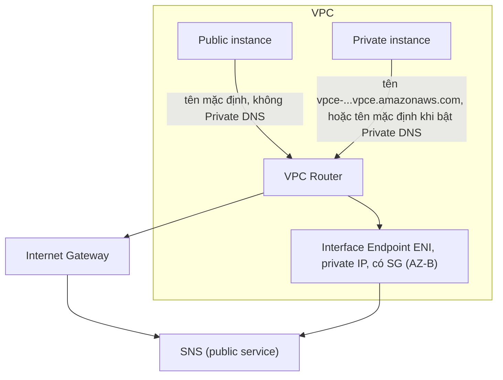

# Interface VPC Endpoints

> **TL;DR:** Interface endpoint đưa một dịch vụ AWS public (SNS, SQS, SSM, ...) **vào trong VPC** dưới dạng một **ENI có private IP** trong subnet của bạn. Traffic tới dịch vụ được dẫn bằng **DNS** chứ không bằng route table. Vì là ENI trong một subnet, endpoint chỉ thuộc **một AZ**, nên **không HA mặc định**: cần một endpoint mỗi AZ. Có thể gắn **Security Group**. Hỗ trợ **TCP và UDP**, VPC **IPv4, IPv6 hoặc dual-stack**. Công nghệ bên dưới là **[[AWS PrivateLink]]**.

## 🖼️ Sơ đồ
![[Interface VPC Endpoints.excalidraw]]
*Mở bằng plugin Excalidraw để chỉnh sửa · ảnh tĩnh: [[Interface VPC Endpoints.svg]]*

![[Interface VPC Endpoints - dns.excalidraw]]
*Mở bằng plugin Excalidraw để chỉnh sửa · ảnh tĩnh: [[Interface VPC Endpoints - dns.svg]]*

## Khái niệm cốt lõi
- **Mục đích giống gateway endpoint**: cho instance private hoặc VPC private hoàn toàn truy cập dịch vụ AWS public **mà không cần public IP, IGW hay NAT**. Cách làm thì khác hẳn.
- **Dịch vụ hỗ trợ**:
  - Trước đây interface endpoint dùng cho **mọi dịch vụ trừ S3 và DynamoDB** (hai cái đó chỉ có gateway endpoint).
  - Khóa học: S3 đã hỗ trợ cả hai loại; DynamoDB vẫn chỉ có gateway.
  - (Hiện nay 2026: **DynamoDB cũng đã có interface endpoint** từ 2024. Cả S3 và DynamoDB đều có cả hai loại.)
- **Là network interface trong subnet**: mỗi interface endpoint là ENI với **private IP thuộc dải của subnet** chứa nó.
  - Một subnet = một AZ, nên một interface endpoint chỉ ở **một AZ**. AZ đó hỏng thì chức năng endpoint ở đó cũng mất.
  - Muốn HA: đặt **một interface trong một subnet ở mỗi AZ** mà VPC dùng. Dùng 2 AZ cần 2, dùng 3 AZ cần 3.
  - Mỗi AZ chỉ chọn được **một subnet** cho một endpoint.
- **Security Group**: vì là ENI nên kiểm soát truy cập mạng bằng SG được. **Gateway endpoint không làm được điều này.**
- **Endpoint policy**: vẫn dùng được, giống gateway endpoint, để giới hạn endpoint được dùng truy cập cái gì.
- **Protocol**: hỗ trợ **TCP và UDP**, dùng được trong VPC **chỉ IPv4, chỉ IPv6 hoặc dual-stack** (cả hai). *(Bản khóa cũ nói chỉ TCP và chỉ IPv4; bài mới đã đổi.)*
- **[[AWS PrivateLink]]**: công nghệ cho phép **"inject" dịch vụ bên ngoài vào VPC** dưới dạng ENI trong subnet của bạn. Đây là khác biệt lớn nhất so với gateway endpoint (chỉ dựa vào routing).
  - Interface endpoint chạy trên PrivateLink: ví dụ interface endpoint cho S3 thêm một ENI vào VPC, trỏ vào đó là có đường private tới S3.
  - PrivateLink còn dùng để cung cấp dịch vụ của **account khác / vendor / partner** (endpoint service sau NLB) vào VPC private mà không cần IGW, NAT, peering. Kiến trúc provider/consumer: xem [[AWS PrivateLink]].
  - Gặp chữ "PrivateLink" trong đề → nghĩ tới interface endpoint / đưa dịch vụ vào VPC qua ENI.

## Cách hoạt động / Kiến trúc: DNS
Gateway endpoint dùng prefix list trong route table. Interface endpoint thì **dùng DNS**: tên miền resolve ra private IP của ENI endpoint, rồi traffic đi tới IP đó như mọi IP trong VPC.

### Các tên DNS của một interface endpoint
| Loại | Ví dụ / ý nghĩa |
|---|---|
| **Endpoint-specific, Regional** | `vpce-123-xyz.sns.us-east-1.vpce.amazonaws.com`. Một tên duy nhất, chạy được dù dùng AZ nào. Đơn giản và HA. |
| **Endpoint-specific, Zonal** | Mỗi interface ở mỗi AZ có một tên riêng, resolve tới **đúng interface ở AZ đó**. |
| **Private DNS** (tùy chọn) | Ghi đè **tên DNS mặc định của dịch vụ** (ví dụ `sns.us-east-1.amazonaws.com`) để nó resolve ra private IP của endpoint. |

- Ứng dụng có thể dùng tên regional hoặc zonal, nhưng phải **sửa cấu hình ứng dụng** (ví dụ CLI dùng `--endpoint-url`).
- **Private DNS**: AWS gắn một **Route 53 private hosted zone** (do AWS quản lý) vào VPC. Zone này có bản ghi thay thế cho tên mặc định của dịch vụ, trỏ về IP của interface endpoint. Kết quả là **ứng dụng không cần sửa gì** vẫn đi qua endpoint. Tùy chọn này **bật mặc định** khi tạo endpoint, và giảng viên khuyên **trong production gần như luôn nên bật** (cần VPC bật **DNS hostnames** và **DNS resolution**, tức `enableDnsHostnames` và `enableDnsSupport`). Xem [[R53 Private Hosted Zones]].

### Ba trường hợp với SNS

1. **Không có endpoint**: instance resolve `sns.us-east-1.amazonaws.com` ra **public IP**, đi qua VPC router → IGW → SNS. Instance public chạy được. **Instance private thất bại** vì không có public IP để qua IGW.
2. **Có endpoint, không bật Private DNS**: client vẫn dùng tên mặc định thì vẫn đi ra IGW như cũ. Client dùng **tên endpoint-specific** thì resolve ra private IP của endpoint và đi qua endpoint, không cần public addressing.
3. **Có endpoint, bật Private DNS**: tên mặc định bị ghi đè, resolve ra private IP của endpoint. **Mọi client, kể cả ứng dụng không sửa được**, đều đi qua endpoint.

## Demo / Lab
Phần 1 của chuỗi demo web store Aus-E-Mart (phần 2: [[Gateway VPC Endpoints]], phần 3: [[Egress-Only Internet Gateway]]):
- One-click stack `Endpoints` ở us-east-1: VPC `AEM-VPC1` có **app tier** (backend) trong app subnet private, **không có Internet vào hay ra**, và **web front-end** trong web subnet public. Stack tạo thêm **EC2 Instance Connect Endpoint** (mất khoảng 5 phút) để vào được instance chỉ có private IP: Connect → **EC2 Instance Connect** → *Connect using a private IP*.
- Trên backend: `curl` tải gói cài đặt của backend (nằm trên S3) bị **timeout**; `ping 1.1.1.1` và `ping -6 ipv6.google.com` đều lỗi. Front-end mở bằng public IP thì chưa chạy vì backend chưa cài xong.
- VPC → Endpoints → Create endpoint `AEM S3 interface-endpoint`, AWS services (có tùy chọn cross-region endpoint, không dùng), dịch vụ `com.amazonaws.us-east-1.s3` loại **Interface** (S3 có cả Gateway lẫn Interface). Endpoint tạo **cho một dịch vụ, một VPC, một region**.
- Chọn VPC `AEM-VPC1`. **Tắt Private DNS name** để thấy khác biệt (thực tế production gần như luôn bật). DNS record type IPv4.
- Chọn subnet: **mỗi AZ chỉ chọn được một subnet**; chọn app A, app B, app C (một subnet là đủ cho một instance, nhưng chọn cả 3 cho đủ AZ). Mỗi subnet được chọn sẽ có một ENI của endpoint.
- Gắn **Security Group** của stack (gateway endpoint không làm được). Endpoint policy (có ở cả hai loại endpoint) để Full access.
- Interface endpoint **tạo lâu hơn** gateway endpoint (pending vài phút rồi available).
- Chạy lại `curl` cũ: vẫn lỗi, vì không bật Private DNS nên tên S3 mặc định vẫn resolve ra IP public. Lấy **tên DNS endpoint-specific** trên trang endpoint, sửa URL trong lệnh (thay `*` đầu tên bằng `bucket`, theo dạng `bucket.vpce-….s3.us-east-1.vpce.amazonaws.com`) thì tải được gói backend.
- Chạy `sudo bash install.sh`: cài được một phần, nhưng bước tải **product catalog** dùng **tên DNS mặc định của S3 viết cứng** trong script nên **thất bại**. Web store chạy dở, không có sản phẩm.
- Bài học: ứng dụng dùng tên mặc định của dịch vụ sẽ lỗi nếu interface endpoint **không bật Private DNS** (hoặc không dùng gateway endpoint chỉ dựa vào routing). Đây là cân nhắc lớn khi chọn loại endpoint.
- Xóa S3 interface endpoint (giữ EC2 Instance Connect Endpoint) và chuyển sang phần 2.

*(Bản khóa cũ nêu, bài mới không làm)*: demo cũ là phần 2 của chuỗi "A4L secret VPC": interface endpoint cho **SNS** (`com.amazonaws.us-east-1.sns`) ở app-A/B/C, tắt Private DNS, gọi `aws sns publish … --endpoint-url https://<regional endpoint-specific DNS>` (chọn tên regional, không chọn tên có AZ), rồi Actions → **Modify private DNS names** bật lại và gửi được tin nhắn bằng tên mặc định; SNS SMS ở sandbox phải verify số nhận, một số nước cần origination number qua Pinpoint (khoảng 2 USD/tháng).

## 🎯 Mẹo thi SAA-C03
- Interface endpoint **không HA mặc định** → câu hỏi về resilience thì đáp án đúng là **mỗi AZ một endpoint** (một subnet mỗi AZ).
- Cơ chế = **DNS + ENI có private IP**, **không dùng routing**. Gateway endpoint = prefix list + route table.
- Cần **Security Group** kiểm soát ai được dùng endpoint → interface endpoint (gateway endpoint không có SG).
- "Ứng dụng **không sửa được** nhưng vẫn phải đi qua endpoint" → bật **Private DNS**.
- **PrivateLink** = công nghệ của interface endpoint, và là cách **chia sẻ/đưa dịch vụ của bên thứ ba vào VPC** riêng tư (xem [[AWS PrivateLink]]).
- Interface endpoint **truy cập được từ on-premises** (qua VPN/Direct Connect) và từ VPC peer, vì nó chỉ là một private IP. Gateway endpoint thì không.
- Protocol: **TCP và UDP**; VPC **IPv4, IPv6 hoặc dual-stack** (bản khóa cũ nói "chỉ TCP, chỉ IPv4", nay không còn đúng).
- (Ngoài khóa học: interface endpoint **tính phí theo giờ mỗi AZ và theo GB**, còn gateway endpoint miễn phí. Đề nói S3/DynamoDB + rẻ nhất → gateway.)

## Liên kết
- Tiên quyết: [[VPC Subnets]], [[EC2 Network Interfaces IPs and DNS]], [[Security Groups]], [[DNS Fundamentals]], [[AWS Public vs Private Services]]
- Liên quan: [[AWS PrivateLink]], [[R53 Private Hosted Zones]], [[SNS]], [[SSM Parameter Store]], [[Site-to-Site VPN]], [[Direct Connect]], [[Gateway Load Balancer]]
- Phân biệt với: [[Gateway VPC Endpoints]], [[Compare - Gateway vs Interface Endpoints]], [[VPC Peering]]
- Section: [[_MOC 16 Advanced VPC Networking]]
