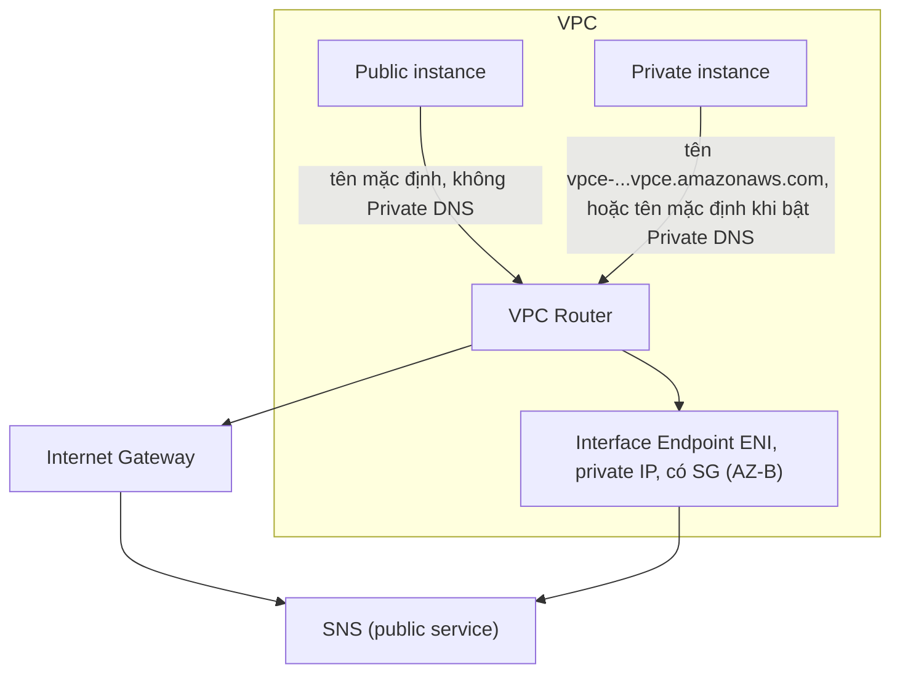

# Interface VPC Endpoints

> **TL;DR:** Interface endpoint đưa một dịch vụ AWS public (SNS, SQS, SSM, ...) **vào trong VPC** dưới dạng một **ENI có private IP** trong subnet của bạn. Traffic tới dịch vụ được dẫn bằng **DNS** chứ không bằng route table. Vì là ENI trong một subnet, endpoint chỉ thuộc **một AZ**, nên **không HA mặc định**: cần một endpoint mỗi AZ. Có thể gắn **Security Group**. Công nghệ bên dưới là **AWS PrivateLink**.

## 🖼️ Sơ đồ
![[Interface VPC Endpoints.excalidraw]]
*Mở bằng plugin Excalidraw để chỉnh sửa · ảnh tĩnh: [[Interface VPC Endpoints.svg]]*

![[Interface VPC Endpoints - dns.excalidraw]]
*Mở bằng plugin Excalidraw để chỉnh sửa · ảnh tĩnh: [[Interface VPC Endpoints - dns.svg]]*

## Khái niệm cốt lõi
- **Mục đích giống gateway endpoint**: cho instance private hoặc VPC private hoàn toàn truy cập dịch vụ AWS public **mà không cần public IP, IGW hay NAT**. Cách làm thì khác hẳn.
- **Dịch vụ hỗ trợ**:
  - Trước đây interface endpoint dùng cho **mọi dịch vụ trừ S3 và DynamoDB** (hai cái đó chỉ có gateway endpoint).
  - Khóa học: S3 đã hỗ trợ cả hai loại; DynamoDB vẫn chỉ có gateway.
  - (Hiện nay 2026: **DynamoDB cũng đã có interface endpoint** từ 2024. Cả S3 và DynamoDB đều có cả hai loại.)
- **Là network interface trong subnet**: mỗi interface endpoint là ENI với **private IP thuộc dải của subnet** chứa nó.
  - Một subnet = một AZ, nên một interface endpoint chỉ ở **một AZ**. AZ đó hỏng thì chức năng endpoint ở đó cũng mất.
  - Muốn HA: đặt **một interface trong một subnet ở mỗi AZ** mà VPC dùng. Dùng 2 AZ cần 2, dùng 3 AZ cần 3.
  - Mỗi AZ chỉ chọn được **một subnet** cho một endpoint.
- **Security Group**: vì là ENI nên kiểm soát truy cập mạng bằng SG được. **Gateway endpoint không làm được điều này.**
- **Endpoint policy**: vẫn dùng được, giống gateway endpoint, để giới hạn endpoint được dùng truy cập cái gì.
- **Giới hạn protocol**: khóa học nói chỉ **TCP** và chỉ **IPv4** (Adrian nói IPv4 là ý quan trọng hơn). (Hiện nay interface endpoint đã hỗ trợ IPv6/dual-stack cho nhiều dịch vụ; vẫn chỉ TCP.)
- **AWS PrivateLink**: công nghệ cho phép **"inject" dịch vụ của AWS hoặc của bên thứ ba vào VPC** dưới dạng ENI trong subnet của bạn.
  - Interface endpoint chạy trên PrivateLink.
  - Cũng là cách triển khai dịch vụ của **vendor/bên thứ ba** vào VPC private mà không cần thêm hạ tầng (IGW, NAT, peering). Rất hữu ích cho ngành bị quản lý chặt.
  - Gặp chữ "PrivateLink" trong đề → nghĩ tới interface endpoint / đưa dịch vụ vào VPC qua ENI.

## Cách hoạt động / Kiến trúc: DNS
Gateway endpoint dùng prefix list trong route table. Interface endpoint thì **dùng DNS**: tên miền resolve ra private IP của ENI endpoint, rồi traffic đi tới IP đó như mọi IP trong VPC.

### Các tên DNS của một interface endpoint
| Loại | Ví dụ / ý nghĩa |
|---|---|
| **Endpoint-specific, Regional** | `vpce-123-xyz.sns.us-east-1.vpce.amazonaws.com`. Một tên duy nhất, chạy được dù dùng AZ nào. Đơn giản và HA. |
| **Endpoint-specific, Zonal** | Mỗi interface ở mỗi AZ có một tên riêng, resolve tới **đúng interface ở AZ đó**. |
| **Private DNS** (tùy chọn) | Ghi đè **tên DNS mặc định của dịch vụ** (ví dụ `sns.us-east-1.amazonaws.com`) để nó resolve ra private IP của endpoint. |

- Ứng dụng có thể dùng tên regional hoặc zonal, nhưng phải **sửa cấu hình ứng dụng** (ví dụ CLI dùng `--endpoint-url`).
- **Private DNS**: AWS gắn một **Route 53 private hosted zone** (do AWS quản lý) vào VPC. Zone này có bản ghi thay thế cho tên mặc định của dịch vụ, trỏ về IP của interface endpoint. Kết quả là **ứng dụng không cần sửa gì** vẫn đi qua endpoint. Tùy chọn này **bật mặc định** khi tạo endpoint (cần bật `enableDnsSupport` và `enableDnsHostnames` của VPC). Xem [[R53 Private Hosted Zones]].

### Ba trường hợp với SNS

1. **Không có endpoint**: instance resolve `sns.us-east-1.amazonaws.com` ra **public IP**, đi qua VPC router → IGW → SNS. Instance public chạy được. **Instance private thất bại** vì không có public IP để qua IGW.
2. **Có endpoint, không bật Private DNS**: client vẫn dùng tên mặc định thì vẫn đi ra IGW như cũ. Client dùng **tên endpoint-specific** thì resolve ra private IP của endpoint và đi qua endpoint, không cần public addressing.
3. **Có endpoint, bật Private DNS**: tên mặc định bị ghi đè, resolve ra private IP của endpoint. **Mọi client, kể cả ứng dụng không sửa được**, đều đi qua endpoint.

## Demo / Lab
Phần 2 của chuỗi demo "A4L secret VPC" (nối tiếp gateway endpoint ở phần 1):
- Trên instance private chạy `aws sns publish --message "cats are the best" --phone-number <số> --region us-east-1`: lệnh bị treo vì không tới được SNS.
- Tạo endpoint `com.amazonaws.us-east-1.sns`, loại **Interface**, VPC `a4l-secret`. Chọn **một subnet app trong mỗi AZ** (app-A, app-B, app-C). Không dùng route table như gateway endpoint.
- Trong Additional settings **tắt "Enable DNS name"** (tức Private DNS) để thấy sự khác biệt. Chọn **Security Group** `A4L secret` (không dùng default SG). Policy để Full access.
- Endpoint mất vài phút ở trạng thái **pending** rồi mới **available**, vì AWS phải tạo ENI thật. Gateway endpoint thì gần như tức thì.
- Chạy lại lệnh cũ vẫn treo, vì CLI mặc định dùng tên DNS mặc định của dịch vụ mà Private DNS đang tắt.
- Thêm `--endpoint-url https://<regional endpoint-specific DNS>` (chọn tên regional, không chọn tên có AZ) thì gọi được SNS.
- Lưu ý ngoài lề: SNS SMS mặc định ở **sandbox mode**, phải thêm và verify số nhận. Một số nước (như Mỹ) cần **origination number** cấp qua Pinpoint (khoảng 2 USD/tháng).
- Sửa endpoint: Actions → **Modify private DNS names** → bật. Chờ available, rồi chạy lại lệnh **không có `--endpoint-url`**: gửi được tin nhắn bằng tên mặc định.
- Bài học: interface endpoint dựa vào DNS; Private DNS giúp ứng dụng dùng endpoint mà không cần chỉnh sửa.

## 🎯 Mẹo thi SAA-C03
- Interface endpoint **không HA mặc định** → câu hỏi về resilience thì đáp án đúng là **mỗi AZ một endpoint** (một subnet mỗi AZ).
- Cơ chế = **DNS + ENI có private IP**, **không dùng routing**. Gateway endpoint = prefix list + route table.
- Cần **Security Group** kiểm soát ai được dùng endpoint → interface endpoint (gateway endpoint không có SG).
- "Ứng dụng **không sửa được** nhưng vẫn phải đi qua endpoint" → bật **Private DNS**.
- **PrivateLink** = công nghệ của interface endpoint, và là cách **chia sẻ/đưa dịch vụ của bên thứ ba vào VPC** riêng tư.
- Interface endpoint **truy cập được từ on-premises** (qua VPN/Direct Connect) và từ VPC peer, vì nó chỉ là một private IP. Gateway endpoint thì không.
- Khóa học: "chỉ TCP, chỉ IPv4". Nếu đề cũ hỏi, chọn theo đó; thực tế hiện nay đã có IPv6.
- (Ngoài khóa học: interface endpoint **tính phí theo giờ mỗi AZ và theo GB**, còn gateway endpoint miễn phí. Đề nói S3/DynamoDB + rẻ nhất → gateway.)

## Liên kết
- Tiên quyết: [[VPC Subnets]], [[EC2 Network Interfaces IPs and DNS]], [[Security Groups]], [[DNS Fundamentals]], [[AWS Public vs Private Services]]
- Liên quan: [[R53 Private Hosted Zones]], [[SNS]], [[SSM Parameter Store]], [[Site-to-Site VPN]], [[Direct Connect]], [[Gateway Load Balancer]]
- Phân biệt với: [[Gateway VPC Endpoints]], [[Compare - Gateway vs Interface Endpoints]], [[VPC Peering]]
- Section: [[_MOC 16 Advanced VPC Networking]]
