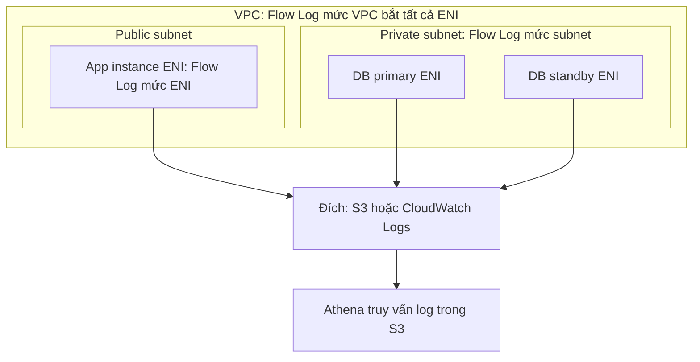

# VPC Flow Logs

> **TL;DR:** VPC Flow Logs ghi lại **metadata** của các luồng traffic đi qua network interface trong VPC: IP nguồn/đích, port, protocol, số packet/byte, ACCEPT hay REJECT. Nó **không ghi nội dung packet** và **không real-time**. Log được đẩy tới S3 hoặc CloudWatch Logs để phân tích, xử lý sự cố hoặc kiểm tra bảo mật.

## 🖼️ Sơ đồ
![[VPC Flow Logs.excalidraw]]
*Mở bằng plugin Excalidraw để chỉnh sửa · ảnh tĩnh: [[VPC Flow Logs.svg]]*

![[VPC Flow Logs - record.excalidraw]]
*Mở bằng plugin Excalidraw để chỉnh sửa · ảnh tĩnh: [[VPC Flow Logs - record.svg]]*

## Khái niệm cốt lõi
- **Chỉ có metadata, không có payload.** Flow Logs cho biết những gì "nhìn được từ bên ngoài" một luồng: source/destination IP, source/destination port, protocol, kích thước, thời điểm, kết quả cho phép/chặn.
  - Muốn xem **nội dung packet** thì cần **packet sniffer** (ví dụ cài trên EC2), Flow Logs không làm được. (Ngoài khóa học: AWS có VPC Traffic Mirroring cho mục đích này.)
- **Không real-time.** Traffic xảy ra rồi một lúc sau mới hiện trong Flow Logs. Adrian nhấn mạnh đây là câu hay ra thi: **không dùng Flow Logs làm telemetry thời gian thực**. (Hiện nay khoảng thời gian gom log, gọi là aggregation interval, là 1 phút hoặc 10 phút, cộng thêm độ trễ khi đẩy tới đích.)
- **Ba mức gắn monitor**, mỗi mức bắt mọi thứ **từ điểm đó trở xuống**:
  - **VPC**: mọi ENI trong mọi subnet của VPC.
  - **Subnet**: mọi ENI trong subnet đó.
  - **ENI** (Elastic Network Interface): chỉ đúng interface đó. Xem [[EC2 Network Interfaces IPs and DNS]].
- **Bộ lọc traffic**: chỉ ACCEPT, chỉ REJECT, hoặc ALL.
- **Destination**:
  - **S3**: truy cập file log trực tiếp, đưa vào công cụ giám sát bên thứ ba hoặc tự xây pipeline. Có thể truy vấn bằng [[Athena]] với cú pháp kiểu SQL. Athena là ad-hoc query engine kiểu **schema-on-read**, chỉ trả tiền cho lượng dữ liệu đọc (cộng phí lưu trữ S3). Hợp với đội data muốn review log bài bản.
  - **[[CloudWatch Logs]]**: tích hợp với dịch vụ khác, stream dữ liệu đi nơi khác, xem bằng console hoặc truy cập qua API.
  - (Khóa học chỉ nêu S3 và CloudWatch Logs; hiện nay còn gửi thẳng được tới [[Kinesis Data Firehose|Amazon Data Firehose]].)

## Cách hoạt động / Kiến trúc

Ví dụ của khóa học là ứng dụng Catagram: app server trong public subnet được Bob truy cập, database primary và standby nằm trong private subnet.



- Flow Log đặt ở ENI của app instance thì chỉ bắt metadata của instance đó.
- Flow Log đặt ở private subnet thì bắt cả hai DB instance.

### Cấu trúc một Flow Log record
Mỗi dòng (record) có các trường theo thứ tự sau (format mặc định version 2):

`version  account-id  interface-id  srcaddr  dstaddr  srcport  dstport  protocol  packets  bytes  start  end  action  log-status`

Các trường dùng nhiều nhất: **srcaddr, dstaddr, srcport, dstport, protocol, action**.

Ví dụ trên slide: Bob (`119.18.34.78`) ping một instance (`10.16.48.20`):
```
2 ACC-ID eni-ID 119.18.34.78 10.16.48.20 0 0 1 4 336 1432917027 1432917142 ACCEPT OK
2 ACC-ID eni-ID 10.16.48.20 119.18.34.78 0 0 1 4 336 1432917094 1432917142 REJECT OK
```
- Port là `0 0` vì **ICMP không có port**.
- Trường `protocol` là số protocol IP: **ICMP = 1, TCP = 6, UDP = 17**. Đề thi ít hỏi trực tiếp nhưng có thể dùng để loại đáp án, nên nhớ ba số này. Xem [[Layer 3 Network]] và [[Layer 4 Transport]].
- `start`/`end` là Unix timestamp.
- `action` là ACCEPT hoặc REJECT, cho biết traffic có bị [[Security Groups|Security Group]] hoặc [[NACL]] chặn hay không.

### Đọc ACCEPT rồi REJECT: SG và NACL
- **Security Group là stateful**: request được cho phép thì response tự động được cho phép. Vì vậy thường chỉ thấy **một dòng** cho cả cuộc hội thoại.
- **NACL là stateless**: request và response được đánh giá **riêng**. Có thể thấy **hai dòng**.
- Tình huống ví dụ ở trên: SG của instance cho phép ping từ IP ngoài, response được SG cho đi. Nhưng NACL của subnet cho ping **inbound** mà không cho **outbound**, nên dòng thứ hai là REJECT cho chiều trả lời.
- Nếu đề cho **một ACCEPT và một REJECT cùng một luồng** thì nghĩ ngay tới chuyện **NACL đang chặn chiều về**. Xem [[Compare - Security Groups vs NACL]] và [[Stateful vs Stateless Firewalls]].

### Traffic KHÔNG được ghi
- Truy cập **Instance Metadata Service** `169.254.169.254` (xem [[EC2 Instance Metadata]]).
- **Time Sync Service** `169.254.169.123`.
- **DHCP** trong VPC.
- Traffic tới **Amazon DNS server** (Route 53 Resolver của VPC).
- Traffic **kích hoạt license Amazon Windows** (chỉ liên quan Windows instance).

## 🎯 Mẹo thi SAA-C03
- "Cần xem **nội dung packet** / deep packet inspection" → **không phải** Flow Logs. Flow Logs chỉ có metadata.
- "Giám sát traffic **real-time**" → Flow Logs không đáp ứng vì có độ trễ.
- "Vì sao không thấy truy cập metadata / DNS / DHCP trong Flow Logs?" → các loại đó **bị loại trừ** khỏi Flow Logs.
- Thấy ACCEPT inbound rồi REJECT outbound trong cùng một luồng → có **NACL** (stateless) chặn chiều trả lời. Một dòng ACCEPT duy nhất là dấu hiệu chỉ có SG (stateful).
- Phân tích Flow Logs bằng SQL, trả tiền theo dữ liệu đọc → **S3 + Athena**. Cần tích hợp, stream, alarm, metric filter → **CloudWatch Logs**.
- Phạm vi: VPC > subnet > ENI. Gắn ở mức cao thì bao luôn mọi ENI bên dưới.
- Số protocol: ICMP 1, TCP 6, UDP 17.

## Liên kết
- Tiên quyết: [[VPC Subnets]], [[Security Groups]], [[NACL]], [[EC2 Network Interfaces IPs and DNS]]
- Liên quan: [[CloudWatch Logs]], [[S3 Basics]], [[Athena]], [[GuardDuty]] (dùng Flow Logs làm nguồn dữ liệu), [[CloudTrail]] (ghi API call, không ghi traffic)
- Phân biệt với: [[Compare - Security Groups vs NACL]], [[Stateful vs Stateless Firewalls]]
- Section: [[_MOC 16 Advanced VPC Networking]]
