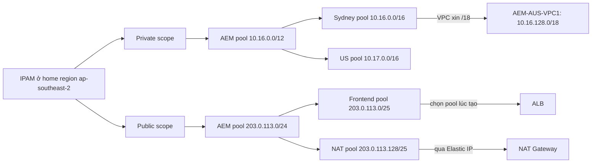

# VPC IPAM

> **TL;DR:** **VPC IP Address Manager (IPAM)** giúp quản lý địa chỉ IP **ở quy mô lớn** (nhiều VPC, nhiều account, nhiều region) và **tránh trùng CIDR**. Bạn tạo IPAM ở một **home region**; nó có sẵn hai **scope** (**private** và **public**). Trong scope tạo **pool** theo **cấp bậc** (toàn công ty → từng vùng → prod), mỗi pool đặt **min / max / default netmask**. Khi tạo VPC chỉ cần **chọn pool và kích thước** (ví dụ /18), IPAM tự cấp dải còn trống và **thu hồi** khi VPC bị xóa. Quản cả IP public cho ELB, NAT Gateway, Elastic IP, cả subnet và IPv6 (kể cả **private IPv6**, chỉ có qua IPAM). **Free tier** chỉ 1 account, 1 region, **không có private IPv4**; **advanced tier** (trả phí) mới có private IPv4, audit, cross-region và cross-account (chia sẻ pool bằng AWS Organizations + **RAM** (AWS Resource Access Manager)).

## 🖼️ Sơ đồ
![[VPC IPAM.excalidraw]]
*Mở bằng plugin Excalidraw để chỉnh sửa · ảnh tĩnh: [[VPC IPAM.svg]]*

## Khái niệm cốt lõi
- **Vấn đề**: một VPC, một region, một account thì quản lý IP đơn giản. Có rất nhiều VPC thì việc giữ một không gian mạng có cấu trúc, **không chồng lấn** (điều kiện để [[VPC Peering]] và kết nối hybrid chạy được) trở nên khó rất nhanh. Xem cách lên kế hoạch dải IP thủ công ở [[VPC Sizing and Structure]].
- **IPAM** quản lý **pool** địa chỉ IP rồi **cấp (allocate)** cho nơi cần dùng.
- **Scope**: nhóm pool theo loại địa chỉ. Tạo IPAM là có sẵn **hai scope**: **public scope** và **private scope**.
- **Pool có cấp bậc (hierarchy)**: ví dụ một pool IPv4 private cho **toàn bộ Aus-E-Mart**, chia tiếp cho VPC ở **Úc**, **châu Âu**, **Mỹ**, rồi có thể chia nữa thành **sub-pool cho production**. Coi cả không gian mạng như "một cái bánh", cắt ra từng miếng theo nhu cầu.
- Mỗi pool định nghĩa **minimum, maximum và default netmask**: miếng bánh này được chia nhỏ tiếp tối thiểu, tối đa và mặc định cỡ nào.
- **Không chỉ VPC**: IPAM còn quản **IP public** dùng cho **Elastic Load Balancer**, **NAT Gateway**, **Elastic IP**, và có thể quản tới mức **subnet** (bình thường chỉ ở mức VPC).
- **Home region**: tạo IPAM ở **một region**, gọi là home region; **mỗi account một IPAM**.
- **Hai mức dịch vụ**:

| | **Free tier** | **Advanced tier** (trả phí) |
|---|---|---|
| Account | **1 account** | **Cross-account** |
| Region | **1 region** (chỉ home region) | **Cross-region** |
| Private IPv4 | **Không** | **Có** |
| Audit | | **Có** |

- Giảng viên nhận xét: free tier không có private IPv4 nên gần như không dùng được cho đúng loại môi trường cần IPAM nhất (nhiều account, nhiều region).

## Cách hoạt động / Kiến trúc

Ví dụ Aus-E-Mart, home region `ap-southeast-2`:

1. Tạo IPAM ở `ap-southeast-2`; IPAM tự tạo **public scope** và **private scope**.
2. Trong private scope tạo pool **10.16.0.0/12** cho toàn Aus-E-Mart, chia tiếp thành **Sydney pool 10.16.0.0/16** và **US pool 10.17.0.0/16**, mỗi pool đặt min/max/default netmask.
3. Tạo VPC mới ở Sydney (`AEM-AUS-VPC1`): thay vì tự gõ CIDR, **chọn Sydney pool** (hoặc dùng pool khi thêm CIDR phụ) và chỉ nói **kích thước**, ví dụ **/18**. IPAM cấp một /18 **còn trống** trong pool (ví dụ `10.16.128.0/18`). Không phải ghi chép, không phải dò cả mạng xem dải nào còn trống. Sau đó subnet trong VPC dùng dải này và resource nhận private IP như bình thường.
4. Trong public scope tạo pool IPv4 public **203.0.113.0/24**, chia thành **pool front-end** và **pool cho NAT Gateway**. Với resource dùng IP public, **chọn pool lúc tạo** và IPAM tự gán:
   - Một số resource như **ALB** nhận IP từ pool ngay khi tạo.
   - **NAT Gateway** dùng **Elastic IP**, nên **Elastic IP** được tạo từ pool IPAM.
5. **Cross-region**: muốn quản thêm `us-east-1` thì **sửa IPAM ở home region**, chọn thêm các region hoạt động; sau đó dùng y như trên.
6. **Thu hồi**: IPAM không chỉ cấp mà còn **nhận lại** dải khi được release. Ví dụ đang quản 5 VPC ở Sydney, tạo VPC thứ 6 thì được cấp dải còn trống; **xóa một VPC thì dải của nó quay về pool** để cấp cho nơi khác.

### Lưu ý thêm
- **Cross-account**: dùng **[[AWS Organizations]]** để quản các account và **[[AWS Resource Access Manager]]** để **chia sẻ pool** IPAM sang account khác.
- **IP public đưa vào IPAM** theo hai cách:
  - **BYOIP**: mang dải IP mình mua từ ISP hay nhà cung cấp mạng khác; phải qua bước **xác minh** để chứng minh với Amazon là bạn sở hữu dải đó.
  - **Amazon-provided**: nay **mua được IP public trực tiếp từ Amazon**.
- **IPv6**: IPAM hỗ trợ IPv6, dùng y như IPv4. Bình thường mọi IPv6 trong AWS đều public, nhưng IPAM cho dùng được dải **IPv6 private-only** (AWS không cho ra Internet). Đây là **cách duy nhất** có private IPv6 (xem [[Custom VPC]]).

## Bảng so sánh / số liệu

| Thành phần | Ý nghĩa |
|---|---|
| **IPAM** | Một mỗi account, tạo ở **home region** |
| **Scope** | **Private** và **public**, có sẵn khi tạo IPAM |
| **Pool** | Dải IP, lồng nhau theo cấp bậc; có **min / max / default netmask** |
| **Allocation** | VPC/subnet/ELB/NAT Gateway/Elastic IP lấy dải từ pool lúc tạo; IPAM chọn dải còn trống |
| **Release** | Xóa tài nguyên → dải **về lại pool** |
| **Cross-account** | AWS Organizations + RAM chia sẻ pool (advanced tier) |
| **Cross-region** | Sửa IPAM ở home region, thêm region hoạt động (advanced tier) |
| **Public IP** | BYOIP (phải xác minh) hoặc Amazon-provided |
| **IPv6** | Có; **private IPv6 chỉ có qua IPAM** |

## 🎯 Mẹo thi SAA-C03
- "Nhiều VPC, nhiều account, nhiều region; cần **quản lý tập trung dải IP**, **tránh CIDR chồng lấn**, tự cấp CIDR khi tạo VPC" → **VPC IPAM**.
- IPAM dùng cho **cross-account** → kết hợp **AWS Organizations + RAM** để chia sẻ pool; cần **advanced tier**.
- **Free tier**: 1 account, 1 region, **không private IPv4**. Đề cần private IPv4 hoặc nhiều region/account → advanced tier.
- Muốn dải **IPv6 private** (không ra Internet) → chỉ có qua **IPAM**.
- Tài nguyên dùng IP public (ALB, NAT Gateway qua Elastic IP) có thể lấy IP từ **public pool** của IPAM; IP public đưa vào bằng **BYOIP** hoặc **Amazon-provided**.
- IPAM theo dõi cả **cấp** lẫn **thu hồi**: xóa VPC thì dải quay về pool.

## Liên kết
- Tiên quyết: [[Custom VPC]], [[VPC Sizing and Structure]], [[VPC Subnets]]
- Liên quan: [[AWS Organizations]], [[AWS Resource Access Manager]], [[VPC Peering]] (cần CIDR không trùng), [[NAT Gateway]], [[Elastic Load Balancer]]
- Section: [[_MOC 16 Advanced VPC Networking]]
