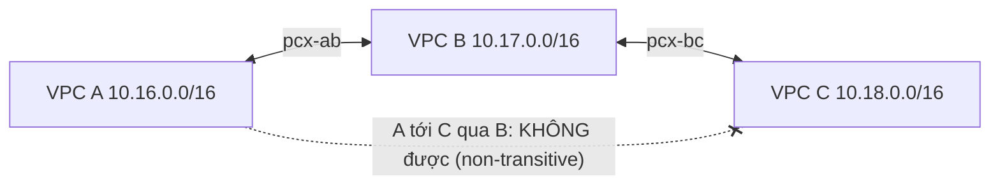

# VPC Peering

> **TL;DR:** VPC Peering tạo một kết nối mạng **riêng tư**, chỉ đi trên **mạng backbone của AWS**, giữa **đúng hai VPC**, cùng hoặc khác region, cùng hoặc khác account; **peering cross-region được AWS mã hóa thêm**. Peering **không bắc cầu (non-transitive)**: A-B và B-C không có nghĩa là A nói chuyện được với C. CIDR hai bên **không được trùng**. Ngoài việc tạo peering còn phải cấu hình **route table cả hai phía** và **SG/NACL**.

## 🖼️ Sơ đồ
![[VPC Peering.excalidraw]]
*Mở bằng plugin Excalidraw để chỉnh sửa · ảnh tĩnh: [[VPC Peering.svg]]*

## Khái niệm cốt lõi
- **Một peering connection = hai VPC, không hơn.** Giảng viên nhấn mạnh đây là ý quan trọng nhất cho đề thi (cùng với non-transitive).
- **Phạm vi**: cùng region hoặc **cross-region**; cùng account hoặc **cross-account**. Cross-region có vài giới hạn nhưng vẫn làm được.
- **Không bắc cầu (non-transitive)**: không route xuyên qua một VPC trung gian. Muốn A, B, C nói chuyện đầy đủ thì cần **3 peering** (A-B, B-C, A-C). Tổng quát, full mesh n VPC cần **n(n-1)/2** peering. Khi số VPC lớn thì dùng [[Transit Gateway]].
- **CIDR không được chồng lấn**. Đây là lý do ngay từ đầu khóa đã khuyên **không bao giờ dùng trùng dải IP** giữa các VPC (xem [[VPC Sizing and Structure]], [[VPC IPAM]]).
- **Gateway object logic**: tạo peering thực chất tạo một gateway object logic (`pcx-...`) ở **cả hai** VPC.
- **Routing**: mỗi phía cần route trong route table với **destination = CIDR của VPC bên kia**, **target = peering connection** (`pcx-...`). Phải làm ở **mọi subnet cần dùng, ở cả hai phía**.
- **Security**: tạo peering và route xong vẫn phải mở **[[Security Groups]]** (và [[NACL]] nếu có) cho traffic giữa hai VPC.
- **Tham chiếu Security Group chéo**:
  - **Cùng region**: SG bên này có thể tham chiếu **SG ID** của VPC bên kia. Đây là cách tham chiếu logic hiệu quả như trong cùng VPC; instance mới thêm vào SG nguồn tự động được phép.
  - **Khác region**: không tham chiếu SG được, phải dùng **IP hoặc CIDR**.
- **DNS resolution qua peering**: có tùy chọn để **public DNS hostname** của instance bên VPC peer **resolve ra private IP**. Nhờ vậy dùng chung một tên DNS dù truy cập trong hay ngoài peer.
- **Đường truyền và mã hóa**: peering **luôn dùng mạng toàn cầu (backbone) của AWS**, không cần và không đi qua Internet công cộng, kể cả cross-region. Bài mới nói **riêng peering cross-region thì AWS mã hóa traffic** như lớp bảo vệ thêm. *(Bản khóa cũ nói chung "dữ liệu qua peering được mã hóa".)*
- **Mô hình invite/accept**: VPC **requester** gửi yêu cầu, VPC **accepter** chấp nhận (khi tạo chọn đích: my account, another account, cùng region hoặc another region). Cùng account thì tự accept được; khác account thì chủ bên kia phải accept. Trạng thái chờ là `pending-acceptance`.
- (Ngoài khóa học: peering không có edge-to-edge routing. VPC A **không** dùng được IGW, NAT Gateway, VPN, Direct Connect hay [[Gateway VPC Endpoints|gateway endpoint]] của VPC B thông qua peering.)

## Cách hoạt động / Kiến trúc

| Route table | Destination | Target |
|---|---|---|
| VPC A | `10.17.0.0/16` | `pcx-ab` |
| VPC B | `10.16.0.0/16` | `pcx-ab` |
| VPC B | `10.18.0.0/16` | `pcx-bc` |
| VPC C | `10.17.0.0/16` | `pcx-bc` |

Muốn A ↔ C thì tạo thêm `pcx-ac` và thêm route `10.18.0.0/16 → pcx-ac` ở A, `10.16.0.0/16 → pcx-ac` ở C.

### Checklist ba bước để peering chạy được
1. **Tạo peering connection** (request rồi accept).
2. **Thêm route** ở cả hai phía: CIDR bên kia → `pcx-...`.
3. **Mở SG/NACL** cho traffic từ bên kia (SG ID nếu cùng region, CIDR nếu khác region).

## Demo / Lab
One-click stack ở us-east-1 tạo 3 VPC private A (`10.16.0.0/16`), B (`10.17.0.0/16`), C (`10.18.0.0/16`), mỗi VPC một EC2 chỉ có private IPv4. Vào instance bằng **EC2 Instance Connect** qua **EC2 Instance Connect Endpoint** (mất khoảng 5 phút để tạo). **B và C đã được peer sẵn**; việc của bạn là nối A với B.
- **Ban đầu**: từ instance A ping private IP của instance B (`10.17.x.x`) không có phản hồi (mặc định các VPC cô lập). Từ B ping C thì chạy, nhờ peering B-C có sẵn.
- **Tạo peering** `AEM VPC A to VPC B`: requester VPC A, chọn **My account / This region** (có thể chọn another account, another region), accepter VPC B → trạng thái `pending-acceptance` → Actions → **Accept request**. Ping vẫn lỗi: link mạng đã có nhưng VPC A chưa biết đường tới B.
- **Route ở A**: trước khi sửa, xem **subnet associations** để chắc đang sửa đúng route table (bảng riêng của subnet private A; main route table không subnet nào dùng). Thêm `10.17.0.0/16` → peering connection.
- **Security**: SG của A chỉ có inbound SSH, outbound mặc định cho tất cả nên không chặn. SG của B chỉ có SSH → thêm inbound **All ICMP - IPv4** với nguồn là **SG ID của A** (được vì cùng region). Kiểm tra **NACL** của A và B: đều mặc định allow.
- Ping **vẫn lỗi**: mới có route **một chiều** (A biết đường tới B, B chưa biết đường về A). Đây là lỗi rất hay gặp ngoài thực tế. Thêm route `10.16.0.0/16` → peering ở route table của B thì ping chạy.
- Từ A ping C: **không được** dù A-B và B-C đều chạy. Chứng minh **non-transitive**. Muốn A tới C phải tạo peering A-C, thêm route hai phía và mở SG (bài để làm tùy chọn).
- **Dọn dẹp**: xóa route hai phía, xóa rule ICMP trong SG của B, xóa peering A-B tạo tay, rồi xóa stack.

*(Bản khóa cũ nêu, bài mới không làm)*: demo cũ tự tạo cả 3 peering (A-B, B-C, A-C), kết nối bằng Session Manager; thử thêm SG ID của A vào SG của C thì **báo lỗi** vì không tham chiếu được SG của VPC **không có peering trực tiếp** (dùng CIDR `10.16.0.0/16` thì được); khi xóa peering, các route trỏ tới nó chuyển thành **blackhole**, phải xóa tay.

## 🎯 Mẹo thi SAA-C03
- "Peering có **transitive** không?" → **Không**. A-B + B-C không cho A-C. Đề hay đưa đáp án "route qua VPC B" là bẫy.
- Một peering chỉ nối **hai** VPC. Nhiều VPC cần full mesh → nhiều peering; số lượng lớn hoặc cần transitive/hub-and-spoke → **[[Transit Gateway]]**.
- **CIDR trùng nhau** → **không tạo peering được**. Đáp án phải đổi CIDR hoặc dùng giải pháp khác.
- Peering đã tạo mà vẫn không thông → kiểm tra **route table cả hai phía** (thiếu route chiều về là lỗi kinh điển) và **SG/NACL**.
- **Tham chiếu SG ID của VPC peer** chỉ được khi **cùng region** (và phải có peering trực tiếp). Khác region dùng CIDR.
- Peering luôn đi trên **AWS global network**, không qua Internet; **cross-region** thì traffic còn được **mã hóa**.
- Cross-account được, theo mô hình request/accept.

## Liên kết
- Tiên quyết: [[VPC Sizing and Structure]], [[VPC Routing and Internet Gateway]], [[Security Groups]], [[NACL]]
- Liên quan: [[Custom VPC]], [[Compare - Security Groups vs NACL]], [[R53 Private Hosted Zones]], [[AWS Organizations]], [[Interface VPC Endpoints]]
- Phân biệt với: [[Transit Gateway]] (transitive, hub-and-spoke), [[Site-to-Site VPN]], [[Direct Connect]]
- Section: [[_MOC 16 Advanced VPC Networking]]
