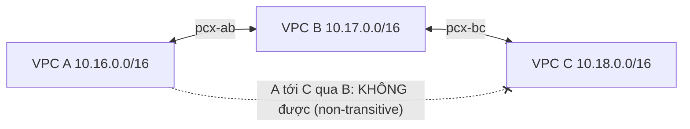

# VPC Peering

> **TL;DR:** VPC Peering tạo một kết nối mạng **riêng tư, mã hóa** giữa **đúng hai VPC**, cùng hoặc khác region, cùng hoặc khác account. Peering **không bắc cầu (non-transitive)**: A-B và B-C không có nghĩa là A nói chuyện được với C. CIDR hai bên **không được trùng**. Ngoài việc tạo peering còn phải cấu hình **route table cả hai phía** và **SG/NACL**.

## 🖼️ Sơ đồ
![[VPC Peering.excalidraw]]
*Mở bằng plugin Excalidraw để chỉnh sửa · ảnh tĩnh: [[VPC Peering.svg]]*

## Khái niệm cốt lõi
- **Một peering connection = hai VPC, không hơn.** Adrian nhấn mạnh đây là ý quan trọng nhất cho đề thi.
- **Phạm vi**: cùng region hoặc **cross-region**; cùng account hoặc **cross-account**. Cross-region có vài giới hạn nhưng vẫn làm được.
- **Không bắc cầu (non-transitive)**: không route xuyên qua một VPC trung gian. Muốn A, B, C nói chuyện đầy đủ thì cần **3 peering** (A-B, B-C, A-C). Tổng quát, full mesh n VPC cần **n(n-1)/2** peering. Khi số VPC lớn thì dùng [[Transit Gateway]].
- **CIDR không được chồng lấn**. Đây là lý do Adrian khuyên ngay từ đầu khóa **không bao giờ dùng trùng dải IP** giữa các VPC (xem [[VPC Sizing and Structure]]).
- **Gateway object logic**: tạo peering thực chất tạo một gateway object logic (`pcx-...`) ở **cả hai** VPC.
- **Routing**: mỗi phía cần route trong route table với **destination = CIDR của VPC bên kia**, **target = peering connection** (`pcx-...`). Phải làm ở **mọi subnet cần dùng, ở cả hai phía**.
- **Security**: tạo peering và route xong vẫn phải mở **[[Security Groups]]** (và [[NACL]] nếu có) cho traffic giữa hai VPC.
- **Tham chiếu Security Group chéo**:
  - **Cùng region**: SG bên này có thể tham chiếu **SG ID** của VPC bên kia. Đây là cách tham chiếu logic hiệu quả như trong cùng VPC; instance mới thêm vào SG nguồn tự động được phép.
  - **Khác region**: không tham chiếu SG được, phải dùng **IP hoặc CIDR**.
- **DNS resolution qua peering**: có tùy chọn để **public DNS hostname** của instance bên VPC peer **resolve ra private IP**. Nhờ vậy dùng chung một tên DNS dù truy cập trong hay ngoài peer.
- **Mã hóa và đường truyền**: dữ liệu qua peering được **mã hóa**. Peering cross-region chạy trên **mạng toàn cầu của AWS**, không qua Internet công cộng, nên vừa an toàn vừa có hiệu năng tốt.
- **Mô hình invite/accept**: VPC **requester** gửi yêu cầu, VPC **accepter** chấp nhận. Cùng account thì tự accept được; khác account thì chủ bên kia phải accept. Trạng thái chờ là `pending-acceptance`.
- (Ngoài khóa học: peering không có edge-to-edge routing. VPC A **không** dùng được IGW, NAT Gateway, VPN, Direct Connect hay [[Gateway VPC Endpoints|gateway endpoint]] của VPC B thông qua peering.)

## Cách hoạt động / Kiến trúc

| Route table | Destination | Target |
|---|---|---|
| VPC A | `10.17.0.0/16` | `pcx-ab` |
| VPC B | `10.16.0.0/16` | `pcx-ab` |
| VPC B | `10.18.0.0/16` | `pcx-bc` |
| VPC C | `10.17.0.0/16` | `pcx-bc` |

Muốn A ↔ C thì tạo thêm `pcx-ac` và thêm route `10.18.0.0/16 → pcx-ac` ở A, `10.16.0.0/16 → pcx-ac` ở C.

### Checklist ba bước để peering chạy được
1. **Tạo peering connection** (request rồi accept).
2. **Thêm route** ở cả hai phía: CIDR bên kia → `pcx-...`.
3. **Mở SG/NACL** cho traffic từ bên kia (SG ID nếu cùng region, CIDR nếu khác region).

## Demo / Lab
CloudFormation tạo 3 VPC private A (`10.16.0.0/16`), B (`10.17.0.0/16`), C (`10.18.0.0/16`), mỗi VPC một EC2. Kết nối instance A bằng Session Manager.
- **Ban đầu**: ping private IP của instance B không có phản hồi, vì mặc định các VPC cô lập hoàn toàn.
- **Peering A-B**: tạo `VPCA-VPCB` (requester A, accepter B, cùng account, cùng region), trạng thái `pending-acceptance`, rồi Actions → Accept. Vẫn chưa ping được vì **chưa có route**.
- **Route**: route table A thêm `10.17.0.0/16 → pcx`, route table B thêm `10.16.0.0/16 → pcx`. **Vẫn chưa ping được** vì SG chặn.
- **SG**: SG của A cho mọi outbound, và stateful nên response tự được phép. SG của B chỉ cho traffic từ chính nó và SSH, không cho ICMP. Thêm inbound **All ICMP - IPv4** với nguồn là **SG ID của A** (được vì cùng region). Ping chạy ngay.
- **Peering B-C**: tạo, accept, thêm route hai phía, SG của C cho ICMP từ SG ID của B.
- Thử thêm SG ID của A vào SG của C thì **báo lỗi**: không tham chiếu được SG của VPC **không có peering trực tiếp**. Thay bằng CIDR `10.16.0.0/16` thì lưu được, vì tham chiếu CIDR không bị giới hạn.
- Ping từ A tới C: **không được**, dù A-B và B-C đều chạy. Chứng minh **non-transitive**.
- **Peering A-C**: tạo, accept, thêm route hai phía. Ping A → C tự chạy (SG của C đã cho CIDR của A từ trước).
- **Dọn dẹp**: xóa 3 peering. Các route trỏ tới peering đã xóa chuyển thành trạng thái **blackhole**, phải xóa tay. Xóa rule ICMP trong SG, xóa stack.

## 🎯 Mẹo thi SAA-C03
- "Peering có **transitive** không?" → **Không**. A-B + B-C không cho A-C. Đề hay đưa đáp án "route qua VPC B" là bẫy.
- Một peering chỉ nối **hai** VPC. Nhiều VPC cần full mesh → nhiều peering; số lượng lớn hoặc cần transitive/hub-and-spoke → **[[Transit Gateway]]**.
- **CIDR trùng nhau** → **không tạo peering được**. Đáp án phải đổi CIDR hoặc dùng giải pháp khác.
- Peering đã tạo mà vẫn không thông → kiểm tra **route table cả hai phía** và **SG/NACL**.
- **Tham chiếu SG ID của VPC peer** chỉ được khi **cùng region** (và phải có peering trực tiếp). Khác region dùng CIDR.
- Cross-region peering: traffic **mã hóa**, đi trên **AWS global network**, không qua Internet.
- Cross-account được, theo mô hình request/accept.

## Liên kết
- Tiên quyết: [[VPC Sizing and Structure]], [[VPC Routing and Internet Gateway]], [[Security Groups]], [[NACL]]
- Liên quan: [[Custom VPC]], [[Compare - Security Groups vs NACL]], [[R53 Private Hosted Zones]], [[AWS Organizations]], [[Interface VPC Endpoints]]
- Phân biệt với: [[Transit Gateway]] (transitive, hub-and-spoke), [[Site-to-Site VPN]], [[Direct Connect]]
- Section: [[_MOC 16 Advanced VPC Networking]]
