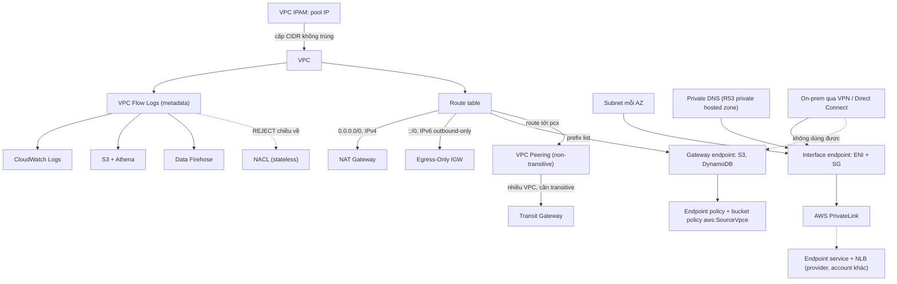

# 16 Advanced VPC Networking

Section nâng cao sau [[_MOC 06 VPC Basics|VPC Basics]]: quan sát traffic bằng VPC Flow Logs, cho IPv6 ra Internet một chiều bằng Egress-Only IGW, đưa dịch vụ của account khác vào VPC bằng AWS PrivateLink, truy cập dịch vụ AWS public một cách riêng tư bằng Gateway và Interface VPC Endpoints, nối hai VPC với nhau bằng VPC Peering, và quản lý dải IP tập trung bằng VPC IPAM. Demo dùng web store Aus-E-Mart. Đây là bước đệm trước phần kết nối on-prem và nhiều VPC ở [[_MOC 17 Hybrid and Migration|Hybrid and Migration]] (VPN, Direct Connect, Transit Gateway).

← [[00 Home]] · Trước: [[_MOC 15 Global Content Delivery]] · Sau: [[_MOC 17 Hybrid and Migration]]

## Lộ trình học
1. [[VPC Flow Logs]] — ghi metadata luồng traffic (IP, port, protocol, ACCEPT/REJECT) ở mức VPC/subnet/ENI, không ghi nội dung, không real-time (gom 1 hoặc 10 phút); đẩy tới S3, CloudWatch Logs hoặc Data Firehose; custom format thêm trường.
2. [[Egress-Only Internet Gateway]] — internet gateway chỉ cho IPv6 và chỉ outbound, inbound bị drop ngay tại gateway; thay NAT Gateway trong thế giới IPv6, route `::/0`.
3. [[AWS PrivateLink]] — provider đặt dịch vụ sau NLB + endpoint service, consumer tạo interface endpoint; mỗi AZ một endpoint, TCP/UDP, IPv4/IPv6, private DNS, dùng qua DX/VPN/peering/TGW.
4. [[Gateway VPC Endpoints]] — truy cập S3/DynamoDB riêng tư bằng prefix list trong route table; miễn phí, HA sẵn, cùng region, chỉ dùng từ trong VPC.
5. [[Interface VPC Endpoints]] — ENI có private IP trong subnet (PrivateLink), dẫn traffic bằng DNS; theo AZ, có Security Group, TCP/UDP, IPv4/IPv6, dùng được từ on-prem.
6. [[VPC Peering]] — kết nối riêng tư trên backbone AWS giữa đúng hai VPC (khác region/account được, cross-region thì mã hóa); non-transitive, CIDR không được trùng.
7. [[VPC IPAM]] — pool IP theo cấp bậc (private/public scope), VPC chọn pool là được cấp CIDR không trùng; cross-account qua Organizations + RAM (AWS Resource Access Manager).
8. [[Compare - Gateway vs Interface Endpoints]] — routing/prefix list vs DNS/ENI; HA sẵn vs mỗi AZ một endpoint; khi nào chọn cái nào.

## Bản đồ khái niệm

## Liên kết sang section khác
- Nền tảng VPC: [[VPC Routing and Internet Gateway]], [[NAT Gateway]], [[Security Groups]], [[NACL]]
- DNS cho endpoint: [[R53 Private Hosted Zones]]
- Dịch vụ public vs private: [[AWS Public vs Private Services]]
- Phân tích log: [[CloudWatch Logs]], [[Athena]]
- Bước tiếp theo khi nối nhiều mạng: [[Transit Gateway]], [[Direct Connect]]

## 🎯 Top mẹo thi của section
- Cần **nội dung packet** hoặc giám sát **real-time** → không phải Flow Logs (chỉ metadata, gom 1 hoặc 10 phút, có độ trễ). Đích: S3, CloudWatch Logs, Data Firehose. ([[VPC Flow Logs]])
- ACCEPT inbound rồi REJECT outbound trong cùng luồng → **NACL** chặn chiều trả lời. Truy vấn SQL rẻ → **S3 + Athena**; cần alarm/metric filter → **CloudWatch Logs**. ([[VPC Flow Logs]])
- IPv6 instance ra Internet nhưng **không cho Internet vào** → **Egress-Only IGW**, không phải NAT Gateway hay IGW thường; inbound bị drop tại EIGW, SG không mở được. ([[Egress-Only Internet Gateway]])
- Cung cấp dịch vụ cho VPC/account khác riêng tư, không qua Internet → **PrivateLink**: provider **NLB + endpoint service**, consumer **interface endpoint** mỗi AZ. ([[AWS PrivateLink]])
- Instance private cần **S3/DynamoDB**, không qua Internet, rẻ nhất → **Gateway endpoint** (miễn phí). ([[Gateway VPC Endpoints]])
- Gateway endpoint **HA sẵn, không thuộc AZ** → "tạo mỗi AZ một gateway endpoint" là sai. Không có Security Group. ([[Gateway VPC Endpoints]])
- On-prem (VPN/DX) hoặc VPC peer cần truy cập S3 riêng tư → **interface endpoint cho S3**; gateway endpoint chỉ dùng được từ trong VPC, cùng region. ([[Gateway VPC Endpoints]], [[Interface VPC Endpoints]])
- Interface endpoint **không HA mặc định** → mỗi AZ một endpoint. Ứng dụng không sửa được → bật **Private DNS**. Hỗ trợ **TCP và UDP**, IPv4/IPv6/dual-stack. ([[Interface VPC Endpoints]])
- Nhắc **route table/prefix list** → gateway; nhắc **DNS/ENI/private IP/Security Group/PrivateLink** → interface. ([[Compare - Gateway vs Interface Endpoints]])
- Giới hạn VPC chỉ truy cập vài bucket → **endpoint policy**; bucket chỉ nhận traffic từ VPC → bucket policy với **`aws:SourceVpce`**. ([[Compare - Gateway vs Interface Endpoints]])
- VPC Peering **không transitive**: A-B + B-C không cho A-C; nhiều VPC cần hub-and-spoke → **Transit Gateway**. ([[VPC Peering]])
- **CIDR trùng** → không peering được; peering tạo xong vẫn không thông → kiểm tra **route table cả hai phía** và SG/NACL. ([[VPC Peering]])
- Tham chiếu **SG ID của VPC peer** chỉ được khi **cùng region**; peering luôn đi trên AWS backbone, **cross-region** thì được mã hóa. ([[VPC Peering]])
- Quản lý tập trung dải IP nhiều VPC/account/region, tránh CIDR trùng → **VPC IPAM** (advanced tier cho private IPv4, cross-account, cross-region; private IPv6 chỉ có qua IPAM). ([[VPC IPAM]])
