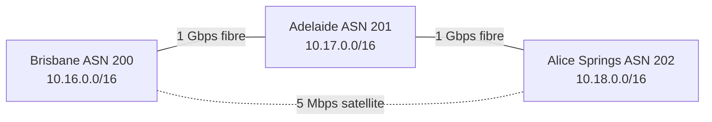

# BGP

> **TL;DR:** BGP (Border Gateway Protocol) là routing protocol để các mạng độc lập (Autonomous System) trao đổi thông tin "đi tới mạng X thì qua đường nào". Đề SAA-C03 không hỏi sâu BGP. Bạn chỉ cần hiểu ở mức kiến trúc, vì [[Direct Connect]] và **dynamic** [[Site-to-Site VPN]] đều dùng BGP để học và quảng bá route.

## 🖼️ Sơ đồ
![[BGP.excalidraw]]
*Mở bằng plugin Excalidraw để chỉnh sửa · ảnh tĩnh: [[BGP.svg]]*

## Khái niệm cốt lõi
- **Autonomous System (AS)**: một mạng hoặc một nhóm router do **một thực thể duy nhất** quản lý. Với BGP, AS là một **black box**. BGP không quan tâm routing nội bộ bên trong, chỉ quan tâm traffic đi vào và ra khỏi AS.
- **ASN (Autonomous System Number)**: số định danh AS, do **IANA** cấp.
  - ASN 16-bit nằm trong dải **0 – 65535**.
  - **64512 – 65534 là private ASN**, dùng trong peering riêng mà không cần IANA cấp. Ví dụ ASN mặc định phía Amazon của VGW là 64512.
  - Hiện nay còn có ASN 32-bit (4-byte). Dải private của loại này là 4200000000–4294967294. Khóa học chỉ nói tới ASN 16-bit.
- **Transport**: BGP chạy trên **TCP port 179**, nên **reliable** (có error correction, flow control).
- **Không tự động**: quan hệ **peering** giữa hai AS phải được **cấu hình thủ công**. Sau khi peer xong, hai bên tự trao đổi topology.
- **Path-vector protocol**: mỗi AS chỉ quảng bá **đường tốt nhất (ngắn nhất)** mà nó biết tới một đích, không quảng bá mọi đường. Đường này được biểu diễn bằng **AS_PATH**, là danh sách các ASN phải đi qua.
- BGP **không xét tốc độ hay tình trạng link**. Nó chỉ xét **độ dài AS_PATH**.
- **iBGP** (internal) là routing **bên trong** một AS. **eBGP** (external) là routing **giữa** các AS. Khi làm việc với AWS, bạn chủ yếu gặp **eBGP**.
- BGP là xương sống routing của Internet: các mạng lõi liên tục trao đổi route với nhau.

## Cách hoạt động / Kiến trúc

### Ví dụ: ba thành phố ở Úc
| Site | CIDR | Router | ASN |
|---|---|---|---|
| Brisbane | 10.16.0.0/16 | 10.16.0.1 | 200 |
| Adelaide | 10.17.0.0/16 | 10.17.0.1 | 201 |
| Alice Springs | 10.18.0.0/16 | 10.18.0.1 | 202 |

- Brisbane ↔ Adelaide và Adelaide ↔ Alice Springs nối bằng **cáp quang 1 Gbps**.
- Brisbane ↔ Alice Springs nối bằng **vệ tinh 5 Mbps**: chậm và latency cao.

### Route table của BGP gồm 3 cột
- **Destination**: prefix đích.
- **Next hop**: IP của router kế tiếp. `0.0.0.0` nghĩa là mạng nối trực tiếp (local).
- **AS_PATH**: chuỗi ASN phải đi qua. Ký hiệu **`i`** nghĩa là **origin**, tức route được học từ mạng nối trực tiếp.

### Quá trình học route
1. Ban đầu mỗi site chỉ biết mạng local của mình (next hop `0.0.0.0`, AS_PATH `i`).
2. Khi peering được thiết lập, mỗi AS quảng bá route nó biết cho peer và **prepend ASN của chính nó** vào AS_PATH. Ví dụ Brisbane học được `10.17.0.0/16 → next hop 10.17.0.1, AS_PATH 201,i`.
3. Route tiếp tục lan ra. Brisbane cũng học được đường gián tiếp tới Alice Springs qua Adelaide: `10.18.0.0/16 → 10.17.0.1, AS_PATH 201,202,i`.
4. Mỗi site có **hai đường** tới mỗi site còn lại (theo chiều kim đồng hồ và ngược chiều). Đường có AS_PATH **ngắn hơn** được ưu tiên. Đường dài hơn là dự phòng: nếu một link hoặc một site chết, BGP tự chuyển sang đường còn lại. Kết quả là mạng có **HA**.

### Vấn đề và AS Path Prepending
- Từ Brisbane đi Alice Springs, đường trực tiếp qua vệ tinh có AS_PATH `202,i` (1 AS). Đường qua Adelaide là `201,202,i` (2 AS). BGP sẽ chọn **vệ tinh** vì ngắn hơn, dù cáp quang nhanh hơn rất nhiều.
- **AS Path Prepending**: tại Alice Springs, cấu hình để route quảng bá qua link vệ tinh lặp lại ASN của mình nhiều lần, ví dụ `202,202,202,i`. Đường vệ tinh trông **dài hơn thực tế**, nên Brisbane chuyển sang ưu tiên đường cáp quang qua Adelaide. Link vệ tinh chỉ còn làm **backup**.
- Đây là cách chuẩn để **ảnh hưởng lựa chọn đường** trong BGP. Trong hybrid AWS, kỹ thuật này dùng để chọn link primary/backup, ví dụ giữa hai [[Direct Connect]] hoặc giữa DX và VPN.

## 🎯 Mẹo thi SAA-C03
- Nhớ ba con số: **TCP 179**, ASN private **64512–65534**, peering **cấu hình thủ công**.
- **Dynamic VPN = BGP**. Nếu đề nói customer router **không hỗ trợ BGP** thì chỉ dùng được **static VPN** (xem [[Site-to-Site VPN]]).
- [[Direct Connect]] luôn dùng BGP trên mỗi VIF.
- BGP chọn đường theo **AS_PATH ngắn nhất**, không theo bandwidth hay latency. Muốn đẩy traffic khỏi một link thì dùng **AS path prepending** để link đó trông dài hơn.
- Route học qua BGP có thể tự vào VPC route table nhờ **route propagation** của VGW (xem [[VPC Routing and Internet Gateway]]).

## Liên kết
- Tiên quyết: [[Layer 3 Network]], [[Layer 4 Transport]], [[Subnetting]]
- Dùng bởi: [[Site-to-Site VPN]], [[Direct Connect]], [[Transit Gateway]]
- Liên quan: [[IPSec VPN]], [[VPC Routing and Internet Gateway]], [[Compare - VPN vs Direct Connect]]
