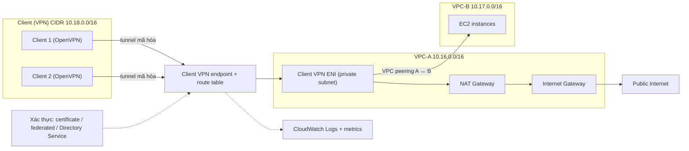

# Client VPN

> **TL;DR:** AWS Client VPN là bản **managed của OpenVPN**: thay vì cả một site nối vào AWS như [[Site-to-Site VPN]], ở đây **từng máy client** (laptop, desktop) kết nối vào VPC qua một tunnel mã hóa trên Internet. Client nối tới một **Client VPN endpoint**, endpoint được gắn với **một VPC** (hoặc gắn thẳng **một Transit Gateway**) và với **một hoặc nhiều subnet** (target network, mỗi AZ một subnet để HA). Client được đối xử như một thứ chạy trong VPC: muốn ra Internet hay sang VPC khác thì vẫn cần NAT Gateway, IGW, peering như bình thường. **Mặc định mọi traffic của client đi qua VPN**; muốn chỉ traffic tới AWS đi qua VPN thì phải **bật split tunnel**.

## 🖼️ Sơ đồ
![[Client VPN.excalidraw]]
*Mở bằng plugin Excalidraw để chỉnh sửa · ảnh tĩnh: [[Client VPN.svg]]*

## Khái niệm cốt lõi
- **Site-to-Site VPN vs Client VPN**: Site-to-Site nối **một hay nhiều cơ sở (site)** của doanh nghiệp vào AWS; Client VPN cho **từng client** kết nối.
- **Managed OpenVPN**: bạn vẫn có thể tự dựng OpenVPN server trên EC2, giống như tự cài database trên EC2. Client VPN với OpenVPN giống [[RDS Architecture|RDS]] với database: AWS quản lý giúp.
  - Vì dựa trên OpenVPN (mã nguồn mở) nên **mọi thiết bị chạy được phần mềm OpenVPN** đều dùng được: gần như mọi hệ điều hành và cả router dân dụng.
  - AWS có **desktop client riêng**, nhưng **client OpenVPN chuẩn nào cũng chạy**.
- **Client VPN endpoint**: điểm client kết nối tới.
  - Gắn với **một VPC**, **hoặc** gắn thẳng vào **một [[Transit Gateway]]** để client tới được mọi thứ route được qua TGW. Một endpoint chỉ dùng **một kiểu association**, không trộn subnet VPC với TGW.
  - Gắn với **một hoặc nhiều target network** (subnet). **Mỗi AZ chỉ chọn được một subnet**; chọn nhiều subnet ở nhiều AZ để **HA**.
  - Mỗi subnet target network được đặt một **interface (ENI)** để chuyển traffic giữa target network và client.
- **Xác thực**: **certificate**, **federated identity**, hoặc **AWS [[Directory Service]]**.
- **Giám sát**: tích hợp CloudWatch: **connection log** vào **CloudWatch Logs**, **metric** vào CloudWatch (xem [[CloudWatch Logs]]).
- **Chi phí** (bắt đầu tính khi associate target network):
  - Phí **theo giờ cho mỗi subnet** cấu hình làm target network (vì mỗi subnet có một interface, giống [[Interface VPC Endpoints|interface endpoint]] có phí).
  - Phí **theo giờ cho mỗi client VPN connection**.

## Cách hoạt động / Kiến trúc
Ví dụ bài: client được cấp CIDR `10.18.0.0/16`; **VPC-A** `10.16.0.0/16` có public subnet; **VPC-B** `10.17.0.0/16` chỉ có private subnet.

1. Tạo **Client VPN endpoint**, associate với VPC-A và một hoặc nhiều subnet. Mỗi subnet có một **Client VPN ENI**.
2. Endpoint có **route table** riêng. Mặc định nó có route tới **toàn bộ CIDR của VPC được associate** (ở đây là CIDR của VPC-A); có thể **thêm route thủ công**.
3. Client kết nối thì nhận route từ endpoint. **Mặc định** client nhận **một route `0.0.0.0/0`** gửi **mọi traffic qua VPN**, và route table của endpoint **thay thế** route table hiện có trên máy client.
4. Muốn client ra **public Internet** qua VPN: thêm default route vào route table của endpoint, và VPC-A cần **NAT Gateway + Internet Gateway**, vì traffic đi ra từ Client VPN ENI nằm trong **private subnet** (xem [[NAT Gateway]], [[VPC Routing and Internet Gateway]]).
5. Muốn client tới **instance trong VPC-B**: tạo [[VPC Peering]] A ↔ B, cấu hình routing như bình thường, rồi thêm route tới CIDR VPC-B vào route table của endpoint.

**Ý chính**: hãy coi client như **một thứ chạy trong VPC**. Nó cần đúng các gateway mà một interface trong VPC cần: peering, NAT Gateway, Internet Gateway.

### Mặc định vs split tunnel
- **Mặc định**: route table của Client VPN **thay thế** route cục bộ trên client, nên client **không truy cập được gì trong mạng LAN của mình**. Traffic giữa hai client (client 1 ↔ client 2) cũng phải đi vòng qua Client VPN, một đường đi **kém tối ưu**. Traffic ra Internet cũng bị ép qua tunnel.
- **Split tunnel**: route từ Client VPN endpoint được **thêm vào** route table của client thay vì thay thế. Traffic ra Internet đi thẳng qua **default route bình thường của client**, traffic trong LAN và giữa các client **không đi qua VPN**. Chỉ traffic tới mạng AWS mới vào tunnel.
- **Split tunnel không phải mặc định**: phải **bật rõ ràng**.

## Bảng so sánh / số liệu
| | [[Site-to-Site VPN]] | Client VPN |
|---|---|---|
| Ai kết nối | **Cả site** (router on-prem, CGW) | **Từng client** (laptop, desktop) |
| Công nghệ | IPsec | **OpenVPN** (managed) |
| Phía AWS | VGW hoặc Transit Gateway | **Client VPN endpoint** gắn một VPC (các subnet) **hoặc** một Transit Gateway |
| HA | 2 tunnel / connection; full HA cần 2 CGW | Nhiều subnet target network ở nhiều AZ (mỗi AZ một subnet) |
| Xác thực | PSK / certificate giữa hai router | Certificate, federated identity, Directory Service |
| Chi phí | Theo giờ mỗi VPN connection + data out | Theo giờ **mỗi subnet** target network + theo giờ **mỗi client connection** |

| Chế độ | Route trên client | Traffic Internet / LAN |
|---|---|---|
| **Mặc định (full tunnel)** | Route của endpoint **thay thế** route cục bộ (`0.0.0.0/0` qua VPN) | Mọi traffic qua VPN; không tới được LAN; client ↔ client đi vòng qua VPN |
| **Split tunnel** (phải bật) | Route của endpoint **thêm vào** route cục bộ | Internet và LAN đi đường bình thường; chỉ traffic tới AWS qua VPN |

## 🎯 Mẹo thi SAA-C03
- **Nhân viên làm từ xa / từng laptop cần truy cập private vào VPC qua Internet**, không muốn tự quản VPN server → **AWS Client VPN**. Cả văn phòng / data center nối vào → [[Site-to-Site VPN]].
- **Mặc định mọi traffic đi qua VPN.** Đề nói client mất truy cập mạng nội bộ, Internet chậm vì bị ép qua VPN, hay chỉ muốn traffic tới AWS qua tunnel → **bật split tunnel**.
- Client qua Client VPN muốn ra **Internet** → route trong endpoint route table **cộng NAT Gateway + IGW** trong VPC. Muốn tới **VPC khác** → **VPC peering** (hoặc gắn endpoint vào **Transit Gateway**) **cộng route** trong endpoint route table.
- **HA**: associate subnet ở **nhiều AZ** (mỗi AZ một subnet).
- Xác thực bằng **certificate, federated identity hoặc Directory Service**; log kết nối vào **CloudWatch Logs**.
- Tính phí theo **số subnet associate** và **số client connection** theo giờ.

## Liên kết
- Tiên quyết: [[Site-to-Site VPN]], [[VPC Routing and Internet Gateway]], [[Custom VPC]]
- Liên quan: [[Transit Gateway]], [[NAT Gateway]], [[VPC Peering]], [[Directory Service]], [[Interface VPC Endpoints]], [[CloudWatch Logs]], [[IPSec VPN]]
- Phân biệt với: [[Site-to-Site VPN]], [[Compare - VPN vs Direct Connect]]
- Tổng quan: [[_MOC 17 Hybrid and Migration]]
