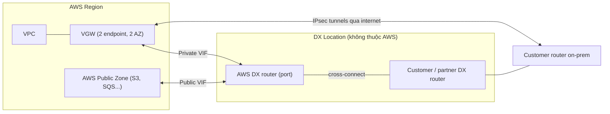

# Compare - VPN vs Direct Connect

> **TL;DR:** [[Site-to-Site VPN]] là kết nối **logic, mã hóa IPsec, chạy qua internet công cộng**: dựng nhanh (dưới một giờ đến vài giờ), rẻ, nhưng bị giới hạn ~1.25 Gbps và latency không ổn định. [[Direct Connect]] (DX) là **kết nối vật lý riêng** vào AWS: tốc độ cao (1/10/100 Gbps), latency thấp và ổn định, nhưng mất **hàng tuần đến hàng tháng** để provision, **không mã hóa** và **không có resilience sẵn**. Thực tế hay **kết hợp** cả hai.

## 🖼️ Sơ đồ
![[Compare - VPN vs Direct Connect.excalidraw]]
*Mở bằng plugin Excalidraw để chỉnh sửa · ảnh tĩnh: [[Compare - VPN vs Direct Connect.svg]]*

![[Compare - VPN vs Direct Connect - decision.excalidraw]]
*Mở bằng plugin Excalidraw để chỉnh sửa · ảnh tĩnh: [[Compare - VPN vs Direct Connect - decision.svg]]*

## Bảng so sánh

| Tiêu chí | Site-to-Site VPN | Direct Connect (DX) |
|---|---|---|
| Bản chất | Kết nối **logic** (software-defined) VPC ↔ on-prem | **Port vật lý** tại DX location, nối bằng cross-connect (cáp quang) |
| Đường truyền | **Public internet** (trừ khi chạy VPN trên DX) | Mạng riêng, **không** qua internet |
| Mã hóa | **Có**: IPsec | **Không** mặc định (thêm VPN trên public VIF để mã hóa) |
| Băng thông | **~1.25 Gbps** mỗi VPN connection/tunnel; VGW cũng có trần tổng ~1.25 Gbps (theo khóa học) | **1 / 10 / 100 Gbps** (dedicated), gần như đạt tối đa tốc độ port |
| Latency | **Cao hơn, không ổn định** (nhiều hop internet) | **Thấp và ổn định** |
| Overhead | Có overhead mã hóa/giải mã (CPU), đáng kể ở tốc độ cao | Không |
| Thời gian setup | **Nhanh**: < 1 giờ đến vài giờ, toàn bộ là cấu hình | **Chậm**: AWS cấp port, rồi cross-connect, rồi kéo cáp tới văn phòng; **tuần đến tháng** |
| HA | AWS side HA sẵn (VGW có 2 endpoint ở 2 AZ, 2 tunnel). **Fully HA** khi có 2 CGW, 2 đường internet, lý tưởng ở 2 tòa nhà | **Không có resilience sẵn**: cáp đứt là mất. Phải tự thiết kế nhiều DX ([[Direct Connect Resilience]]) |
| Chi phí | Phí theo giờ + data transfer out; tốn data cap internet on-prem | Phí theo giờ của port (theo DX location + tốc độ) + data **out**; data **in miễn phí** |
| Thiết bị on-prem | Router hỗ trợ IPsec (gần như mọi thiết bị, kể cả loại consumer). Dynamic VPN cần **BGP** | Router hỗ trợ DX (VLAN, BGP); cần port ở customer cage hoặc qua comms partner |
| Truy cập | Vào VPC (qua VGW hoặc [[Transit Gateway]]) | **Private VIF** → VGW/VPC; **Public VIF** → dịch vụ public của AWS (S3, SQS, EIP...); **Transit VIF** → [[Transit Gateway]]. **Không** ra internet (trừ khi tự đặt proxy) |
| Routing | Static hoặc Dynamic ([[BGP]]); route propagation | [[BGP]] |

> Cập nhật (2026): tài liệu AWS hiện ghi trần 1.25 Gbps là **mỗi tunnel**. Có thể cộng gộp băng thông bằng **ECMP qua [[Transit Gateway]]** với nhiều tunnel/connection. DX dedicated hiện có thêm tốc độ 400 Gbps ở một số location, và có **hosted connection** tốc độ thấp hơn qua partner. Trên đề, coi "> 1.25 Gbps" là dấu hiệu loại VPN.

## Kiến trúc tóm tắt

## Khi nào chọn cái nào
- **Chọn VPN khi:**
  - Cần kết nối **ngay** (giờ, không phải tuần).
  - Băng thông yêu cầu **≤ 1.25 Gbps**.
  - Ngân sách thấp, chấp nhận latency biến động.
  - Cần **mã hóa** sẵn.
  - Làm **backup rẻ** cho DX thay vì mua DX thứ hai.
- **Chọn Direct Connect khi:**
  - Cần **băng thông cao** (> 1.25 Gbps), **latency thấp và ổn định** (ứng dụng nhạy latency).
  - Truyền dữ liệu lớn thường xuyên, không muốn đi qua/ăn data cap internet.
  - Cần truy cập cả **dịch vụ public** của AWS qua đường riêng (Public VIF).
  - Có thời gian chờ provisioning.
- **Kết hợp:**
  1. **VPN trước, DX sau**: dựng VPN để có kết nối ngay, đặt DX song song. Khi DX lên thì thay VPN hoặc giữ cả hai.
  2. **DX chính + VPN backup**: HA rẻ hơn hai DX.
  3. **VPN chạy trên DX (Public VIF)**: thêm mã hóa IPsec cho lưu lượng DX ([[Direct Connect Public VIF and VPN]]).

## 🎯 Mẹo thi SAA-C03
- "**Nhanh nhất** / trong vài giờ / ngay lập tức" → **VPN**. DX không bao giờ là đáp án khi cần kết nối gấp.
- "**> 1.25 Gbps**", "**latency thấp, ổn định**", "không đi qua internet" → **DX**.
- "DX + **mã hóa**" → **VPN over DX** (IPsec qua Public VIF). Bản thân DX **không mã hóa**.
- "DX cần **HA nhưng tiết kiệm**" → thêm **VPN làm backup**. "HA tối đa" → nhiều DX ở nhiều DX location ([[Direct Connect Resilience]]).
- VPN chỉ **fully HA** khi phía khách hàng cũng có **2 router + 2 đường internet**. Một CGW = **single point of failure** (partial HA).
- Muốn **failover tự động / nhiều đường / dùng cùng DX** → **dynamic VPN (BGP)**. Router không hỗ trợ BGP thì chỉ dùng được static VPN.
- **DX location không phải tòa nhà của AWS**: đó là data center khu vực nơi AWS thuê chỗ. Nếu doanh nghiệp không có chỗ ở đó thì **comms partner** kéo DX port về văn phòng.
- DX **không truy cập được internet công cộng**, chỉ VPC (private VIF) và dịch vụ public AWS (public VIF).
- Data **vào AWS qua DX miễn phí**, chỉ tính data out.

## Liên kết
- Tiên quyết: [[IPSec VPN]], [[BGP]], [[VPC Routing and Internet Gateway]], [[AWS Public vs Private Services]]
- Chi tiết: [[Site-to-Site VPN]], [[Direct Connect]], [[Direct Connect Resilience]], [[Direct Connect Public VIF and VPN]]
- Liên quan: [[Transit Gateway]], [[HA vs FT vs DR]], [[Encryption Fundamentals]]
- Phân biệt với: [[VPC Peering]] (VPC ↔ VPC, không phải hybrid)
