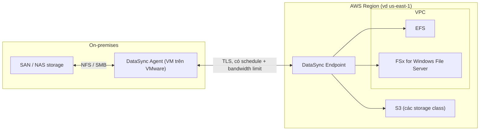

# DataSync

> **TL;DR:** AWS DataSync là dịch vụ truyền dữ liệu **qua mạng (online)**, được quản lý end-to-end, để chuyển dữ liệu **vào hoặc ra khỏi AWS** (và giữa các dịch vụ storage AWS với nhau). Nó lo luôn lịch chạy, giới hạn băng thông, retry, nén, mã hóa, giữ metadata và tự kiểm tra tính toàn vẹn dữ liệu. Trên đề, đây là lựa chọn "điện tử" khi cần chuyển lượng dữ liệu lớn một cách tin cậy, khác với thiết bị vật lý như [[Snow Family]].

## 🖼️ Sơ đồ
![[DataSync.excalidraw]]
*Mở bằng plugin Excalidraw để chỉnh sửa · ảnh tĩnh: [[DataSync.svg]]*

## Khái niệm cốt lõi
- **Bài toán:** trước đây chuyển dữ liệu vào AWS chủ yếu là upload/download thủ công hoặc gửi thiết bị vật lý (Snowball/Snowball Edge). DataSync quản lý toàn bộ quá trình qua đường mạng.
- **Use case điển hình:**
  - Migration dữ liệu từ on-premises lên AWS.
  - Đưa dữ liệu lên AWS để xử lý rồi kéo kết quả về lại (hai chiều).
  - Archive dữ liệu sang storage giá rẻ của AWS (ví dụ các [[S3 Storage Classes]] lạnh).
  - Một phần của kế hoạch DR / business continuity (xem [[HA vs FT vs DR]]).
- **Quy mô (số liệu theo khóa học):**
  - Mỗi **agent ~10 Gbps**, tương đương khoảng **100 TB/ngày**. Muốn nhanh hơn thì thêm agent (nếu đường truyền đủ băng thông).
  - Mỗi task (job) xử lý được tới khoảng **50 triệu file**.
- **Giữ metadata**: permission, timestamp. Đây là điều kiện cần khi migrate cấu trúc thư mục phức tạp.
- **Built-in data validation** (bật mặc định): dữ liệu tới AWS được so khớp với bản gốc. Ví dụ hay gặp: chuyển hồ sơ y tế/ảnh chụp cần chứng minh dữ liệu không bị sai lệch.

### Tính năng chính
| Tính năng | Ý nghĩa |
|---|---|
| Scalable | ~10 Gbps/agent (~100 TB/ngày), thêm agent để scale |
| Bandwidth limiter | Đặt trần băng thông (MiB/s) để không làm nghẽn đường internet, giảm ảnh hưởng tới người dùng |
| Incremental & scheduled | Chỉ chuyển phần thay đổi; đặt lịch chạy vào hoặc tránh một số khung giờ |
| Compression & encryption | Nén dữ liệu; mã hóa in-transit bằng TLS (xem [[SSL and TLS]]) |
| Automatic recovery | Tự phục hồi khi lỗi đường truyền |
| Service integration | S3 (mọi storage class), [[EFS]], FSx (ví dụ [[FSx for Windows]]); hỗ trợ cả service-to-service, ví dụ EFS → EFS, kể cả cross-region |
| Giá | Pay-as-you-use, tính theo **GB dữ liệu được chuyển** |

## Cách hoạt động / Kiến trúc

- **Agent** được cài on-premises dưới dạng máy ảo trên nền tảng ảo hóa (ví dụ VMware). Agent nói chuyện với storage nội bộ qua **NFS** (thường cho Linux/Unix) hoặc **SMB** (thường cho Windows), nên gần như mọi SAN/NAS đều tích hợp được.
- Agent kết nối tới **DataSync endpoint** trong AWS, từ đó ghi dữ liệu vào S3, EFS hoặc FSx (EFS/FSx nằm trong VPC).
- Có thể đặt schedule và bandwidth limit để không ảnh hưởng giờ làm việc.

### Các thành phần
- **Task**: một "job". Định nghĩa đồng bộ cái gì, tốc độ bao nhiêu (throttle), lịch chạy, và **hai location**: FROM và TO.
- **Agent**: phần mềm đọc/ghi vào data store on-premises qua NFS hoặc SMB, kéo dữ liệu lên AWS hoặc đẩy ngược về.
- **Location**: mỗi task có đúng hai location (nguồn và đích). Ví dụ: NFS, SMB, Amazon EFS, Amazon FSx, Amazon S3.

> Ghi chú cập nhật (2026): khóa học chỉ nêu S3/EFS/FSx for Windows. Hiện nay DataSync hỗ trợ thêm nhiều location khác (HDFS, object storage tự host, các FSx khác như [[FSx for Lustre]], storage của cloud khác), agent chạy được trên VMware, Hyper-V, KVM hoặc EC2, và truyền giữa các dịch vụ AWS với nhau thì không cần agent. Đề SAA-C03 vẫn chỉ hỏi ở mức kiến trúc.

## 🎯 Mẹo thi SAA-C03
- Câu hỏi DataSync thường **không** hỏi chi tiết tính năng. Đề bắt bạn **chọn giữa DataSync và một cách khác** để đưa dữ liệu vào AWS.
- Chọn **DataSync** khi đề có các từ khóa sau:
  - Chuyển **online / qua mạng** (loại Snowball/Snowball Edge, vốn là thiết bị vật lý → [[Snow Family]]).
  - Truyền **hai chiều** (vào và ra AWS).
  - Cần **schedule**, **bandwidth throttling**, **incremental**, **automatic retry**, **compression**, **data validation/integrity**.
  - Đích là **S3, EFS hoặc FSx**; nguồn là NAS/SAN dùng **NFS hoặc SMB**.
  - Khối lượng dữ liệu lớn, nhiều file, cần tin cậy.
- Nhớ kiến trúc: **agent on-premises** → (NFS/SMB tới storage nội bộ) → **DataSync endpoint** → S3/EFS/FSx.
- Phân biệt:
  - [[Storage Gateway]]: tích hợp **lâu dài** (hybrid storage, file/volume/tape gateway, cache cục bộ). DataSync dùng để **di chuyển/đồng bộ** dữ liệu.
  - [[Snow Family]]: offline, khi băng thông không đủ hoặc dữ liệu quá lớn so với thời gian cho phép.
  - [[Transfer Family]]: cho **người dùng/đối tác bên ngoài** đẩy file vào S3/EFS bằng SFTP/FTPS/FTP/AS2.
  - [[DMS]]: migrate **database**, không phải file.

## Liên kết
- Tiên quyết: [[S3 Basics]], [[EFS]], [[Storage Fundamentals]]
- Liên quan: [[FSx for Windows]], [[FSx for Lustre]], [[S3 Storage Classes]], [[Site-to-Site VPN]], [[Direct Connect]]
- Phân biệt với: [[Storage Gateway]], [[Snow Family]], [[Transfer Family]], [[DMS]]
