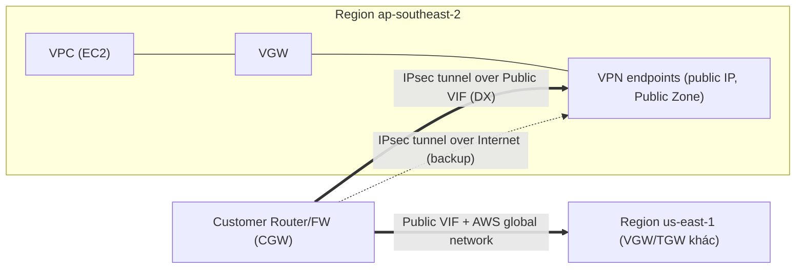

# Direct Connect Public VIF and VPN

> **TL;DR:** [[Direct Connect]] mặc định không mã hóa. Muốn có **mã hóa end-to-end** vào VPC qua DX thì chạy **IPsec VPN** (xem [[IPSec VPN]]) **trên một public VIF**, nối từ customer gateway tới **public endpoint** của VGW hoặc TGW. Kết quả là có cả bảo mật của VPN (encrypted, authenticated) lẫn hiệu năng của DX (latency thấp và ổn định).

## 🖼️ Sơ đồ
![[Direct Connect Public VIF and VPN.excalidraw]]
*Mở bằng plugin Excalidraw để chỉnh sửa · ảnh tĩnh: [[Direct Connect Public VIF and VPN.svg]]*

## Khái niệm cốt lõi
- **Tại sao dùng public VIF mà không dùng private VIF?** Đây là chỗ nhiều người nhầm.
  - **Private VIF** chỉ truy cập được **private IP** trong VPC.
  - **Public VIF** truy cập được **public zone**, tức các **public IP thuộc AWS**.
  - VPN endpoint của **VGW/TGW** có **public IP** nằm trong AWS public zone. Vì vậy muốn tới chúng qua DX thì cần **public VIF**.
  - Quy tắc chọn VIF: **xem bạn đang kết nối tới cái gì**. Đích là public IP thì dùng public VIF, đích là private IP thì dùng private VIF.
- Dù chạy trên public VIF, **tunnel VPN vẫn tạo kết nối private vào VPC**.
- **Transit agnostic**: cấu hình VPN tới VGW/TGW **giống hệt nhau**, dù transit đi qua **public Internet** hay **public VIF**. Chỉ có đường vận chuyển là khác.
- **Kết nối tới VPC ở region khác**: qua cùng một public VIF, bạn có thể dựng VPN tới VGW/TGW ở **region khác**, đi trên **AWS global network**. Đây là cách tốt để có encrypted transit toàn cầu giữa nhiều VPC và mạng doanh nghiệp.

### VPN vs MACsec: không cạnh tranh nhau
| | IPsec VPN over DX | MACsec |
|---|---|---|
| Phạm vi | **End-to-end**: từ CGW tới VGW/TGW | **Single hop** ở Layer 2: giữa AWS DX router và thiết bị nhận cross connect |
| Hỗ trợ vendor | **Rộng**: router hỗ trợ IPsec rất phổ biến | Hẹp hơn: cần switch hoặc router hỗ trợ MACsec |
| Overhead | **Cao**: tốn nhiều xử lý mật mã, nên **giới hạn tốc độ** (phụ thuộc phần cứng, và giới hạn của AWS ~1.25 Gbps/tunnel) | Thấp: thiết kế cho tốc độ **10 Gbps trở lên** |

## Cách hoạt động / Kiến trúc
- Khi tạo VPN với VGW, AWS tạo **2 VPN endpoint ở 2 AZ**, nằm trong **AWS public zone** và có **public addressing**.
- Có hai cách để tới các endpoint này:
  - Qua **public Internet**: nhiều hop, latency biến động.
  - Qua **DX public VIF**: đi thẳng, latency thấp.

### Các mẫu kết hợp DX + VPN
1. **VPN trước, DX sau**: VPN dựng được trong vài phút hoặc vài giờ. Dùng VPN cho traffic ngay, đặt DX song song. Khi DX sẵn sàng thì:
   - giữ VPN chạy **trên DX** để mã hóa traffic chính, **và/hoặc**
   - giữ VPN qua Internet làm **backup** cho DX.
2. **Mẫu resilience phổ biến**: một đường **Internet thường** có IPsec VPN vào AWS, cộng với **DX** cũng chạy một IPsec VPN. Traffic **luôn được mã hóa**. DX là primary nên hiệu năng tốt, còn backup là một **đường mạng hoàn toàn riêng** với tunnel riêng.

## 🎯 Mẹo thi SAA-C03
- **"Encrypt traffic over Direct Connect"** → **IPsec VPN over a public VIF** tới VGW/TGW.
- Câu hỏi bẫy kiểu "VPN qua DX dùng private VIF". Sai, vì VPN endpoint là **public IP** nên phải dùng **public VIF**.
- VPN + DX = **bảo mật của VPN + latency thấp và ổn định của DX**. Tuy nhiên throughput vẫn bị giới hạn bởi overhead của VPN.
- **VPN làm cầu nối khi DX đang provision** và **VPN làm backup cho DX** là hai pattern rất hay ra đề.
- MACsec chỉ mã hóa **một hop**. VPN mã hóa **end-to-end**.

## Liên kết
- Tiên quyết: [[Direct Connect]], [[IPSec VPN]], [[Site-to-Site VPN]], [[AWS Public vs Private Services]]
- Liên quan: [[Direct Connect Resilience]], [[Transit Gateway]], [[Encryption Fundamentals]], [[BGP]]
- Phân biệt với: [[Compare - VPN vs Direct Connect]]
