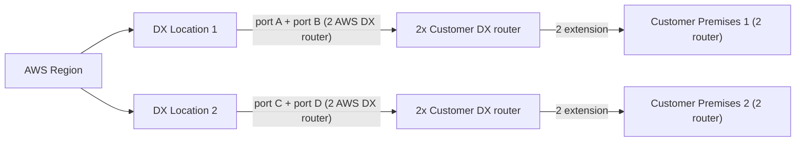

# Direct Connect Resilience

> **TL;DR:** [[Direct Connect]] là công nghệ vật lý nên **mặc định hoàn toàn không resilient**. Mỗi thành phần trong chuỗi là một single point of failure: location, router, cross connect, cáp extension. Muốn HA thì bạn phải tự thiết kế thêm: **nhiều DX port, nhiều DX location, nhiều customer premises, nhiều router**. Một cách khác là dùng [[Site-to-Site VPN]] làm backup.

## 🖼️ Sơ đồ
![[Direct Connect Resilience.excalidraw]]
*Mở bằng plugin Excalidraw để chỉnh sửa · ảnh tĩnh: [[Direct Connect Resilience.svg]]*

![[Direct Connect Resilience - resilient.excalidraw]]
*Mở bằng plugin Excalidraw để chỉnh sửa · ảnh tĩnh: [[Direct Connect Resilience - resilient.svg]]*

## Khái niệm cốt lõi

### Chuỗi thành phần của một DX điển hình
**AWS Region** → (luôn HA) → **DX location** chứa **AWS DX router** → **cross connect** (một sợi cáp) → **customer/provider DX router** → **extension** (cáp do telco kéo về) → **customer premises** chứa **customer router**.

- Phần Region ↔ DX location: AWS nối bằng nhiều đường tốc độ cao. **Coi như luôn HA.**
- Mọi thành phần từ DX location trở ra là trách nhiệm thiết kế của bạn.

### 7 single point of failure của thiết kế "một DX"
1. Toàn bộ **DX location** (mất điện, sự cố tòa nhà).
2. **AWS DX router**.
3. **Cross connect** (chỉ là một sợi cáp).
4. **Customer DX router** (nhất là khi không có thiết bị dự phòng tại chỗ).
5. **Extension** từ DX location về văn phòng (cáp chôn dưới đường, dễ bị đứt khi có công trình).
6. **Customer premises** (cả tòa nhà).
7. **Customer premises router**.

Adrian lưu ý: phần lớn công ty provision DX theo đúng kiểu không resilient này, vì nghĩ DX tự nó đã resilient.

## Cách hoạt động / Kiến trúc: các mức tiến hóa

| Mức | Thiết kế | Chịu được | Vẫn còn rủi ro |
|---|---|---|---|
| **Không resilient** | 1 port, 1 DX location, 1 cross connect, 1 extension, 1 customer router | Không chịu được gì | Cả 7 SPOF ở trên |
| **Cải thiện** | **2 DX port tại cùng 1 DX location** (AWS tự đặt hai port trên **hai AWS DX router khác nhau**), 2 customer DX router, 2 extension, 2 customer router, nhưng **1 customer premises** | Lỗi **một router** hoặc **một extension** trên một nhánh | Lỗi **cả DX location**, lỗi **cả customer premises**. Thêm rủi ro ẩn: hai extension giữa cùng hai địa điểm thường **đi chung tuyến cáp vật lý**, ví dụ cùng chui dưới một vỉa hè, nên một lần đào đường có thể cắt cả hai |
| **Tốt hơn** | **2 DX location**, mỗi nơi 1 port, nối về **2 customer premises khác nhau** (lý tưởng là cách xa nhau về địa lý) | Lỗi hardware **hoặc** lỗi cả một location, ở cả phía DX lẫn phía customer. Khi đó chạy ở mức resilience giảm | Mất **cả một location** rồi **thêm một lỗi hardware ở nhánh còn lại** |
| **Tối đa (extreme)** | **2 DX location × 2 port** trên thiết bị riêng, mỗi location có **2 customer DX router**, extension về **2 customer premises**, mỗi premises có **2 router** | Lỗi cả một DX location **và đồng thời** lỗi một cặp router ở location còn lại. Extension đi giữa các địa điểm khác nhau nên **khác tuyến cáp** | Rất thấp, nhưng chi phí và độ phức tạp cao nhất |

### Kết hợp với VPN
- Có thể dùng [[Site-to-Site VPN]] qua Internet làm **backup** cho DX, thay vì mua thêm một DX thứ hai. Cách này rẻ hơn nhưng khi failover thì băng thông và latency kém hơn.
- Mẫu hay gặp ở khách hàng thực tế: DX là primary, có IPsec VPN chạy trên DX, cộng thêm một IPsec VPN qua đường Internet riêng làm backup (xem [[Direct Connect Public VIF and VPN]]).
- Việc chọn primary/backup giữa các đường được điều khiển bằng [[BGP]], ví dụ dùng AS path prepending.

## 🎯 Mẹo thi SAA-C03
- **"Direct Connect is NOT resilient by default"**. Một DX = 1 port, 1 router, 1 location, nên là SPOF.
- Đề yêu cầu **HA/resilient DX** → chọn **nhiều DX connection ở nhiều DX location** (và lý tưởng là nhiều customer premises). Hai DX ở **cùng một location** vẫn còn SPOF là chính location đó.
- Đề yêu cầu **HA nhưng tiết kiệm chi phí** → **DX primary + Site-to-Site VPN backup**.
- Đặt hai DX vào cùng một DX location thì AWS sẽ đặt chúng trên **hai AWS DX router khác nhau**.
- Cẩn thận với **rủi ro ẩn**: hai extension giữa cùng hai địa điểm có thể đi chung một tuyến cáp vật lý.

## Liên kết
- Tiên quyết: [[Direct Connect]], [[HA vs FT vs DR]]
- Liên quan: [[Site-to-Site VPN]], [[Direct Connect Public VIF and VPN]], [[BGP]], [[Transit Gateway]], [[RPO and RTO]]
- Phân biệt với: [[Compare - VPN vs Direct Connect]]
