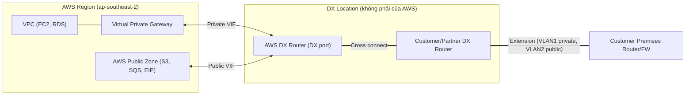

# Direct Connect

> **TL;DR:** AWS Direct Connect (DX) là kết nối **vật lý** riêng từ mạng của bạn vào một AWS Region, đi qua một **DX location**. Khi đặt DX, thứ bạn thực sự nhận được chỉ là **một port** trên AWS DX router. Bạn phải tự kéo cáp vào port đó. Đổi lại DX cho **băng thông cao, latency thấp và ổn định**, nhưng **provision lâu** (hàng tuần tới hàng tháng) và **không có resilience sẵn**.

## 🖼️ Sơ đồ
![[Direct Connect.excalidraw]]
*Mở bằng plugin Excalidraw để chỉnh sửa · ảnh tĩnh: [[Direct Connect.svg]]*

## Khái niệm cốt lõi
- **Tốc độ port (dedicated connection)**: **1 Gbps, 10 Gbps, 100 Gbps** theo khóa học; hiện nay có thêm **400 Gbps** ở một số location. Tốc độ thấp hơn thì mua dạng **hosted connection** qua partner, từ 50 Mbps tới vài chục Gbps.
- **Bản chất là port allocation**: AWS cấp port và **ủy quyền** cho bạn nối vào port đó (bằng LOA-CFA). AWS **không** cung cấp đường truyền. Bạn tự nối, hoặc thuê **communications partner** kéo dài kết nối về văn phòng.
- **Chi phí**:
  - Phí **theo giờ**, tùy DX location và tốc độ port.
  - Phí **data transfer out**.
  - **Data transfer in miễn phí**.
- **Provisioning time**: AWS cần thời gian cấp port. Sau đó bạn còn phải nối vào DX location, và nếu phải kéo cáp mới từ DX location về văn phòng thì mất thêm **hàng tuần tới hàng tháng**.
- **Không có resilience sẵn**: đây là một sợi cáp vật lý. Cáp đứt là mất kết nối. Muốn HA thì phải tự thiết kế (xem [[Direct Connect Resilience]]).
- **Low latency và consistent latency**: không đi qua public Internet, chỉ qua một sợi cáp hoặc vài link riêng.
- **Băng thông cao nhất** cho hybrid networking. Port là dedicated và không có overhead mã hóa như IPsec, nên gần như đạt được tốc độ tối đa của port.
- **Truy cập được**: AWS **private services** (trong VPC) và AWS **public services** (S3, SQS, Elastic IP...). **Không** truy cập được **public Internet**, trừ khi tự đặt proxy hoặc network appliance.
- **Không mã hóa mặc định**. Muốn mã hóa thì dùng VPN trên public VIF (xem [[Direct Connect Public VIF and VPN]]) hoặc MACsec (mã hóa Layer 2, hop-by-hop).

## Cách hoạt động / Kiến trúc

### Ba địa điểm vật lý
1. **Business premises**: có **customer premises router/firewall**. Có thể là router Internet hiện tại hoặc một router mới hỗ trợ DX (BGP, VLAN 802.1Q).
2. **DX location**: một data center lớn trong vùng. **Không thuộc sở hữu của AWS**, AWS chỉ thuê chỗ và đặt thiết bị ở đó.
   - **AWS DX cage**: chứa **AWS DX router(s)**, là endpoint của dịch vụ DX. **DX port** nằm trên các router này.
   - **Customer cage** (nếu là tổ chức lớn, tự thuê chỗ) hoặc **comms partner cage** (nếu là tổ chức nhỏ). Ở đây có **customer/partner DX router** và có thể có thêm hạ tầng khác.
   - **Cross connect**: một **sợi cáp quang vật lý** nối AWS DX port với port trên router của bạn hoặc của partner, **trong cùng DX location**.
3. **AWS Region**: luôn được nối với các DX location trong vùng bằng nhiều đường **tốc độ cao và HA**.

### Virtual Interfaces (VIF)
Trên **một kết nối vật lý**, bạn tạo nhiều **VIF logic**. Mỗi VIF là một **VLAN 802.1Q** riêng và một phiên **BGP** riêng (xem [[BGP]]).

| Loại VIF | Đi tới đâu | Dùng để |
|---|---|---|
| **Private VIF** | **VGW** gắn vào một VPC (hoặc qua DX Gateway) | Truy cập tài nguyên **private IP** trong VPC |
| **Public VIF** | **AWS Public Zone** | Truy cập AWS **public services** và public IP của AWS, kể cả VPN endpoint |
| **Transit VIF** | **DX Gateway** nối với [[Transit Gateway]] | Đưa DX vào TGW để tới nhiều VPC |

## 🎯 Mẹo thi SAA-C03
- Đề có từ khóa **"low latency", "consistent latency", "high throughput", "dedicated/private connection", "không đi qua Internet"** → chọn **Direct Connect**.
- **"Cần ngay, trong vài ngày"** → DX **không** đáp ứng được vì provision mất hàng tuần tới hàng tháng. Chọn [[Site-to-Site VPN]], hoặc dùng VPN trước rồi thêm DX sau.
- **DX location không phải của AWS**. Thứ bạn đặt mua chỉ là **port**. Còn **cross connect** và **extension** về văn phòng là việc của bạn hoặc partner.
- **Một DX = single point of failure**. Muốn HA thì mua nhiều DX ở nhiều location, hoặc dùng **VPN làm backup** (xem [[Direct Connect Resilience]]).
- **Private VIF → VPC (private IP). Public VIF → AWS public services**. DX **không** cho đi ra public Internet.
- DX **không mã hóa** sẵn. Đề yêu cầu "encrypted over DX" thì chọn **IPsec VPN over public VIF** (xem [[Direct Connect Public VIF and VPN]]).
- **Inbound data miễn phí**, outbound tính phí, và thường rẻ hơn data out qua Internet.

## Liên kết
- Tiên quyết: [[BGP]], [[Layer 1 Physical]], [[Layer 2 Data Link]], [[AWS Public vs Private Services]]
- Tiếp theo: [[Direct Connect Resilience]], [[Direct Connect Public VIF and VPN]], [[Transit Gateway]]
- Liên quan: [[Site-to-Site VPN]], [[IPSec VPN]], [[AWS Global Infrastructure]]
- Phân biệt với: [[Compare - VPN vs Direct Connect]]
