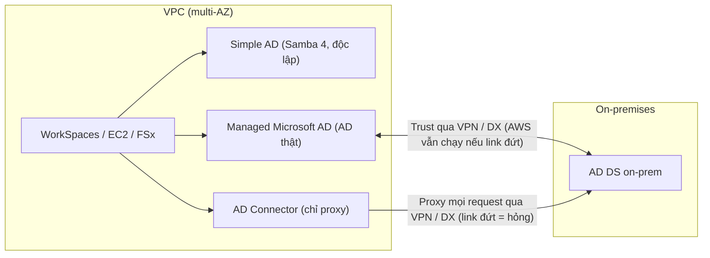

# Directory Service

> **TL;DR:** AWS Directory Service là **directory được quản lý** (kho user, group, computer và các object khác) chạy trong VPC, giống như [[RDS Architecture|RDS]] đối với database nhưng dành cho Active Directory. Có 3 mode: **Simple AD** (Samba 4, độc lập, rẻ), **AWS Managed Microsoft AD** (AD thật, trust được với AD on-prem) và **AD Connector** (chỉ là proxy về AD on-prem). Đề hỏi **chọn mode nào**.

## 🖼️ Sơ đồ
![[Directory Service.excalidraw]]
*Mở bằng plugin Excalidraw để chỉnh sửa · ảnh tĩnh: [[Directory Service.svg]]*

## Khái niệm cốt lõi
### Directory là gì
- Lưu thông tin **identity và tài sản**: user, group, computer, server, file share.
- Cấu trúc **phân cấp dạng cây ngược**, thường gọi là **domain**. Nhiều domain gom lại thành **forest**.
- Phổ biến trong môi trường **Windows doanh nghiệp**: join laptop, desktop, server vào domain để **xác thực và quản lý tập trung**. Một username/password đăng nhập được nhiều máy; IT quản lý identity và tài sản ở một chỗ.
- Phổ biến nhất là **Microsoft Active Directory Domain Services (AD DS)**. Thay thế mã nguồn mở là **Samba**, chỉ **tương thích một phần** với AD. Đây là điểm quyết định khi chọn mode.

### Directory Service trên AWS
- Managed service, bỏ được chi phí quản trị (vốn lớn) khi tự chạy domain controller.
- Là **private service, chạy trong VPC**. Dịch vụ dùng nó phải nằm trong VPC đó hoặc có **kết nối private** tới VPC.
- **HA**: triển khai vào **nhiều subnet ở nhiều AZ** ([[VPC Subnets]], [[AWS Global Infrastructure]]).
- Một số dịch vụ **có thể dùng** directory: ví dụ [[EC2 Basics|EC2]] Windows join domain, đăng nhập bằng identity trong directory, quản lý tập trung các tính năng Windows.
- Một số dịch vụ **bắt buộc** cần directory đã **đăng ký với AWS**: ví dụ **Amazon WorkSpaces** (VDI, tương tự Citrix). Join EC2 vào domain bằng công cụ của AWS cũng cần directory đã đăng ký.
- Ba kiểu kiến trúc: directory **độc lập trong AWS**; directory **tích hợp với AD on-prem** (quan hệ trust); hoặc **connector** chỉ proxy về on-prem.

## Cách hoạt động / Kiến trúc

### 1. Simple AD
- **Rẻ nhất, đơn giản nhất.** Là directory mã nguồn mở dựa trên **Samba 4**, cố gắng tương thích AD tối đa nhưng nhẹ.
- Hai cỡ: **Small ≤ 500 user**, **Large ≤ 5.000 user**.
- Tạo user và object trực tiếp trong Simple AD, tích hợp được với WorkSpaces, Amazon Connect, QuickSight, WorkMail, [[RDS Architecture|RDS]], **đăng nhập AWS Management Console**… và EC2 (qua console hoặc cấu hình OS thủ công). Bất cứ thứ gì join được Samba đều join được Simple AD. (Một vài dịch vụ trong danh sách của khóa học như WorkDocs, Chime đã bị AWS ngừng.)
- Bản chất là một cụm Samba có HA.
- **Thiết kế để dùng độc lập**: không dành cho tích hợp on-prem, không phải AD đầy đủ.

### 2. AWS Managed Microsoft AD
- Dùng khi cần **AD thật trong AWS** và/hoặc có **AD on-prem sẵn**.
- Là triển khai **Microsoft AD thật** (khóa học nói bản 2012 R2; hiện nay AWS chạy bản Windows Server mới hơn), không giả lập, không bị AWS chỉnh sửa. Hỗ trợ ứng dụng cần tính năng AD như **schema / schema extension**: **SharePoint**, ứng dụng dựa trên **SQL Server**.
- Ngoài tạo user trực tiếp, còn tạo được **trust relationship** với AD on-prem, đi qua **kết nối private**: [[Site-to-Site VPN]] hoặc [[Direct Connect]].
- **Primary location nằm trong AWS**: nếu VPN đứt, dịch vụ AWS dựa vào directory vẫn chạy. Đây là directory đầy đủ, **không phụ thuộc hạ tầng on-prem**.
- Dùng được làm user store cho [[FSx for Windows]].

### 3. AD Connector
- Tình huống: chỉ muốn dùng **một dịch vụ AWS cần directory** (ví dụ WorkSpaces) mà đã có AD on-prem, không muốn dựng directory mới.
- Cần kết nối private (ví dụ VPN) giữa VPC và on-prem, rồi tạo AD Connector trỏ về AD on-prem.
- **CHỈ là proxy**: không có chức năng xác thực riêng, không lưu dữ liệu directory trên cloud. Dịch vụ AWS thấy "có một AD", còn mọi request được chuyển về directory on-prem.
- Nhược điểm: **kết nối private đứt** (hoặc AD on-prem hỏng) → AD Connector ngừng hoạt động → dịch vụ AWS dùng nó bị gián đoạn.

## Bảng so sánh / số liệu
| | Simple AD | AWS Managed Microsoft AD | AD Connector |
|---|---|---|---|
| Bản chất | Samba 4 (tương thích một phần) | Microsoft AD DS thật | Proxy, không có directory riêng |
| Dữ liệu directory nằm ở | AWS | AWS (primary) | On-prem |
| Tích hợp on-prem | Không (dùng độc lập) | **Trust** với AD on-prem qua VPN/DX | Proxy về AD on-prem qua VPN/DX |
| Khi link on-prem đứt | Không ảnh hưởng | Dịch vụ AWS vẫn hoạt động | **Hỏng** |
| Quy mô / tính năng | 500 (Small) / 5.000 (Large) user | Schema extension, SharePoint, SQL Server | Phụ thuộc AD on-prem |
| Chi phí / độ phức tạp | Thấp nhất | Cao nhất | Thấp, nhưng cần AD on-prem |

## 🎯 Mẹo thi SAA-C03
- **Simple AD là mặc định**: yêu cầu đơn giản, cần một directory trong AWS, **không cần kết nối on-prem**. Từ khóa **open source / Samba / Samba 4** → Simple AD.
- **Managed Microsoft AD** khi: ứng dụng trong AWS cần **Microsoft AD DS thật** (schema extension, SharePoint, SQL Server), hoặc cần **trust** với AD on-prem, hoặc cần directory **vẫn chạy khi VPN/DX đứt**.
- **AD Connector** khi: muốn dùng dịch vụ AWS cần directory (WorkSpaces…) **mà không lưu bất kỳ thông tin directory nào trên cloud**, chỉ proxy về AD on-prem. Nhớ điểm yếu: phụ thuộc kết nối private và AD on-prem.
- Adrian nói đã gặp AD Connector trong đề thật; SAA-C03 có nhiều câu về **môi trường Windows** hơn bản cũ. Hãy nhóm Directory Service với [[FSx for Windows]] và WorkSpaces khi gặp câu hybrid Windows.
- Đề chỉ hỏi ở mức kiến trúc, không hỏi chi tiết cài đặt.
- Đừng nhầm với identity cho người dùng ứng dụng web/mobile ([[Cognito]]) hay quyền truy cập AWS API ([[IAM Basics]], [[IAM Roles]]).

## Liên kết
- Tiên quyết: [[VPC Subnets]], [[Site-to-Site VPN]], [[Direct Connect]]
- Liên quan: [[FSx for Windows]], [[EC2 Basics]], [[RDS Architecture]], [[HA vs FT vs DR]], [[Storage Gateway]]
- Phân biệt với: [[Cognito]], [[IAM Basics]], [[IAM Roles]]
