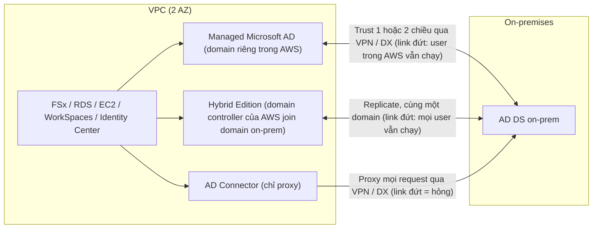

# Directory Service

> **TL;DR:** AWS Directory Service là **directory được quản lý** (kho user, group, computer và các object khác) chạy trong VPC, giống như [[RDS Architecture|RDS]] đối với database nhưng dành cho Active Directory. Lựa chọn **mặc định** là **AWS Managed Microsoft AD** (AD thật, có bản **Standard**, **Enterprise** và **Hybrid Edition**); **AD Connector** chỉ là proxy về AD on-prem; **Simple AD** (Samba 4) đã **đóng với khách hàng mới**. Đề hỏi **chọn kiểu nào**.

## 🖼️ Sơ đồ
![[Directory Service.excalidraw]]
*Mở bằng plugin Excalidraw để chỉnh sửa · ảnh tĩnh: [[Directory Service.svg]]*

## Khái niệm cốt lõi
### Directory là gì
- Lưu thông tin **identity và tài sản**: user, group, computer, server, file share.
- Cấu trúc **phân cấp dạng cây ngược**, thường gọi là **domain**. Nhiều domain gom lại thành **forest**.
- Phổ biến trong môi trường **Windows doanh nghiệp**: join laptop, desktop, server vào domain để **xác thực và quản lý tập trung**. Một username/password đăng nhập được nhiều máy; IT quản lý identity và tài sản ở một chỗ.
- Phổ biến nhất là **Microsoft Active Directory Domain Services (AD DS)**. Thay thế mã nguồn mở là **Samba**, chỉ **tương thích một phần** với AD.

### Directory Service trên AWS
- Managed service, bỏ được chi phí quản trị (vốn lớn) khi tự chạy domain controller.
- Là **private service, chạy trong VPC**. Dịch vụ dùng nó phải nằm trong VPC đó hoặc có **kết nối private** tới VPC.
- **HA**: triển khai vào **hai subnet ở hai AZ** ([[VPC Subnets]], [[AWS Global Infrastructure]]).
- Một số dịch vụ **có thể dùng** directory: ví dụ [[EC2 Basics|EC2]] Windows join domain.
- Một số dịch vụ **cần** directory:
  - [[FSx for Windows]]: join domain AD khi tạo, dùng user và group trong domain để phân quyền share.
  - **Amazon WorkSpaces** (VDI, tương tự Citrix) và [[IAM Identity Center]]: dùng directory để user đăng nhập bằng credential sẵn có.
  - Ngoài ra: [[RDS Architecture|Amazon RDS]], [[Transfer Family|AWS Transfer Family]].
- Bốn cách dùng: directory **độc lập trong AWS**; directory **trust** với directory on-prem (hai domain riêng); **mở rộng chính domain on-prem** vào AWS (một domain ở cả hai nơi); hoặc **AD Connector** chỉ proxy về on-prem.

## Cách hoạt động / Kiến trúc

### 1. AWS Managed Microsoft AD (mặc định)
- Ví dụ bài: Aus-E-Mart chạy [[FSx for Windows]] trong VPC cho nhân viên lưu file. FSx cần directory, nên triển khai Managed Microsoft AD: AWS chạy và patch **hai domain controller, mỗi AZ một cái**. Bạn vẫn tạo user và object trong đó; FSx dùng nó để phân quyền share.
- Là triển khai **Microsoft AD thật**, không giả lập. Hỗ trợ ứng dụng cần tính năng AD như **schema / schema extension**: **SharePoint**, ứng dụng **.NET** hay **SQL Server** tự viết. (Bản khóa cũ nêu: bản 2012 R2; bổ sung, bài không nói: hiện AWS chạy bản Windows Server mới hơn.)
- Dùng được cho FSx, RDS, WorkSpaces, IAM Identity Center, Transfer Family, và EC2 join domain.
- **Ba edition**:
  - **Standard** và **Enterprise**: Enterprise cho directory lớn hơn và là bản **replicate được sang region khác**.
  - **Hybrid Edition**: xem mục 2.
- **Trust với AD on-prem** (do bạn sở hữu và quản lý): cần kết nối private, [[Site-to-Site VPN]] hoặc [[Direct Connect]].
  - Trust **một chiều hoặc hai chiều**. FSx, RDS, EC2 chạy được với cả hai; **IAM Identity Center cần trust hai chiều**.
  - Directory mà dịch vụ AWS dựa vào nằm trong AWS, nên **VPN đứt** thì mọi thứ dùng account trong directory AWS **vẫn chạy**.
  - Đây là **hai domain riêng**: ví dụ `aws.ausemart.net` (AWS quản lý) và `internal.ausemart.net` (on-prem, bạn toàn quyền). Trust nối chúng lại nhưng vẫn tách biệt. Vì vậy khi VPN đứt, **user chỉ có ở on-prem không đăng nhập được** vào dịch vụ AWS cho tới khi link lên lại.

### 2. Hybrid Edition (của Managed Microsoft AD)
- Dùng khi **đã có domain on-prem** (nguồn sự thật) và muốn **mở rộng chính domain đó** vào AWS, không tạo domain thứ hai.
- Vẫn cần kết nối private (DX hoặc VPN). AWS triển khai và quản lý **hai domain controller (mỗi AZ một cái)**, chúng **join domain của bạn** và **replicate** với các domain controller on-prem. **Một domain**, cùng user, group, policy, **không có trust**.
- Bắt buộc phải có sẵn domain của mình; bạn vẫn toàn quyền với domain, AWS chỉ quản lý các domain controller nó chạy.
- **VPN đứt**: mọi user vẫn đăng nhập được vào dịch vụ AWS, vì domain controller trong AWS là bản đầy đủ của domain (không nên để mất kết nối lâu).
- Đánh đổi: chạy được với thứ **join domain** (EC2, FSx for Windows File Server, RDS), nhưng **không chạy với WorkSpaces và IAM Identity Center**. Hai dịch vụ này cần trust hoặc AD Connector.

### 3. AD Connector
- Tình huống: chỉ muốn dùng **một dịch vụ AWS cần directory** (ví dụ WorkSpaces) mà đã có AD on-prem, không muốn dựng directory mới.
- Cần kết nối private (ví dụ VPN) giữa VPC và on-prem, rồi tạo AD Connector trỏ về AD on-prem.
- **CHỈ là proxy**: không có chức năng xác thực riêng, không lưu dữ liệu directory trên cloud. Dịch vụ AWS (WorkSpaces, Transfer Family…) thấy "có một AD", còn mọi request xác thực được chuyển về directory on-prem.
- Nhược điểm: **kết nối private đứt** (hoặc AD on-prem hỏng) → AD Connector ngừng hoạt động → không ai đăng nhập được vào dịch vụ dùng nó.
- **FSx for Windows File Server và RDS không dùng được AD Connector.**

### 4. Simple AD (đóng với khách hàng mới)
- Directory cơ bản, độc lập, chạy **Samba 4**, cho yêu cầu đơn giản, **không tích hợp được với directory on-prem**.
- **Đã đóng với khách hàng mới**: chỉ gặp trong môi trường có sẵn, không chọn được cho triển khai mới.
- Bản khóa cũ nêu (bài mới không nói): rẻ nhất; hai cỡ **Small ≤ 500 user**, **Large ≤ 5.000 user**; tích hợp WorkSpaces, QuickSight, WorkMail, RDS, đăng nhập AWS Management Console… và từng được coi là lựa chọn mặc định.

## Bảng so sánh / số liệu
| | AWS Managed Microsoft AD | Hybrid Edition | AD Connector | Simple AD |
|---|---|---|---|---|
| Bản chất | Microsoft AD DS thật, domain riêng trong AWS | Domain controller do AWS quản lý, **join domain on-prem của bạn** | Proxy, không có directory riêng | Samba 4 (tương thích một phần) |
| Quan hệ với on-prem | Tùy chọn **trust** 1 hoặc 2 chiều qua VPN/DX | **Một domain**, replicate, không trust | Proxy về AD on-prem qua VPN/DX | Không tích hợp |
| Khi link on-prem đứt | User trong AWS vẫn chạy; user chỉ ở on-prem thì không | **Mọi user vẫn chạy** | **Hỏng** | Không áp dụng (không nối on-prem) |
| Dùng được với | FSx, RDS, EC2, WorkSpaces, Identity Center (cần trust 2 chiều), Transfer Family | EC2, FSx, RDS; **không** WorkSpaces, Identity Center | WorkSpaces, Transfer Family…; **không** FSx, RDS | (môi trường cũ) |
| Khi nào chọn | **Mặc định**; cần AD thật, schema extension, trust | Workload phụ thuộc AD chuyển lên AWS, muốn giữ **một domain** | Không muốn lưu gì về directory trên cloud | Không chọn được cho triển khai mới |

## 🎯 Mẹo thi SAA-C03
- **Managed Microsoft AD là mặc định**: cần directory trong AWS cho dịch vụ cần directory, ứng dụng cần **Microsoft AD DS thật** (schema extension, SharePoint, SQL Server), hoặc cần **trust** với AD on-prem.
- **Hybrid Edition** khi: workload trong AWS phải nằm trong **chính domain on-prem hiện có** (một domain, không trust), AWS quản lý domain controller. Nhớ: không dùng với WorkSpaces / IAM Identity Center.
- **AD Connector** khi: muốn dùng dịch vụ AWS cần directory (WorkSpaces…) **mà không lưu bất kỳ thông tin directory nào trên cloud**, chỉ proxy về AD on-prem. Nhớ điểm yếu: phụ thuộc kết nối private và AD on-prem; **FSx for Windows và RDS không dùng được**.
- **IAM Identity Center** + AD on-prem qua Managed Microsoft AD → cần **trust hai chiều**.
- **Simple AD** đã đóng với khách hàng mới: không phải đáp án cho triển khai mới. (Bổ sung, bài không nói: đề cũ có thể còn coi Simple AD là "mặc định, rẻ nhất, Samba".)
- Hãy nhóm Directory Service với [[FSx for Windows]] và WorkSpaces khi gặp câu hybrid Windows. (Bản khóa cũ nêu: đã gặp AD Connector trong đề thật.)
- Đề chỉ hỏi ở mức kiến trúc và **chọn kiểu nào**, không hỏi chi tiết cài đặt.
- Đừng nhầm với identity cho người dùng ứng dụng web/mobile ([[Cognito]]) hay quyền truy cập AWS API ([[IAM Basics]], [[IAM Roles]]).

## Liên kết
- Tiên quyết: [[VPC Subnets]], [[Site-to-Site VPN]], [[Direct Connect]]
- Liên quan: [[FSx for Windows]], [[EC2 Basics]], [[RDS Architecture]], [[IAM Identity Center]], [[Transfer Family]], [[HA vs FT vs DR]], [[Storage Gateway]], [[Client VPN]]
- Phân biệt với: [[Cognito]], [[IAM Basics]], [[IAM Roles]]
