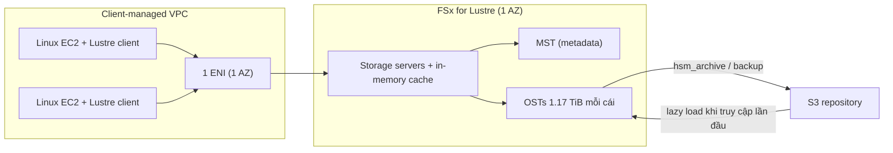

# FSx for Lustre

> **TL;DR:** Amazon FSx for Lustre là bản managed của **Lustre**, một file system song song cho **HPC**, phục vụ **client Linux** với permission kiểu **POSIX**. Throughput có thể lên tới hàng trăm GB/s, latency dưới 1 ms. Dùng cho machine learning, big data, financial modelling. Có thể gắn một **S3 bucket làm repository** và lazy load dữ liệu từ đó. Chỉ chạy trong **một AZ**.

## 🖼️ Sơ đồ
![[FSx for Lustre.excalidraw]]
*Mở bằng plugin Excalidraw để chỉnh sửa · ảnh tĩnh: [[FSx for Lustre.svg]]*

![[FSx for Lustre - deployment.excalidraw]]
*Mở bằng plugin Excalidraw để chỉnh sửa · ảnh tĩnh: [[FSx for Lustre - deployment.svg]]*

## Khái niệm cốt lõi
- **Đối tượng:** Linux instance (cài Lustre client), quyền kiểu **POSIX**. Đây là từ khóa cần nhớ.
- **Workload:** machine learning, big data, financial modelling, nói chung là xử lý khối dữ liệu lớn với hiệu năng rất cao, nhiều client song song.
- **Hiệu năng:** throughput **hàng trăm GB/s**, latency **sub-millisecond**.
- **Truy cập:** từ VPC qua ENI, và từ on-premises qua **VPN hoặc Direct Connect** (cần băng thông rất lớn mới tận dụng được).

### Deployment types
| | **Scratch** | **Persistent** |
|---|---|---|
| Mục tiêu | Hiệu năng thuần túy, workload **ngắn hạn/tạm thời** | Lưu trữ **dài hạn**, cần HA |
| HA / replication | **Không HA, không replication** | Replication **trong một AZ** |
| Lỗi phần cứng | Dữ liệu trên phần cứng hỏng bị **mất** (phần dữ liệu khác vẫn còn) | **Self-healing**: phần cứng hỏng được AWS tự thay, không mất dữ liệu |
| Lỗi cả AZ | Mất | **Vẫn có thể mất** (không chịu được lỗi AZ) |
| Baseline throughput | **200 MB/s per TiB** | **50 / 100 / 200 MB/s per TiB** (chọn) |
| Burst | tới **1,300 MB/s per TiB** (credit) | tới **1,300 MB/s per TiB** (credit) |

- Với Scratch: file system càng lớn thì càng nhiều server và disk, nên **xác suất có lỗi càng cao**.
- Cả hai loại đều **backup được sang S3**: manual hoặc automatic, retention **0–35 ngày** (0 = tắt automatic backup, giống các dịch vụ AWS khác như [[RDS Backups and Restore|RDS]]).

> Cập nhật (2026): các mức 50/100/200 MB/s/TiB là của Persistent_1. Hiện có thêm **Persistent_2** (SSD) với các mức 125/250/500/1000 MB/s/TiB. Đề thi chỉ cần hiểu Scratch và Persistent khác nhau ra sao.

### Kích thước và cách lưu dữ liệu
- **Metadata** (tên file, timestamp, permission) nằm trên **Metadata Target (MST)**. Mỗi file system có một MST. (Thuật ngữ Lustre chuẩn là MDT; slide khóa học ghi MST.)
- **Dữ liệu** được chia (stripe) qua nhiều **Object Storage Target (OST)**, mỗi OST **1.17 TiB**. Hiệu năng cao đến từ việc chia dữ liệu song song qua nhiều OST.
- **Kích thước:** tối thiểu **1.2 TiB**, tăng theo bước **2.4 TiB**.
- **Baseline performance phụ thuộc kích thước**, có **burst credit**: tích credit khi chạy dưới baseline, tiêu credit khi vượt baseline. Cơ chế giống [[EBS Volume Types|EBS gp2/HDD]] nhưng ở quy mô lớn và song song hơn nhiều.

## Cách hoạt động / Kiến trúc

### File system và S3 repository
- File system là nơi dữ liệu **sống trong lúc được xử lý**.
- Khi tạo có thể gắn một **repository là S3 bucket**:
  - Object trong bucket **hiện ra** trong file system ngay, nhưng **chưa thực sự nằm trong Lustre**.
  - Lần đầu client truy cập thì dữ liệu mới được **lazy load** từ S3 vào file system.
  - **Không có đồng bộ tự động** (theo khóa học). Muốn ghi thay đổi ngược về S3 thì dùng lệnh **`hsm_archive`** (`lfs hsm_archive`).
  - Về khái niệm: Lustre là file system **riêng biệt**, S3 chỉ là nền dữ liệu để nạp vào và xuất ra.
  - (Cập nhật: hiện FSx for Lustre có data repository association với **automatic import/export** sang S3. Bản chất "file system riêng, S3 là repository" vẫn giữ nguyên.)

- Client là **Linux EC2 có Lustre software** trong VPC do khách hàng quản lý.
- Provision càng nhiều storage thì FSx dựng càng nhiều **storage server**, nên aggregate throughput và IOPS càng cao. Mỗi server có **in-memory cache** cho dữ liệu hay dùng.
- Hiệu năng được đưa vào VPC qua **một ENI duy nhất**, vì Lustre chạy trong **một AZ**.
- **Ghi** đi qua ENI và ghi thẳng xuống disk, nên phụ thuộc throughput/IO của disk. **Đọc** lần đầu cũng từ disk. Đọc lặp lại (dữ liệu hay dùng) thì lấy từ **cache trong RAM**, lúc đó bị giới hạn bởi tốc độ mạng giữa client và Lustre server.

## Bảng so sánh / số liệu
| | [[FSx for Windows]] | FSx for Lustre | [[EFS]] |
|---|---|---|---|
| OS client | Windows | Linux | Linux |
| Protocol / quyền | SMB, Windows ACL, AD | Lustre, **POSIX** | NFS, POSIX |
| Mục đích | File share doanh nghiệp | **HPC**, ML, big data | Shared FS đa dụng |
| AZ | Single hoặc Multi-AZ | **1 AZ** | Regional |
| Tích hợp S3 | Không | **S3 repository** (lazy load, export) | Không |

## 🎯 Mẹo thi SAA-C03
- **Windows / SMB** → [[FSx for Windows]], **không** phải Lustre.
- Chọn **FSx for Lustre** khi đề có: **Lustre**, **HPC**, **POSIX**, hiệu năng cực cao/throughput hàng trăm GB/s, **machine learning**, **big data**, **financial modelling**, xử lý song song trên nhiều Linux instance.
- **ML + [[SageMaker]]** cần file system hiệu năng rất cao → FSx for Lustre.
- Cần xử lý nhanh dữ liệu đang nằm trong **S3** bằng file system hiệu năng cao → FSx for Lustre với S3 repository (lazy load).
- **Scratch** = tạm thời, nhanh nhất, rẻ, **không HA, không replication**. **Persistent** = dài hạn, HA + self-healing **chỉ trong một AZ**.
- Bẫy: Persistent **không** chống được lỗi cả AZ. Muốn bảo vệ thì backup sang S3.

## Liên kết
- Tiên quyết: [[Storage Fundamentals]], [[EFS]], [[S3 Basics]]
- Liên quan: [[SageMaker]], [[EBS Volume Types]] (cơ chế burst credit), [[DataSync]], [[Site-to-Site VPN]], [[Direct Connect]], [[EC2 Placement Groups]]
- Phân biệt với: [[FSx for Windows]], [[EFS]]
