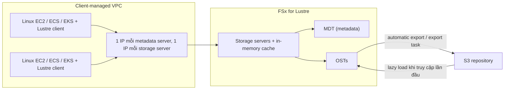

# FSx for Lustre

> **TL;DR:** Amazon FSx for Lustre là bản managed của **Lustre**, một file system song song cho **HPC**, phục vụ **client Linux** với permission kiểu **POSIX**. Throughput có thể lên tới **nhiều TB/s**, hàng triệu IOPS, latency dưới 1 ms. Dùng cho machine learning, big data, financial modelling. Có hai **storage class**: **SSD** (chỉ **một AZ**) và **Intelligent-Tiering** (replicate **nhiều AZ**, co giãn tự động); hai **deployment type**: **Scratch** và **Persistent**. Có thể gắn một **S3 bucket làm repository** và lazy load dữ liệu từ đó (trừ Intelligent-Tiering).

## 🖼️ Sơ đồ
![[FSx for Lustre.excalidraw]]
*Mở bằng plugin Excalidraw để chỉnh sửa · ảnh tĩnh: [[FSx for Lustre.svg]]*

![[FSx for Lustre - deployment.excalidraw]]
*Mở bằng plugin Excalidraw để chỉnh sửa · ảnh tĩnh: [[FSx for Lustre - deployment.svg]]*

## Khái niệm cốt lõi
- Bài mới chỉ nói các tính năng **version 2**. Version 1 vẫn cấu hình được nhưng AWS đã gần như bỏ khỏi console.
- **Đối tượng:** Linux instance (cài Lustre client), quyền kiểu **POSIX**. Đây là từ khóa cần nhớ.
- **Workload:** machine learning, big data, financial modelling, nói chung là xử lý khối dữ liệu lớn với hiệu năng rất cao, nhiều compute instance dùng chung một file system.
- **Hiệu năng:** throughput **nhiều TB/s**, **hàng triệu IOPS**, latency **sub-millisecond**. (Bản khóa cũ nêu: hàng trăm GB/s.)
- **Truy cập:** triển khai vào VPC, và từ on-premises qua **VPN hoặc Direct Connect**.

### Storage class
| | **SSD** | **Intelligent-Tiering** |
|---|---|---|
| Kiểu | Provisioned, latency sub-millisecond | **Fully elastic**: chỉ trả cho dung lượng đã lưu, không phải khai kích thước |
| AZ | **Chỉ một AZ** | **Replicate qua nhiều AZ** |
| Tính năng thêm | | Tự **tier dữ liệu lạnh**, có **SSD read cache** tùy chọn |
| S3 repository | Gắn được | **Không gắn được** |
| Deployment type | Scratch hoặc Persistent | Chỉ Persistent (Scratch chỉ chạy với SSD) |

### Deployment types
| | **Scratch** | **Persistent** |
|---|---|---|
| Mục tiêu | Hiệu năng **tốt nhất**, workload **ngắn hạn/tạm thời** | Lưu trữ **dài hạn**, cần HA |
| Storage class | **Chỉ SSD** | SSD hoặc Intelligent-Tiering |
| HA / replication | **Không HA, không replication** | Replicate để phục hồi: **trong một AZ** với SSD, **qua nhiều AZ** với Intelligent-Tiering |
| Lỗi phần cứng | **Mất dữ liệu** | **Self-healing**: AWS tự thay phần cứng hỏng và phục hồi dữ liệu |
| Lỗi cả AZ | Mất | SSD: **vẫn có thể mất**; Intelligent-Tiering: dữ liệu ở AZ khác |
| Baseline throughput | **200 MB/s per TiB** | **125 / 250 / 500 / 1000 MB/s per TiB** (chọn) |
| Burst | tới **1,300 MB/s per TiB** (credit) | tới **1,300 MB/s per TiB** cho các mức thấp (125, 250); mức cao không cần burst |
| Backup | **Không có** | Manual hoặc automatic, retention **0–90 ngày** (không có khi đã gắn S3 repository) |

- Với Scratch: file system càng lớn thì càng nhiều server và disk, nên **xác suất có lỗi càng cao**. AWS cũng cảnh báo điều này.
- Backup: **không có** với Scratch, và **không có** khi file system đã gắn S3 repository (repository có automatic export thì tự nó đóng vai trò backup).
- (Bản khóa cũ nêu: Persistent 50 / 100 / 200 MB/s per TiB, backup cả hai loại với retention 0–35 ngày. Đó là số của version 1.)

### Kích thước và cách lưu dữ liệu
- **Metadata** (tên file, timestamp, permission) nằm trên **một hoặc nhiều Metadata Target (MDT)**. (Bản khóa cũ nêu: mỗi file system một MST.)
- **Dữ liệu** được chia (stripe) qua nhiều **Object Storage Target (OST)**. Hiệu năng cao đến từ việc chia dữ liệu song song qua nhiều OST. (Bản khóa cũ nêu: mỗi OST 1.17 TiB.)
- **Kích thước (SSD):** tối thiểu **1.2 TiB**, tăng theo bước **2.4 TiB**. Intelligent-Tiering tự scale theo mức dùng nên không có ràng buộc này.
- **Baseline performance phụ thuộc kích thước**, có **burst credit**: tích credit khi chạy dưới baseline, tiêu credit khi vượt baseline. Cơ chế giống [[EBS Volume Types|EBS gp2/HDD]] nhưng ở quy mô lớn và song song hơn nhiều.

## Cách hoạt động / Kiến trúc

### File system và S3 repository
- File system là nơi dữ liệu **sống trong lúc được xử lý**.
- Khi tạo có thể gắn một **repository là S3 bucket** (không làm được với Intelligent-Tiering):
  - Object trong bucket **hiện ra** trong file system ngay, nhưng **chưa thực sự nằm trong Lustre**.
  - Lần đầu client truy cập thì dữ liệu mới được **lazy load** từ S3 vào file system. Chỉ theo chiều S3 → Lustre.
  - **Mặc định không đồng bộ chiều ngược lại**: thay đổi trong lúc xử lý chỉ nằm trên Lustre. Muốn đưa về S3 thì cấu hình **automatic export policy**, hoặc chạy **export repository task** khi cần (on-demand). (Bản khóa cũ nêu: ghi ngược bằng lệnh `hsm_archive`.)
  - Về khái niệm: Lustre là file system **riêng biệt**, S3 chỉ là nền dữ liệu để nạp vào và xuất ra.

- Client thường là **Linux EC2 có Lustre software** trong VPC do khách hàng quản lý; container trên **ECS** và **EKS** cũng mount được.
- Provision càng nhiều storage thì FSx dựng càng nhiều **storage server**, nên aggregate throughput và IOPS càng cao. Mỗi server có **in-memory cache** cho dữ liệu hay dùng.
- Storage được đưa vào VPC bằng **một IP cho mỗi metadata server và một IP cho mỗi storage server** trong subnet bạn chọn, nên số endpoint tăng theo kích thước file system. **Lustre client** nói chuyện **trực tiếp và song song** với tất cả server, đây là một phần lớn của hiệu năng. (Bản khóa cũ nêu: một ENI duy nhất.)
- **Ghi** đi thẳng xuống disk, nên phụ thuộc throughput/IOPS của disk. **Đọc** dữ liệu chưa cache cũng từ disk. Đọc lặp lại (dữ liệu hay dùng) thì lấy từ **cache trong RAM**, lúc đó chỉ bị giới hạn bởi tốc độ mạng giữa client và Lustre server.

## Bảng so sánh / số liệu
| | [[FSx for Windows]] | FSx for Lustre | [[EFS]] |
|---|---|---|---|
| OS client | Windows | Linux (EC2, ECS, EKS) | Linux |
| Protocol / quyền | SMB, Windows ACL, AD | Lustre, **POSIX** | NFS, POSIX |
| Mục đích | File share doanh nghiệp | **HPC**, ML, big data | Shared FS đa dụng |
| AZ | Single hoặc Multi-AZ | **SSD: 1 AZ**; Intelligent-Tiering: nhiều AZ | Regional |
| Tích hợp S3 | Không | **S3 repository** (lazy load, export), trừ Intelligent-Tiering | Không |

## 🎯 Mẹo thi SAA-C03
- **Windows / SMB** → [[FSx for Windows]], **không** phải Lustre.
- Chọn **FSx for Lustre** khi đề có: **Lustre**, **HPC**, **POSIX**, storage **song song hiệu năng cao cho compute Linux**, **machine learning**, **big data**, **financial modelling**, xử lý song song trên nhiều Linux instance.
- **ML + [[SageMaker]]** cần file system hiệu năng rất cao → FSx for Lustre.
- Cần xử lý nhanh dữ liệu đang nằm trong **S3** bằng file system hiệu năng cao → FSx for Lustre với S3 repository (lazy load); muốn đẩy kết quả về S3 → **automatic export** hoặc **export task**.
- Hai bẫy storage class: **Intelligent-Tiering không gắn được S3 repository**; **SSD không có multi-AZ**.
- **Scratch** = tạm thời, nhanh nhất, **chỉ SSD**, **không replication**, lỗi phần cứng là mất dữ liệu, không backup. **Persistent** = dài hạn, replicate + self-healing; với SSD vẫn **chỉ trong một AZ**.
- Bẫy: Persistent SSD **không** chống được lỗi cả AZ. Cần dữ liệu tồn tại qua lỗi AZ → Intelligent-Tiering, hoặc backup / export sang S3.

## Liên kết
- Tiên quyết: [[Storage Fundamentals]], [[EFS]], [[S3 Basics]]
- Liên quan: [[SageMaker]], [[EBS Volume Types]] (cơ chế burst credit), [[DataSync]], [[Site-to-Site VPN]], [[Direct Connect]], [[EC2 Placement Groups]], [[ECS]], [[EKS]]
- Phân biệt với: [[FSx for Windows]], [[EFS]]
