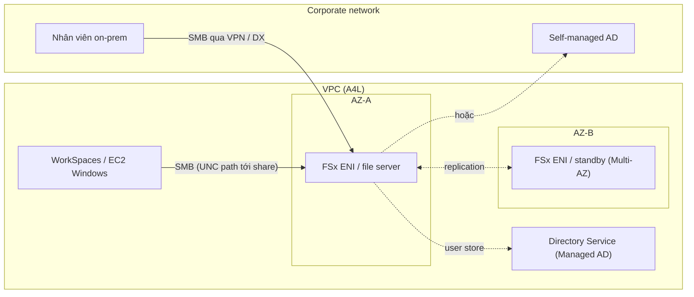

# FSx for Windows

> **TL;DR:** Amazon FSx for Windows File Server cung cấp **file share Windows native, fully managed**, truy cập qua **SMB**, tích hợp với **Active Directory** (Directory Service hoặc AD tự quản, kể cả on-premises). AWS quản lý server bên dưới, bạn chỉ dùng file share, tương tự cách [[RDS Architecture|RDS]] giao database. Trên đề, đây là lựa chọn file system dùng chung cho môi trường **Windows**, đối lập với [[EFS]] cho Linux.

## 🖼️ Sơ đồ
![[FSx for Windows.excalidraw]]
*Mở bằng plugin Excalidraw để chỉnh sửa · ảnh tĩnh: [[FSx for Windows.svg]]*

## Khái niệm cốt lõi
- Là một phần của bộ dịch vụ AWS hỗ trợ Windows. Đơn vị bạn dùng là **file share**, còn server thì bị ẩn đi.
- **Native Windows file system**, không phải giả lập. Hỗ trợ đầy đủ tính năng Windows:
  - **SMB** protocol (chuẩn của Windows).
  - **Windows permission model** (NTFS ACL quen thuộc).
  - **Data deduplication**.
  - **DFS** (Distributed File System): gom nhiều file share vào một cấu trúc chung toàn doanh nghiệp (namespace), hoặc dùng để replicate/scale-out hiệu năng.
  - **VSS (Volume Shadow Copy)**: người dùng tự xem **Previous Versions** của file/folder và tự restore từ phía client, không cần admin hay thao tác trên AWS.
  - Mã hóa at-rest bằng [[KMS]], và có thể **bắt buộc mã hóa in-transit**.
- **Tích hợp directory:** dùng AD làm user store, với hai lựa chọn:
  - AWS Managed Microsoft AD ([[Directory Service]]).
  - **Self-managed AD**, chạy trên AWS hoặc **on-premises**. Không bắt buộc phải tạo directory trong Directory Service. Doanh nghiệp lớn đã có AD sẵn thì nối thẳng vào.
- **Triển khai:** **Single-AZ** hoặc **Multi-AZ** trong một VPC, truy cập qua ENI trong VPC.
  - Single-AZ vẫn **replicate trong AZ** đó, chịu được lỗi phần cứng.
  - Multi-AZ cho HA thật sự giữa các AZ.
- **Backup:** phía AWS có automatic (scheduled) và on-demand backup. Phía client có VSS.
- **Truy cập từ:** trong VPC, qua [[VPC Peering]], qua VPN ([[Site-to-Site VPN]]) và qua [[Direct Connect]].
- **Hiệu năng (theo khóa học):** throughput từ **8 MB/s đến 2 GB/s**, hàng trăm nghìn IOPS, latency **< 1 ms**. (Hiện nay throughput tối đa cao hơn nhiều, cỡ ~12 GB/s với SSD. Đề thi không hỏi con số này.)

## Cách hoạt động / Kiến trúc

- Share được truy cập bằng đường dẫn UNC Windows: `\\<file-system-DNS-name>\<share>`, ví dụ `\\fs-xxxx.animals4life.org\catpics`.
- Dịch vụ AWS cần storage kiểu Windows dùng được FSx. Ví dụ **Amazon WorkSpaces** (VDI kiểu Citrix): WorkSpaces cần Directory Service để chạy và có thể dùng FSx làm shared file system.

## Bảng so sánh / số liệu
| | [[EFS]] | FSx for Windows | [[FSx for Lustre]] |
|---|---|---|---|
| Client | Linux (EC2, on-prem Linux) | Windows | Linux (HPC) |
| Protocol | NFS | **SMB** | Lustre client (POSIX) |
| Permission | POSIX | Windows ACL | POSIX |
| Identity | IAM / POSIX | **Active Directory** | POSIX |
| HA | Regional (multi-AZ) | Single-AZ hoặc Multi-AZ | 1 AZ |
| Đặc trưng | Shared FS cho Linux | VSS, DFS, dedup | Throughput cực cao, S3 repository |

## 🎯 Mẹo thi SAA-C03
- Nhiệm vụ chính trên đề: **chọn FSx for Windows hay EFS** cho shared file system.
  - Linux / NFS / POSIX → [[EFS]].
  - Windows / **SMB** / **Active Directory** / Directory Service → **FSx for Windows**.
- Từ khóa gần như chắc chắn là FSx for Windows:
  - **SMB**.
  - **VSS**, "user-driven restore", "previous versions".
  - **DFS** (Distributed File System).
  - **Windows permission model** / NTFS.
  - "Native Windows file server" nhưng **không muốn tự quản lý** EC2 chạy Windows Server.
  - Tích hợp **Directory Service hoặc AD on-premises có sẵn**.
- Truy cập được từ on-prem qua VPN/DX: phù hợp kịch bản hybrid khi nhân viên văn phòng dùng chung share.
- Nếu đề nói Windows/SMB thì **không chọn** [[FSx for Lustre]].

## Liên kết
- Tiên quyết: [[Storage Fundamentals]], [[EFS]], [[Directory Service]]
- Liên quan: [[DataSync]] (migrate dữ liệu vào FSx), [[KMS]], [[Site-to-Site VPN]], [[Direct Connect]], [[VPC Peering]], [[AWS Backup]], [[Storage Gateway]]
- Phân biệt với: [[EFS]], [[FSx for Lustre]]
