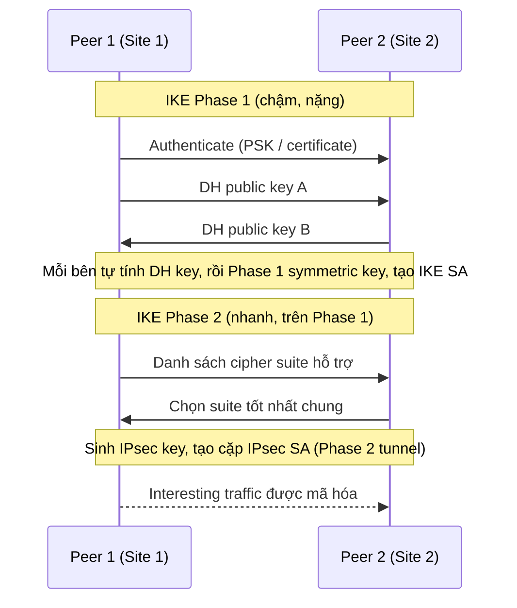

# IPSec VPN

> **TL;DR:** IPsec là một **bộ giao thức** dùng để dựng **tunnel an toàn qua mạng không an toàn** (thường là Internet) giữa hai peer (local và remote router). Nó cung cấp **authentication** (chỉ peer quen biết mới kết nối được) và **encryption** (dữ liệu trong tunnel là ciphertext, không đọc được và không sửa được mà không bị phát hiện). Quá trình dựng tunnel chia thành **IKE Phase 1** (chậm, nặng) và **IKE Phase 2** (nhanh, nhẹ). Đây là nền tảng của [[Site-to-Site VPN]] trên AWS.

## 🖼️ Sơ đồ
![[IPSec VPN.excalidraw]]
*Mở bằng plugin Excalidraw để chỉnh sửa · ảnh tĩnh: [[IPSec VPN.svg]]*

## Khái niệm cốt lõi
- **Peer**: hai router (hoặc firewall) ở hai đầu tunnel, ví dụ hai chi nhánh công ty, hoặc on-prem với AWS.
- **Interesting traffic**: traffic khớp các rule đã định, ví dụ theo network prefix hoặc rule phức tạp hơn.
  - Có interesting traffic thì tunnel được **tạo theo nhu cầu**.
  - Không còn interesting traffic thì tunnel bị **tear down**, và được dựng lại khi có traffic mới.
- **Ôn lại mã hóa** (xem [[Encryption Fundamentals]]):
  - **Symmetric**: nhanh, overhead thấp. Khó ở chỗ phải **trao đổi key** an toàn.
  - **Asymmetric**: chậm hơn, nhưng trao đổi key dễ vì public key được gửi công khai.
  - Hầu hết protocol, IPsec cũng vậy, dùng **asymmetric để thỏa thuận symmetric key**, rồi dùng symmetric key để mã hóa dữ liệu khối lớn.
- **IKE (Internet Key Exchange)**: protocol trao đổi key trong VPN. Có **IKEv1** (cũ) và **IKEv2** (mới, nhiều tính năng hơn).
- **SA (Security Association)**: "kênh" bảo mật đã thỏa thuận giữa hai peer.

## Cách hoạt động / Kiến trúc

### IKE Phase 1: chậm và nặng
1. **Authenticate**: hai peer chứng minh danh tính bằng **pre-shared key (PSK)** hoặc **certificate**. Bước này chỉ xác thực danh tính, chưa trao đổi key mã hóa.
2. **Diffie-Hellman (DH)**:
   - Mỗi bên tạo một **DH private key** và suy ra **public key** tương ứng.
   - Hai bên trao đổi public key cho nhau.
   - Mỗi bên dùng private key của mình và public key của đối phương để tự tính ra cùng một **DH key**. Key này **không bao giờ được truyền qua mạng**.
3. Hai bên dùng DH key cùng key material đã trao đổi để tự sinh ra **Phase 1 symmetric key**.
4. Kết quả là **IKE SA (Phase 1 tunnel)**, dùng để mã hóa các trao đổi tiếp theo.

### IKE Phase 2: nhanh và nhẹ
- Xây trên nền Phase 1: dùng lại DH key, Phase 1 symmetric key và tunnel Phase 1 đã có.
1. Một peer gửi danh sách **cipher suite** nó hỗ trợ. Peer kia chọn **phương thức tốt nhất mà cả hai cùng hỗ trợ** và báo lại.
2. Từ DH key và key material, hai bên sinh ra **IPsec symmetric key**, dùng để mã hóa dữ liệu khối lớn.
3. Kết quả là **IPsec SA (Phase 2 tunnel)** chạy trên Phase 1. Thực chất đây là **một cặp SA**, mỗi SA cho một chiều traffic.
- **Lý do tách hai phase**: Phase 2 có thể bị hủy khi hết interesting traffic trong khi **Phase 1 vẫn giữ**. Khi có traffic mới, dựng lại Phase 2 rất nhanh mà không phải làm lại phần nặng của Phase 1.

## Bảng so sánh: Policy-based vs Route-based VPN
| | Route-based | Policy-based |
|---|---|---|
| Cách match interesting traffic | Theo **prefix** đích, ví dụ "gửi 192.168.0.0/24 qua VPN" | Theo **rule set**, có thể phân loại traffic chi tiết |
| SA | **Một cặp SA** cho mỗi prefix, nên mọi loại traffic dùng chung | **Mỗi policy một cặp SA với IPsec key riêng** |
| Linh hoạt | Ít hơn | Có thể đặt security setting khác nhau cho từng loại traffic, ví dụ infrastructure, CCTV, financial |
| Cấu hình | **Đơn giản** | **Phức tạp hơn** |

Cả hai loại đều chạy trên **cùng một Phase 1 tunnel**. Khác nhau ở số lượng Phase 2 (cặp SA) đặt lên trên.

## 🎯 Mẹo thi SAA-C03
- IPsec = **authentication + encryption in transit** qua mạng không tin cậy. Đề nói "encrypted connection over the public internet to on-prem" thì nghĩ tới [[Site-to-Site VPN]].
- **Phase 1** = authenticate + DH + IKE SA. **Phase 2** = thỏa thuận cipher + IPsec SA cho dữ liệu.
- Mã hóa IPsec tốn CPU, nên VPN bị **giới hạn throughput** (AWS: ~1.25 Gbps/tunnel). Đây là lý do đề thi thường so VPN với [[Direct Connect]].
- Muốn mã hóa traffic chạy trên DX thì chạy IPsec VPN **qua public VIF** (xem [[Direct Connect Public VIF and VPN]]).

## Liên kết
- Tiên quyết: [[Encryption Fundamentals]], [[Layer 3 Network]], [[SSL and TLS]]
- Dùng bởi: [[Site-to-Site VPN]], [[Direct Connect Public VIF and VPN]], [[Transit Gateway]]
- Liên quan: [[BGP]], [[Hashing]], [[Digital Signatures]]
- Phân biệt với: [[Compare - VPN vs Direct Connect]]
