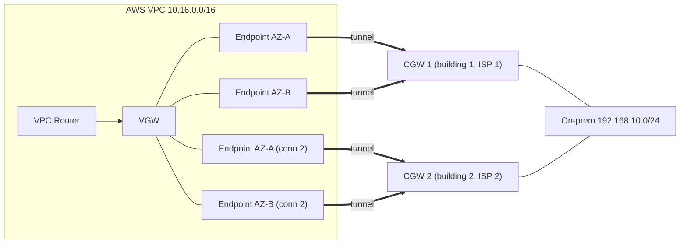

# Site-to-Site VPN

> **TL;DR:** AWS Site-to-Site VPN là kết nối **logic, mã hóa bằng IPsec** giữa một VPC và một mạng bên ngoài AWS (on-prem, cloud khác, data center). Mặc định nó chạy **qua public Internet**. Đây là cách **nhanh nhất** để có hybrid networking: dựng được trong **dưới 1 giờ** vì hoàn toàn là cấu hình phần mềm. Đổi lại, throughput bị giới hạn **~1.25 Gbps** và latency không ổn định. Thiết kế đúng thì đạt **HA hoàn toàn**.

## 🖼️ Sơ đồ
![[Site-to-Site VPN.excalidraw]]
*Mở bằng plugin Excalidraw để chỉnh sửa · ảnh tĩnh: [[Site-to-Site VPN.svg]]*

![[Site-to-Site VPN - static vs dynamic.excalidraw]]
*Mở bằng plugin Excalidraw để chỉnh sửa · ảnh tĩnh: [[Site-to-Site VPN - static vs dynamic.svg]]*

## Khái niệm cốt lõi

### Các thành phần
| Thành phần | Ý nghĩa |
|---|---|
| **VPC** | Mạng phía AWS cần kết nối |
| **Virtual Private Gateway (VGW)** | Gateway object logic, gắn với **một VPC** và làm **target** trong route table. Có thể thay bằng [[Transit Gateway]] |
| **Customer Gateway (CGW)** | Từ này có **hai nghĩa**: (1) object cấu hình logic trong AWS, (2) **router vật lý on-prem** mà object đó đại diện. Khi tạo CGW object cần khai **public IP** của router (và ASN nếu dùng BGP) |
| **VPN Connection** | Lưu cấu hình VPN. Nối **1 VGW với 1 CGW** và tạo ra **2 tunnel** |

- Thông tin cần chuẩn bị: CIDR của VPC, CIDR của mạng on-prem, public IP của router on-prem.
- **VGW có sẵn HA**: phía sau là các **endpoint vật lý đặt ở các AZ khác nhau**, mỗi endpoint có **public IPv4**. Một AZ chết thì endpoint còn lại vẫn chạy.
- Mỗi VPN connection có **2 tunnel**, mỗi tunnel nối một endpoint AWS với CGW. Chỉ cần **một tunnel up** là hai mạng vẫn thông.

### Mức độ HA
- **Partial HA**: 1 VPN connection, tức 2 endpoint AWS ở 2 AZ cùng nối về **1 CGW**. Phía AWS chịu được lỗi AZ, nhưng **CGW on-prem là single point of failure**. Router on-prem chết thì mất toàn bộ kết nối.
- **Full HA**: thêm **CGW thứ hai**, lý tưởng là dùng **đường Internet khác** và đặt ở **tòa nhà khác**. Tạo thêm **VPN connection thứ hai** từ cùng VGW tới CGW mới, AWS sẽ cấp thêm 2 endpoint mới. Tổng cộng có 4 tunnel, chịu được lỗi một AZ hoặc một CGW.

### Static vs Dynamic VPN
Hai loại có cùng kiến trúc: subnet → VPC router → VGW → CGW. Chỉ khác ở **cách trao đổi route**.

| | **Static** | **Dynamic (BGP)** |
|---|---|---|
| Route | Khai **thủ công**: thêm static route vào route table, khai prefix on-prem trên VPN connection | [[BGP]] tự trao đổi network giữa VGW và CGW |
| Yêu cầu | Chỉ cần IPsec, nên chạy được với hầu hết router | **CGW phải hỗ trợ BGP**, loại này ít phổ biến hơn |
| Ưu điểm | Đơn giản | Biết trạng thái link, điều chỉnh route **on the fly**. Hỗ trợ nhiều link cùng lúc, multi-connection failover, kiến trúc HA cao cấp, và kết hợp với [[Direct Connect]] |
| Nhược điểm | Hạn chế về load balancing và failover nhiều connection | Cấu hình phức tạp hơn |

- **Route propagation**: bật cho từng route table. Khi VPN đang active, route mà VGW học được (qua BGP hoặc từ prefix static khai trên VPN connection) sẽ **tự động được thêm** vào route table. Không cần thêm tay vào từng route table. Xem [[VPC Routing and Internet Gateway]].

## Bảng so sánh / số liệu: VPN considerations
| Khía cạnh | Chi tiết |
|---|---|
| **Tốc độ** | **1.25 Gbps** tối đa cho một VPN connection (2 tunnel). VGW **tổng cộng** cũng bị cap ~1.25 Gbps. Còn phụ thuộc khả năng của customer router, vì mã hóa IPsec tốn CPU |
| **Latency** | Đi qua public Internet, nhiều hop, nên latency **cao và không ổn định** |
| **Chi phí** | Phí **theo giờ** cho mỗi VPN connection, phí **data transfer out**, cộng thêm việc dùng băng thông và **data cap** của đường Internet on-prem |
| **Tốc độ triển khai** | **Vài giờ hoặc ít hơn**, vì hoàn toàn là cấu hình phần mềm. IPsec có trên gần như mọi router, kể cả router dân dụng |
| **Kết hợp DX** | Làm **backup** cho [[Direct Connect]], dùng **tạm** trong lúc chờ DX (DX mất hàng tuần tới hàng tháng), hoặc chạy **trên** DX để mã hóa (xem [[Direct Connect Public VIF and VPN]]) |

> (Khóa học nói giới hạn cứng 1.25 Gbps/tunnel. Hiện nay AWS có thêm tùy chọn tunnel băng thông lớn hơn cho VPN gắn [[Transit Gateway]]/Cloud WAN, và TGW hỗ trợ **ECMP** để gộp nhiều tunnel. VGW thì không có hai khả năng này. Với đề thi, cứ nhớ **~1.25 Gbps/tunnel**.)

## Demo / Lab: Simple Site-to-Site VPN (AWS ↔ pfSense)
**Kiến trúc**: AWS VPC `10.16.0.0/16` có *AWS Server A* (web app). Môi trường on-prem **giả lập** trong một VPC khác `192.168.8.0/21`: router **pfSense** (từ Marketplace, trial 30 ngày) có hai interface WAN và LAN, cùng một *on-prem server* Windows trong private subnet `192.168.10.0/24`. Làm trong us-east-1, dựng bằng one-click CloudFormation, cần tạo trước key pair `infra`.

1. **Stage 1, phía AWS**:
   - Tạo **Customer Gateway** với public IP của pfSense (lấy từ Outputs của stack). Không dùng BGP hay certificate.
   - Tạo **VGW** (bỏ qua ASN vì là static) và **attach vào VPC**.
   - Tạo **Site-to-Site VPN connection**: target là VGW, chọn CGW có sẵn, **static routing** với prefix `192.168.8.0/21`. AWS tự cấp 2 endpoint ở 2 AZ.
   - Chờ trạng thái chuyển từ *pending* sang *available*. **Download configuration** cho vendor pfSense (có cả mục *Generic*), chọn **IKEv1**. File này chứa IP endpoint và PSK của từng tunnel.
2. **Stage 2, pfSense**:
   - Lấy password admin từ **EC2 system log**, sau đó gán và bật interface **LAN** (DHCP).
   - Cấu hình **Phase 1 và Phase 2 cho mỗi tunnel**, tổng cộng 4 mục cấu hình.
   - **Phase 1**: IKEv1, interface WAN, remote gateway là IP endpoint AWS, **Mutual PSK** (key lấy từ file config), Main mode, **AES-128, SHA-1, DH group 2 (1024-bit)**, lifetime **28800 s**, bật Dead Peer Detection (delay 10, max failures 3), NAT-T auto.
   - **Phase 2**: tunnel IPv4, local `192.168.10.0/24`, remote `10.16.0.0/16`, **ESP, AES-128, SHA-1, PFS group 2**, lifetime **3600 s**, keepalive ping tới private IP của AWS Server A.
   - Trong Status → IPsec, connect cả hai tunnel cho tới khi hiện **established**.
3. **Stage 3, routing và security**:
   - Phía AWS: bật **route propagation** trên `RT-AWS`. Route `192.168.8.0/21 → VGW` tự xuất hiện với nhãn *propagated*.
   - Phía on-prem: route table private thêm `10.16.0.0/16 → ENI private của pfSense`. Phải chọn target là **network interface** vì pfSense có nhiều ENI.
   - **Security Groups**: SG phía AWS cho phép all traffic từ `192.168.8.0/21`. SG on-prem cho phép từ `10.16.0.0/16`. SG của router cho phép traffic từ SG on-prem. Trong thực tế, phần on-prem là **rule firewall** chứ không phải SG.
4. **Stage 4, test**: RDP vào on-prem server qua **SSM Fleet Manager**, `ping` tới private IP của AWS Server A và mở web app qua HTTP. Cả hai đều chạy qua tunnel.
5. **Stage 5, cleanup**: xóa VPN connection, **detach rồi xóa VGW**, xóa CGW, cuối cùng xóa stack.

**Rút ra**:
- VPN up mới chỉ là một nửa. Vẫn phải lo **routing** hai chiều và **SG/NACL/firewall** thì traffic mới đi được.
- Static VPN phải khai prefix bằng tay. Dynamic BGP VPN thì routing tự động.

## 🎯 Mẹo thi SAA-C03
- **"Nhanh nhất / setup trong vài giờ / chi phí thấp / cần mã hóa qua Internet"** → Site-to-Site VPN.
- **"> 1.25 Gbps"** hoặc **"latency thấp và ổn định"** → không chọn VPN, chọn [[Direct Connect]].
- Một VPN connection = **2 tunnel tới 2 AZ**, nhưng chỉ là **partial HA** nếu chỉ có **1 CGW**. Muốn **full HA** thì cần **2 CGW** (2 router, 2 ISP, lý tưởng là 2 tòa nhà) và **2 VPN connection**.
- **Dynamic VPN cần BGP** trên customer router. Không có BGP thì chỉ dùng được static.
- **Route propagation** giúp route on-prem tự vào VPC route table.
- VPN là **backup rẻ cho DX** (thay vì mua DX thứ hai), và là **giải pháp tạm** trong lúc chờ DX provision.
- Nhiều VPC cùng nối về on-prem mà dùng VGW riêng cho từng VPC thì thành full mesh rất phức tạp. Giải pháp là terminate VPN trên [[Transit Gateway]].

## Liên kết
- Tiên quyết: [[IPSec VPN]], [[BGP]], [[VPC Routing and Internet Gateway]], [[Custom VPC]]
- Liên quan: [[Direct Connect]], [[Direct Connect Public VIF and VPN]], [[Transit Gateway]], [[Security Groups]], [[NACL]], [[AWS Public vs Private Services]]
- Phân biệt với: [[Compare - VPN vs Direct Connect]], [[VPC Peering]]
