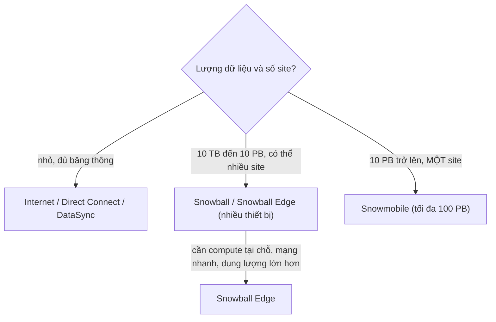

# Snow Family

> **TL;DR:** Snowball, Snowball Edge và Snowmobile là các thiết bị lưu trữ **vật lý** để chuyển lượng dữ liệu rất lớn **vào hoặc ra AWS** khi đường mạng (internet, [[Direct Connect]]) quá chậm hoặc quá đắt. Từ vali cỡ nhỏ (Snowball/Snowball Edge) đến cả một xe tải container (Snowmobile). Đề thi hỏi **khi nào dùng loại nào**, không hỏi chi tiết vận hành.

## 🖼️ Sơ đồ
![[Snow Family.excalidraw]]
*Mở bằng plugin Excalidraw để chỉnh sửa · ảnh tĩnh: [[Snow Family.svg]]*

## Khái niệm cốt lõi
- **Bài toán:** dự án nhỏ thì upload qua internet hoặc Direct Connect là đủ. Khi dữ liệu quá lớn so với băng thông, hoặc cần đưa thật nhiều dữ liệu vào AWS thật nhanh, thì "chở ổ cứng" lại nhanh và rẻ hơn.
- **Hai chiều:** đặt thiết bị rỗng, nạp dữ liệu rồi gửi về AWS (import); hoặc đặt thiết bị đã chứa dữ liệu từ AWS, chép ra rồi trả lại (export).
- **Quy trình vật lý:** tạo job, AWS giao thiết bị tới nơi. Không tức thời.

### Snowball (thế hệ cũ, chỉ có storage)
- Dữ liệu trên thiết bị **mã hóa at-rest bằng [[KMS]]**.
- Hai dung lượng: **50 TB** và **80 TB**.
- Mạng: **1 Gbps hoặc 10 Gbps**. Nơi nhận phải có hạ tầng mạng vật lý phù hợp.
- **Dải kinh tế: 10 TB → 10 PB**. Trong khoảng này, chuyển vật lý thường rẻ hơn truyền qua mạng.
- **Đặt được nhiều thiết bị và gửi tới nhiều địa điểm**, ví dụ 10 Snowball cho 10 văn phòng, mỗi nơi nạp dữ liệu rồi gửi về.
- **Chỉ có storage, không có compute.**

### Snowball Edge (storage + compute)
- Giống Snowball nhưng có thêm **compute**, **dung lượng lớn hơn** và **mạng nhanh hơn**: 10 Gb RJ45, 10/25 Gb SFP, 40/50/100 Gb QSFP+.
- Ba biến thể (số liệu theo khóa học):

| Biến thể | Storage | vCPU | RAM | Ghi chú |
|---|---|---|---|---|
| Storage Optimized | 80 TB | 24 | 32 GiB | |
| Storage Optimized + EC2 | 80 TB + **1 TB SSD** | 24 | 32 GiB | Chạy EC2 instance trên SSD đó |
| Compute Optimized | 100 TB + **7,68 TB NVMe** | 52 | 208 GiB | NVMe gắn thẳng PCIe, latency rất thấp |
| Compute Optimized + GPU | như trên | 52 | 208 GiB | Thêm GPU cho mô phỏng, phân tích khoa học, xử lý song song |

- Chọn Edge thay Snowball khi:
  - Cần **xử lý dữ liệu tại site từ xa ngay khi ingest** (compute, EC2, GPU).
  - Cần **dung lượng lớn hơn** hoặc **mạng nhanh hơn** để nạp xong sớm, gửi trả sớm, rút ngắn thời gian quay vòng.

### Snowmobile
- **Data center di động** trong một **shipping container trên xe tải**. Phải **đặt đặc biệt**, không phổ biến và không có ở mọi nơi.
- Xe tới data center, mở container, cắm vào **nguồn điện và mạng chuẩn data center**, nạp dữ liệu rồi chạy về AWS.
- Tối đa **100 PB mỗi Snowmobile**.
- Lý tưởng cho **một địa điểm duy nhất** với **≥ 10 PB** (ví dụ migration cả data center của doanh nghiệp lớn).
- **Không kinh tế** khi dưới 10 PB hoặc khi **nhiều site** (trừ khi khối lượng cực lớn): một xe chỉ tới một nơi, không chia ra nhiều xe hay đi vòng qua nhiều data center.

> Ghi chú cập nhật (2026): khóa học (bài đánh dấu "new version coming soon") vẫn mô tả cả ba sản phẩm. Thực tế AWS đã **ngừng Snowmobile (2024)**, ngừng Snowball đời đầu và Snowcone, và gần đây Snowball Edge cũng đóng với khách hàng mới. AWS hướng người dùng sang [[DataSync]] (qua mạng) và các điểm truyền dữ liệu vật lý thay thế. Đề SAA-C03 vẫn có thể hỏi các sản phẩm này theo logic chọn lựa bên dưới.

## Cách hoạt động / Kiến trúc

## Bảng so sánh / số liệu
| | Snowball | Snowball Edge | Snowmobile |
|---|---|---|---|
| Hình thức | Thiết bị cỡ vali | Thiết bị cỡ vali | Container trên xe tải |
| Dung lượng | 50 / 80 TB | 80 / 100 TB (+ SSD/NVMe) | Đến 100 PB |
| Compute | Không | Có (EC2, GPU tùy biến thể) | Không (dùng để chuyển dữ liệu) |
| Mạng | 1 / 10 Gbps | 10 → 100 Gbps | Mạng data center |
| Phạm vi hợp lý | 10 TB – 10 PB, nhiều site | Như Snowball + xử lý tại edge | ≥ 10 PB, một site |

## 🎯 Mẹo thi SAA-C03
- Nhớ **dải kinh tế của Snowball: 10 TB – 10 PB**, và câu "**multiple devices, multiple premises**".
- **Snowball = chỉ storage. Snowball Edge = storage + compute.** Đề nhắc xử lý dữ liệu tại site xa, chạy EC2, GPU, hoặc cần nạp nhanh hơn → Snowball Edge.
- **Snowmobile = một xe tải, một site, ≥ 10 PB** (đến 100 PB). Dữ liệu 10 PB nhưng **rải nhiều site** → dùng nhiều **Snowball Edge**, không dùng Snowmobile.
- Dữ liệu vừa phải và đường mạng đủ, cần chuyển online, lặp lại, theo lịch → [[DataSync]], không phải Snow.
- Cần **tích hợp hybrid lâu dài** (on-prem tiếp tục dùng storage AWS) → [[Storage Gateway]], không phải Snow.
- Dữ liệu trên thiết bị được **mã hóa bằng KMS**.

## Liên kết
- Tiên quyết: [[S3 Basics]], [[Storage Fundamentals]]
- Liên quan: [[KMS]], [[EC2 Basics]], [[Direct Connect]], [[DMS]]
- Phân biệt với: [[DataSync]], [[Storage Gateway]], [[Transfer Family]], [[Compare - VPN vs Direct Connect]]
