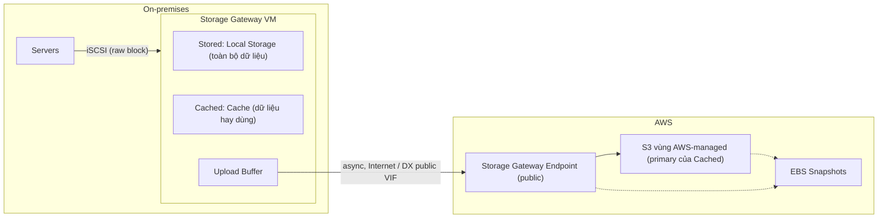
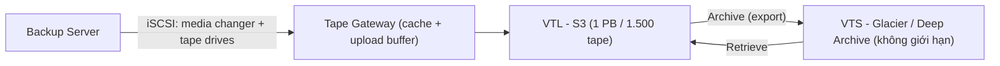
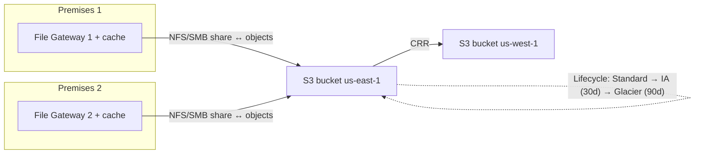

# Storage Gateway

> **TL;DR:** Storage Gateway là một appliance (thường là VM) đặt on-premises, đóng vai "cầu nối" giữa storage nội bộ và AWS. Phía on-prem nó trình bày storage bằng giao thức quen thuộc (**iSCSI, NFS, SMB**), phía AWS nó lưu vào **S3, EBS snapshot, Glacier/Glacier Deep Archive**. Có 3 nhóm mode: **Volume (stored / cached)**, **Tape (VTL)**, **File**. Trên đề, cốt lõi là chọn **đúng mode** cho từng tình huống.

## 🖼️ Sơ đồ
![[Storage Gateway.excalidraw]]
*Mở bằng plugin Excalidraw để chỉnh sửa · ảnh tĩnh: [[Storage Gateway.svg]]*

![[Storage Gateway - choose.excalidraw]]
*Mở bằng plugin Excalidraw để chỉnh sửa · ảnh tĩnh: [[Storage Gateway - choose.svg]]*

## Khái niệm cốt lõi
- **Triển khai:** chủ yếu dưới dạng **virtual appliance** chạy trên hypervisor on-premises. Khóa học nhắc có bản hardware appliance nhưng ít dùng. (Hiện nay có thể chạy gateway trên EC2; bản hardware appliance AWS đã ngừng bán.)
- **Giao thức phía on-prem:**
  - **iSCSI**: block storage qua mạng (kiểu SAN). Dùng cho Volume và Tape mode.
  - **NFS**: chia sẻ file, phổ biến với Linux.
  - **SMB**: chia sẻ file của Windows.
- **Phía AWS:** tích hợp [[EBS]] (dưới dạng [[EBS Snapshots|snapshot]]), [[S3 Basics|S3]] và các lớp Glacier ([[S3 Storage Classes]]).
- **Kết nối:** gateway nói chuyện với **Storage Gateway endpoint**, một **public endpoint** ([[AWS Public vs Private Services]]). Đi qua internet thường hoặc qua **public VIF** của [[Direct Connect]] (xem [[Direct Connect Public VIF and VPN]]).
- **Use case chung:** migration lên AWS, **data center extension** (hết chỗ chứa on-prem thì mượn capacity của AWS), **storage tiering**, **DR**, và **thay thế hệ thống backup bằng tape** đời cũ.
- Bối cảnh điển hình ([[Animals4life Scenario]]): doanh nghiệp nhỏ có vài rack, SAN/NAS phục vụ server qua iSCSI, ít ngân sách cho DR, muốn dùng AWS để giảm chi phí vận hành.

## Cách hoạt động / Kiến trúc

### 1. Volume Gateway – Stored mode
- Gateway trình bày **volume (raw block device)** cho server qua iSCSI, giống hệt volume từ SAN/NAS. Server tự tạo file system lên trên.
- **Primary storage nằm on-premises**: gateway có **local storage** chứa **toàn bộ** dữ liệu của mọi volume.
- Có thêm vùng **upload buffer**: dữ liệu ghi vào volume cũng được ghi tạm vào buffer, rồi copy **bất đồng bộ** lên AWS và lưu thành **EBS snapshot** (trong S3). Chạy liên tục, không cần thao tác tay.
- Thế mạnh:
  - **Full-disk backup** của server, [[RPO and RTO]] tốt vì snapshot liên tục và restore nhanh.
  - **DR**: từ EBS snapshot tạo EBS volume mới, dựng lại server on-prem ngay trong AWS.
  - **Migration**.
  - **Low latency**: mọi dữ liệu đọc ở tốc độ LAN.
- Điểm yếu (ý quan trọng nhất của mode này): **KHÔNG giúp mở rộng capacity**. Mỗi volume có bản đầy đủ on-prem, nên hết dung lượng thì mode này vô dụng.
- Giới hạn (không cần thuộc chính xác): **32 volume/gateway**, **16 TB/volume** → **512 TB/gateway**.

### 2. Volume Gateway – Cached mode
- Kiến trúc giống stored mode: vẫn iSCSI, vẫn có upload buffer, vẫn qua public endpoint.
- Khác biệt là vị trí dữ liệu: **primary storage nằm trong S3**, on-prem chỉ có **cache storage** giữ **dữ liệu truy cập thường xuyên**.
- S3 ở đây là vùng **AWS-managed**, chỉ thấy qua console Storage Gateway, **không mở bucket ra xem được** (dữ liệu là raw block, không phải file/object).
- Vẫn tạo được **EBS snapshot** từ volume, giống stored mode.
- Dữ liệu hay dùng thì nhanh như LAN; dữ liệu ít dùng (không có trong cache) đọc chậm hơn.
- Cho phép **data center extension / capacity extension**: storage "trông như" on-prem nhưng thực ra nằm trong AWS. Ví dụ cache vài trăm GB có thể đứng trước hàng trăm TB dữ liệu.
- Giới hạn: **32 TB/volume**, **32 volume/gateway** → **1 PB/gateway**.

### 3. Tape Gateway (VTL mode)
**Nền tảng về tape backup:**
- Tape (ví dụ **LTO**; LTO-9 chứa **24 TB** không nén, ~60 TB khi nén) là phương tiện **sequential**: phải tua để tìm dữ liệu, không sửa từng phần được, chỉ ghi/đọc theo khối lớn.
- **Tape drive** đọc/ghi tape; **tape loader** (robot / **media changer**) chèn, rút, hoán đổi tape; **tape library** gồm drive + robot + các slot chứa tape; **tape shelf** là mọi nơi ngoài library (kho, site khác).
- Kiến trúc truyền thống: **backup server** nối tới tape library qua **iSCSI** (thấy media changer + tape drive). Chỉ tape **nằm trong library** mới dùng được để backup/restore; tape không dùng thì chở **offsite** (thường do bên thứ ba quản lý). Nhược điểm: chi phí **CAPEX** (tape, phần mềm, library) + **OPEX** (license, bảo trì, nhân sự) + chi phí/thời gian vận chuyển tape.

**VTL mode:**
- Gateway **giả làm một iSCSI tape library, media changer và tape drive**. Backup server không phân biệt được với library thật → gần như **không phải đổi phần mềm backup**, chỉ trỏ sang gateway.
- Gateway có **upload buffer + local cache** (giống volume cached): backup chạy ở tốc độ LAN rồi upload nền lên AWS.
- Phía AWS có hai thành phần:
  - **VTL (Virtual Tape Library)**: backed by **S3** (bucket AWS-managed). Đây là "library".
  - **VTS (Virtual Tape Shelf)**: backed by **Glacier** hoặc **Glacier Deep Archive**. Đây là "kệ/kho offsite".
- **Export** tape trong phần mềm backup (tương đương "rút tape khỏi library") = **archive** tape từ VTL (S3) sang VTS (Glacier). Cần dùng lại thì **retrieve** từ VTS về VTL.
- Glacier cho dữ liệu lưu trữ có thể sẽ cần lấy lại; Deep Archive cho lưu giữ lâu dài (ví dụ yêu cầu pháp lý) và gần như không bao giờ đọc lại.
- Số liệu: virtual tape **100 GiB → 5 TiB** (5 TB cũng là kích thước tối đa của một S3 object theo khóa học, vì mỗi tape là một object); VTL chứa tối đa **1 PB trên 1.500 virtual tape**; **VTS không giới hạn**.
- Use case: giữ phần mềm backup hiện có nhưng thay phần cứng đắt bằng S3/Glacier; mở rộng capacity backup; **migration** (đưa kho tape lịch sử lên VTL/VTS, bỏ phần cứng tape, thậm chí chạy cả gateway và backup server trong AWS để phục vụ restore).

### 4. File Gateway
- Nối **file storage on-prem** với **S3 bucket trong tài khoản của bạn** (bạn thấy và quản lý bucket, khác hẳn vùng AWS-managed của Volume/Tape).
- Tạo **file share (mount point)**, truy cập bằng **NFS** (Linux) hoặc **SMB** (Windows). SMB có thể dùng **Active Directory authentication** (xem [[Directory Service]]).
- **Bucket share** = 1 file share ↔ 1 S3 bucket. Khóa học nói tối đa **10 bucket share mỗi gateway**.
- Ánh xạ file ↔ object: tên file thành tên object, cấu trúc thư mục được nhúng vào **key** (ví dụ file `/omgwow/roffle.png` → object `omgwow/roffle.png`), giống cách S3 giả lập thư mục.
- Ghi file trên share → xuất hiện thành object trong bucket; đặt object vào bucket → thấy được trên share.
- Có **read & write cache** cục bộ để đạt hiệu năng gần LAN; **primary data ở S3**.
- Vì dữ liệu là object S3 thật, có thể dùng các dịch vụ khác trên đó: [[S3 Events]] + [[Lambda]], [[Athena]], v.v.

**Các kiến trúc nâng cao:**
- **Multiple contributors (multi-site):** nhiều gateway ở nhiều văn phòng cùng gắn một bucket.
  - Ghi từ một gateway được đẩy lên S3 **tự động**.
  - Chiều ngược lại **không tự động**: gateway khác chỉ thấy file mới khi bạn chủ động **refresh/list** lại. Dùng tính năng **notify when uploaded** (phát event qua CloudWatch Events / [[EventBridge]]) để báo cho các gateway khác. Việc này phải tự thiết kế.
  - **Không có object locking**: hai site cùng sửa một file → bản ghi sau đè bản trước, **mất dữ liệu**. Giải pháp: chỉ một share read/write, các share khác read-only, hoặc tự kiểm soát ai ghi khi nào.
- **Replication:** bật **Cross-Region Replication** từ bucket chính (ví dụ us-east-1) sang bucket khác (us-west-1) → multi-region DR rẻ, gần như không đổi hạ tầng ([[S3 Replication]]).
- **Lifecycle:** file share có **default storage class** (thường S3 Standard); thêm [[S3 Lifecycle Configuration|lifecycle rule]] như Standard → Standard-IA sau 30 ngày → Glacier sau 90 ngày. Vì primary ở S3, mọi site on-prem hưởng lợi chi phí tự động.

> Ghi chú cập nhật (2026): AWS nay tách tên thành **Amazon S3 File Gateway**, **Volume Gateway**, **Tape Gateway** (và từng có FSx File Gateway nối SMB với [[FSx for Windows]], nhưng đã ngừng nhận khách hàng mới). Khóa học chỉ dạy File Gateway kiểu S3, đúng trọng tâm đề.

## Bảng so sánh / số liệu
| | Volume Stored | Volume Cached | Tape (VTL) | File |
|---|---|---|---|---|
| Giao thức on-prem | iSCSI (block) | iSCSI (block) | iSCSI (tape library, changer, drive) | NFS / SMB |
| Primary data | **On-prem** (local storage) | **S3** (AWS-managed) | S3 (VTL) + Glacier/Deep Archive (VTS) | **S3 bucket của bạn** |
| Local | Toàn bộ dữ liệu + upload buffer | Cache dữ liệu hay dùng + upload buffer | Cache + upload buffer | Read/write cache |
| Bản sao trên AWS | EBS snapshot | EBS snapshot | Virtual tape | Object S3 (thấy trực tiếp) |
| Capacity extension | **Không** | **Có** | Có (cho backup) | Có |
| Giới hạn (theo khóa) | 32 vol × 16 TB = 512 TB | 32 vol × 32 TB = 1 PB | 1 PB / 1.500 tape; tape 100 GiB–5 TiB; VTS không giới hạn | 10 bucket share/gateway |
| Dùng khi | Backup full-disk, DR, migration, cần low latency | Data center extension | Thay tape backup | Hybrid file share, multi-site, đưa file lên S3 |

## 🎯 Mẹo thi SAA-C03
- Quy tắc chọn mode theo từ khóa (Adrian nhấn mạnh): thấy **volume** → Volume Gateway; thấy **tape / backup tape / VTL** → Tape Gateway; thấy **file / NFS / SMB** → File Gateway. Chỉ đổi lựa chọn khi đề có chi tiết loại trừ.
- Volume **stored** vs **cached**:
  - Cần **backup / DR / migration**, cần **truy cập low latency toàn bộ dữ liệu** → **Stored**.
  - Hết chỗ on-prem, cần **mở rộng capacity / data center extension** → **Cached**. Stored **không** giải quyết vấn đề capacity, đây là bẫy hay gặp.
- Câu nào mô tả **kiến trúc tape backup truyền thống** (library, offsite tape, muốn bỏ chi phí tape) → **Tape Gateway (VTL)**. Tape không dùng → archive sang VTS (Glacier/Deep Archive).
- **File Gateway** + từ khóa **extension** → mở rộng file storage lên S3. Muốn xử lý file on-prem bằng dịch vụ AWS (Lambda, Athena) → File Gateway vì object nằm trong bucket của bạn.
- Multi-site File Gateway: nhớ **không tự refresh** giữa các gateway và **không có file locking**.
- Phân biệt với dịch vụ khác:
  - [[DataSync]]: **di chuyển/đồng bộ** dữ liệu (migration, theo lịch). Storage Gateway: **tích hợp hybrid lâu dài** với cache cục bộ.
  - [[Snow Family]]: chuyển offline lượng dữ liệu cực lớn bằng thiết bị vật lý.
  - [[FSx for Windows]] / [[EFS]]: file system nằm hẳn trong AWS, không phải gateway on-prem.
  - [[AWS Backup]]: quản lý backup tập trung cho dịch vụ AWS (có hỗ trợ Volume Gateway).

## Liên kết
- Tiên quyết: [[Storage Fundamentals]], [[S3 Basics]], [[EBS Snapshots]], [[S3 Storage Classes]]
- Liên quan: [[S3 Lifecycle Configuration]], [[S3 Replication]], [[S3 Events]], [[Direct Connect]], [[Direct Connect Public VIF and VPN]], [[RPO and RTO]], [[HA vs FT vs DR]], [[Directory Service]]
- Phân biệt với: [[DataSync]], [[Snow Family]], [[FSx for Windows]], [[EFS]], [[AWS Backup]]
