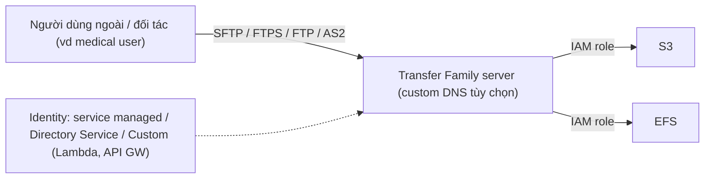

# Transfer Family

> **TL;DR:** AWS Transfer Family là dịch vụ **managed file transfer**. Nó dựng sẵn các "server" nói **SFTP, FTPS, FTP, AS2** đặt trước **S3 hoặc EFS**, để người dùng hoặc đối tác truyền file bằng giao thức họ đang dùng mà không cần đổi ứng dụng sang API S3/NFS, và bạn không phải quản lý server nào.

## 🖼️ Sơ đồ
![[Transfer Family.excalidraw]]
*Mở bằng plugin Excalidraw để chỉnh sửa · ảnh tĩnh: [[Transfer Family.svg]]*

![[Transfer Family - endpoints.excalidraw]]
*Mở bằng plugin Excalidraw để chỉnh sửa · ảnh tĩnh: [[Transfer Family - endpoints.svg]]*

## Khái niệm cốt lõi
- Truyền file **vào/ra S3 và [[EFS]]** bằng giao thức khác với giao thức native của hai dịch vụ này.
- **Giao thức hỗ trợ:**
  | Giao thức | Mô tả |
  |---|---|
  | **FTP** | File Transfer Protocol, **không mã hóa**, giao thức cũ, dùng hạn chế |
  | **FTPS** | FTP + **TLS** |
  | **SFTP** | File transfer chạy trên **SSH** |
  | **AS2** | Applicability Statement 2: truyền **dữ liệu B2B có cấu trúc**, có sẵn tính năng bảo mật/compliance. Gặp trong supply chain/logistics, payment workflow, tích hợp ERP/CRM |
- **Identity provider:**
  - **Service managed** (user tạo ngay trong dịch vụ).
  - **[[Directory Service]]** của AWS.
  - **Custom IdP** qua [[Lambda]] hoặc [[API Gateway]].
- **Managed File Transfer Workflows (MFTW):** workflow engine **serverless**. Định nghĩa các bước xử lý tự động khi file được upload (ví dụ gửi notification, gắn tag...), để gắn Transfer Family vào quy trình nghiệp vụ có sẵn.
- **Quyền truy cập backend:** server dùng **[[IAM Roles]]** để đọc/ghi S3/EFS.
- Có thể dùng **custom DNS name** cho server.

## Cách hoạt động / Kiến trúc

### Endpoint types
| | **Public** | **VPC – Internet** | **VPC – Internal only** |
|---|---|---|---|
| Vị trí | AWS public zone | Trong VPC + **Elastic IP** | Chỉ trong VPC |
| Truy cập | Internet | Internet + VPC + mạng doanh nghiệp (VPN/DX) | VPC + mạng doanh nghiệp (VPN/DX) |
| Giao thức | **Chỉ SFTP** | SFTP, FTPS, AS2 | SFTP, FTPS, **FTP**, AS2 |
| IP | **Động**, AWS quản lý → nên truy cập bằng DNS | **Static** (EIP) | **Static** (private IP) |
| Kiểm soát truy cập bằng SG/NACL | **Không** | Có ([[Security Groups]], [[NACL]]) | Có |
| Cấu hình mạng | Không cần gì | Cần VPC | Cần VPC |

- **FTP chỉ chạy được internal trong VPC**: không mã hóa nên không được đưa ra internet (không dùng với Public hay VPC Internet).
- **AS2 chỉ dùng với VPC Internet hoặc VPC Internal**, không dùng Public.
- Hai kiểu VPC đều truy cập được từ mạng doanh nghiệp qua [[Direct Connect]] hoặc [[Site-to-Site VPN]], như thể client nằm trong VPC.

### Các điểm khác
- **Multi-AZ**, resilient và scalable.
- **Giá:** theo **server được provision mỗi giờ** + **lượng dữ liệu truyền**. Không có phí trả trước.
- **FTP và FTPS chỉ dùng Directory Service hoặc Custom IdP**, không dùng được service-managed identity.

## 🎯 Mẹo thi SAA-C03
- Đề nói cần truy cập **S3/EFS bằng giao thức có sẵn (SFTP/FTPS/FTP/AS2)**, tích hợp với **workflow hiện tại không thể đổi ứng dụng**, hoặc đối tác bên ngoài cần upload file qua SFTP → **Transfer Family**.
- Cần tự động xử lý file sau khi upload mà không dựng server → **MFTW**.
- Ghi nhớ ràng buộc:
  - **Public endpoint chỉ SFTP**, IP động, không gắn được SG/NACL.
  - **FTP = VPC internal only.**
  - **AS2 = VPC (Internet hoặc Internal)**, không Public.
  - **FTP/FTPS = Directory Service hoặc Custom IdP.**
  - Cần **IP tĩnh** để đối tác whitelist → endpoint kiểu VPC (VPC Internet có EIP).
- Phân biệt:
  - [[DataSync]]: đồng bộ/migrate khối dữ liệu lớn giữa storage on-prem và AWS (qua agent).
  - [[Storage Gateway]]: hybrid storage lâu dài cho ứng dụng on-prem (NFS/SMB/iSCSI).
  - Transfer Family: **endpoint giao thức truyền file** cho người dùng/hệ thống bên ngoài.

## Liên kết
- Tiên quyết: [[S3 Basics]], [[EFS]], [[IAM Roles]]
- Liên quan: [[Directory Service]], [[Lambda]], [[API Gateway]], [[Security Groups]], [[NACL]], [[AWS Public vs Private Services]], [[Direct Connect]], [[Site-to-Site VPN]]
- Phân biệt với: [[DataSync]], [[Storage Gateway]], [[Snow Family]]
