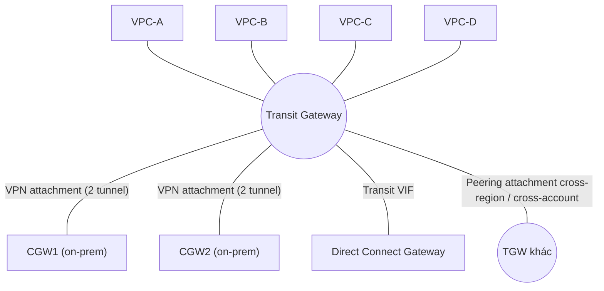

# Transit Gateway

> **TL;DR:** Transit Gateway (TGW) là **network transit hub** dùng để nối **nhiều VPC với nhau** và với **mạng on-prem** (qua [[Site-to-Site VPN]] và [[Direct Connect]]). TGW **hỗ trợ transitive routing**, có **HA và scalable**. Thay cho kiến trúc full mesh gồm hàng loạt [[VPC Peering]] và VPN tunnel, bạn chỉ cần một hub duy nhất, nên **độ phức tạp giảm mạnh**.

## 🖼️ Sơ đồ
![[Transit Gateway.excalidraw]]
*Mở bằng plugin Excalidraw để chỉnh sửa · ảnh tĩnh: [[Transit Gateway.svg]]*

## Khái niệm cốt lõi
- Là một **network gateway object** (giống IGW, VGW). AWS quản lý, có **HA và scalable**.
- Kết nối tới các thành phần khác qua **attachment**:
  - **VPC attachment**: chỉ định **một subnet trong mỗi AZ** cần dùng TGW, cách làm giống [[Interface VPC Endpoints]].
  - **Site-to-Site VPN attachment**: TGW đóng vai trò **điểm terminate VPN phía AWS**, thay cho VGW.
  - **Direct Connect Gateway attachment**: tích hợp DX qua **transit VIF**.
  - **Peering attachment**: peer với TGW khác, **cross-region**, cùng account hoặc **cross-account**.
- **Route table**: mặc định có một **default route table** để route giữa các attachment. Có thể tạo **nhiều route table** để xây topology phức tạp, ví dụ cách ly nhóm VPC.
- **Transitive routing**: traffic có thể đi VPC-A → TGW → VPC-B hoặc VPC → TGW → on-prem, miễn là route table có route phù hợp. Đây là điểm khác cơ bản so với [[VPC Peering]].
- **Global network**: peer nhiều TGW giữa các region. Traffic cross-region đi trên **AWS global network** nên latency ổn định hơn Internet.
- **Chia sẻ giữa các account** bằng **AWS RAM (Resource Access Manager)**.

## Cách hoạt động / Kiến trúc

### Không có TGW: full mesh
Ví dụ Animals4life có 4 VPC (A, B, C, D) và một văn phòng, cần mọi điểm thông với nhau và HA hoàn toàn:
- VPC peering **không transitive**, nên phải tạo full mesh: **6 peering connection** (công thức n(n−1)/2 với n = 4).
- VPN cũng không transitive. Mỗi VPC cần VPN tới CGW: 4 VPC × 2 tunnel = **8 tunnel**.
- Muốn full HA thì cần CGW thứ hai, thêm **8 tunnel** nữa.
- Kết quả: 6 peering + 16 tunnel. Mỗi lần thêm VPC hoặc thêm site thì độ phức tạp tăng nhanh hơn tuyến tính. Thiết kế này **scale rất tệ**.

### Có TGW: hub-and-spoke

- Mỗi CGW chỉ cần nối VPN tới **một TGW**. HA vẫn giữ nguyên: tunnel từ nhiều AZ tới hai CGW. Số tunnel giảm từ 16 xuống 4.
- 4 VPC attachment thay cho 6 peering. Mọi VPC thông với nhau và thông với on-prem qua cùng một thiết bị routing.

## Bảng so sánh: TGW vs VPC Peering vs VGW
| | [[VPC Peering]] | VGW + VPN | **Transit Gateway** |
|---|---|---|---|
| Transitive routing | ❌ | ❌ | ✅ |
| Topology | Full mesh | Mỗi VPC một VGW và một bộ tunnel riêng | Hub-and-spoke |
| Cross-region / cross-account | ✅ | Không áp dụng | ✅ (peering attachment, chia sẻ qua RAM) |
| Kết nối on-prem | ❌ | ✅ (VPN, DX private VIF) | ✅ (VPN, DX qua transit VIF) |
| Độ phức tạp khi scale | Cao, tăng theo n² | Cao | **Thấp** |

## 🎯 Mẹo thi SAA-C03
- **"Nhiều VPC + on-prem, cần đơn giản hóa / giảm số kết nối / transitive routing"** → **Transit Gateway**.
- TGW **hỗ trợ transitive routing**. VPC peering **không** hỗ trợ.
- TGW **peer được cross-region**, cùng account hoặc cross-account. **Chia sẻ cross-account bằng AWS RAM**.
- VPC attachment cần **một subnet trong mỗi AZ** muốn dùng.
- DX tích hợp với TGW qua **Direct Connect Gateway + transit VIF**.
- Có **nhiều route table** để phân tách routing, ví dụ prod và dev không được thông nhau.
- So với VGW, VPN terminate trên TGW còn hỗ trợ **ECMP** để gộp băng thông nhiều tunnel. Đây là kiến thức bổ sung ngoài bài giảng.

## Liên kết
- Tiên quyết: [[VPC Peering]], [[Site-to-Site VPN]], [[Direct Connect]], [[VPC Routing and Internet Gateway]]
- Liên quan: [[BGP]], [[Interface VPC Endpoints]], [[AWS Organizations]], [[Direct Connect Public VIF and VPN]], [[Direct Connect Resilience]]
- Phân biệt với: [[VPC Peering]], [[Compare - VPN vs Direct Connect]]
