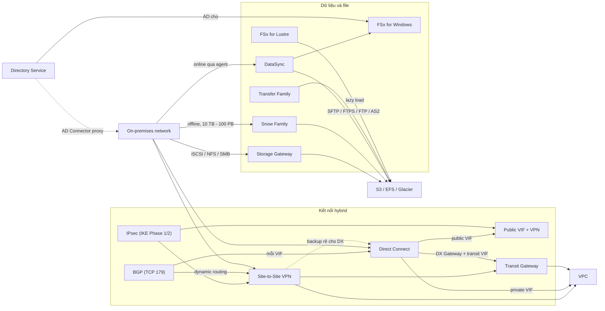

# 17 Hybrid and Migration

Section này nối AWS với thế giới bên ngoài: kết nối mạng hybrid (BGP, IPsec, Site-to-Site VPN, Direct Connect, Transit Gateway) và các cách đưa dữ liệu, file, identity từ on-premises lên AWS (Storage Gateway, Snow Family, DataSync, Transfer Family, FSx, Directory Service). Nó tiếp nối trực tiếp phần mạng VPC nâng cao và là nơi ra nhiều câu "chọn dịch vụ theo từ khóa" nhất trong đề SAA-C03.

← [[00 Home]] · Trước: [[_MOC 16 Advanced VPC Networking]] · Sau: [[_MOC 18 Security Deployment and Operations]]

## Lộ trình học
1. [[BGP]] — routing protocol giữa các Autonomous System; nền cho Direct Connect và dynamic VPN, chỉ cần hiểu ở mức kiến trúc.
2. [[IPSec VPN]] — bộ giao thức dựng tunnel có authentication + encryption qua mạng không tin cậy, gồm IKE Phase 1 và Phase 2.
3. [[Site-to-Site VPN]] — kết nối IPsec logic VPC ↔ on-prem qua Internet: dựng dưới 1 giờ, ~1.25 Gbps/tunnel, full HA cần 2 CGW.
4. [[Direct Connect]] — kết nối vật lý riêng qua DX location: băng thông cao, latency ổn định, nhưng provision hàng tuần–tháng, không mã hóa.
5. [[Direct Connect Resilience]] — DX mặc định không resilient; HA cần nhiều port, nhiều DX location, hoặc VPN backup.
6. [[Direct Connect Public VIF and VPN]] — chạy IPsec VPN qua public VIF để có mã hóa end-to-end trên DX.
7. [[Transit Gateway]] — hub transit nối nhiều VPC và on-prem, hỗ trợ transitive routing, thay full mesh peering/VPN.
8. [[Storage Gateway]] — appliance on-prem trình bày iSCSI/NFS/SMB và lưu vào S3/EBS snapshot/Glacier; mode Volume, Tape, File.
9. [[Snow Family]] — thiết bị vật lý (Snowball, Snowball Edge, Snowmobile) chuyển dữ liệu cực lớn vào/ra AWS offline.
10. [[Directory Service]] — directory managed trong VPC: Simple AD, AWS Managed Microsoft AD, AD Connector.
11. [[DataSync]] — chuyển dữ liệu online, hai chiều, có schedule, throttling, kiểm tra toàn vẹn, giữa NAS/SAN và S3/EFS/FSx.
12. [[FSx for Windows]] — file share Windows native, managed, SMB + Active Directory; đối trọng của EFS cho Linux.
13. [[FSx for Lustre]] — file system song song cho HPC/ML trên Linux, POSIX, có thể lazy load từ S3, chỉ một AZ.
14. [[Transfer Family]] — managed SFTP/FTPS/FTP/AS2 đặt trước S3 hoặc EFS cho người dùng/đối tác bên ngoài.
15. [[Compare - VPN vs Direct Connect]] — so sánh tốc độ dựng, băng thông, latency, mã hóa, chi phí và các pattern kết hợp.

## Bản đồ khái niệm

## Liên kết sang section khác
- [[VPC Routing and Internet Gateway]] — route propagation của VGW đưa route BGP vào route table.
- [[VPC Peering]] — không transitive, lý do cần Transit Gateway.
- [[Interface VPC Endpoints]] — truy cập private dịch vụ AWS từ on-prem qua VPN/DX.
- [[EFS]] — file system Linux/NFS, đối chiếu với FSx for Windows và FSx for Lustre.
- [[AWS Backup]] — backup tập trung, hỗ trợ Volume Gateway.
- [[DMS]] — migrate database, phân biệt với DataSync (file).
- [[S3 Storage Classes]] — đích lưu trữ của Storage Gateway, Snow, DataSync (Glacier/Deep Archive cho tape).
- [[KMS]] — mã hóa dữ liệu trên thiết bị Snow.
- [[SageMaker]] — workload ML hay ghép với FSx for Lustre.
- [[Cognito]] — identity cho người dùng ứng dụng, đừng nhầm với Directory Service.

## 🎯 Top mẹo thi của section
- "Nhanh nhất / trong vài giờ / rẻ / mã hóa qua Internet" → **Site-to-Site VPN**; "> 1.25 Gbps / latency thấp và ổn định / không qua Internet" → **Direct Connect** ([[Compare - VPN vs Direct Connect]]).
- DX provision mất **hàng tuần–tháng**: cần ngay thì dùng VPN trước, thêm DX sau ([[Direct Connect]]).
- DX **không mã hóa** → "encrypt over DX" = **IPsec VPN over public VIF**, không phải private VIF ([[Direct Connect Public VIF and VPN]]).
- DX **không resilient mặc định**: HA tối đa = nhiều DX ở **nhiều DX location**; HA tiết kiệm = **DX + VPN backup** ([[Direct Connect Resilience]]).
- Một VPN connection có 2 tunnel nhưng chỉ **partial HA** với 1 CGW; full HA cần **2 CGW + 2 VPN connection** ([[Site-to-Site VPN]]).
- **Dynamic VPN = BGP**; router không hỗ trợ BGP chỉ dùng được static VPN ([[BGP]]).
- "Nhiều VPC + on-prem, đơn giản hóa, transitive routing" → **Transit Gateway**; chia sẻ cross-account bằng **AWS RAM** ([[Transit Gateway]]).
- Storage Gateway chọn mode theo từ khóa: volume → Volume, tape/VTL → Tape, file/NFS/SMB → File; hết chỗ on-prem → **Volume cached**, không phải stored ([[Storage Gateway]]).
- Snowball **10 TB–10 PB**, nhiều thiết bị/nhiều site; Snowmobile **một site ≥ 10 PB**; cần compute tại chỗ → **Snowball Edge** ([[Snow Family]]).
- Chuyển **online**, có lịch, throttling, kiểm tra toàn vẹn, NFS/SMB → S3/EFS/FSx → **DataSync**; DB → DMS ([[DataSync]]).
- Đối tác cần upload qua **SFTP/FTPS/FTP/AS2** vào S3/EFS → **Transfer Family**; public endpoint chỉ hỗ trợ SFTP ([[Transfer Family]]).
- Windows / SMB / AD / VSS / DFS → **FSx for Windows**; Linux / NFS → EFS ([[FSx for Windows]]).
- HPC / ML / POSIX / throughput hàng trăm GB/s, dữ liệu trong S3 → **FSx for Lustre**; Persistent vẫn chỉ trong **một AZ** ([[FSx for Lustre]]).
- Directory: mặc định **Simple AD**; cần AD thật hoặc trust với on-prem → **Managed Microsoft AD**; không lưu gì trên cloud, chỉ proxy → **AD Connector** ([[Directory Service]]).
