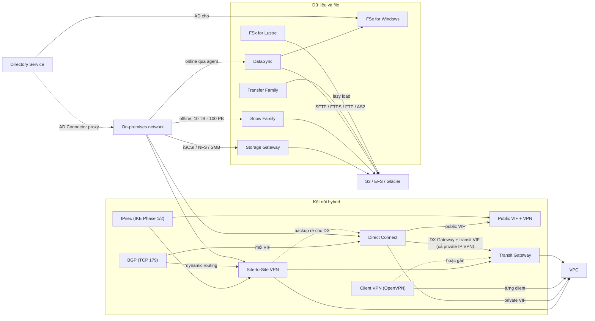

# 17 Hybrid and Migration

Section này nối AWS với thế giới bên ngoài: kết nối mạng hybrid (BGP, IPsec, Site-to-Site VPN, Client VPN, Direct Connect, Transit Gateway) và các cách đưa dữ liệu, file, identity từ on-premises lên AWS (Storage Gateway, Snow Family, DataSync, Transfer Family, FSx, Directory Service). Nó tiếp nối trực tiếp phần mạng VPC nâng cao và là nơi ra nhiều câu "chọn dịch vụ theo từ khóa" nhất trong đề SAA-C03.

← [[00 Home]] · Trước: [[_MOC 16 Advanced VPC Networking]] · Sau: [[_MOC 18 Security Deployment and Operations]]

## Lộ trình học
1. [[BGP]] — routing protocol giữa các Autonomous System; nền cho Direct Connect và dynamic VPN, chỉ cần hiểu ở mức kiến trúc.
2. [[IPSec VPN]] — bộ giao thức dựng tunnel có authentication + encryption qua mạng không tin cậy, gồm IKE Phase 1 và Phase 2.
3. [[Site-to-Site VPN]] — kết nối IPsec logic VPC ↔ on-prem qua Internet: dựng dưới 1 giờ, ~1.25 Gbps/connection (hơn thì DX hoặc VPN trên TGW), full HA cần 2 CGW.
4. [[Client VPN]] — managed OpenVPN cho từng client vào VPC (hoặc TGW); mặc định mọi traffic qua VPN, muốn khác thì bật split tunnel.
5. [[Direct Connect]] — kết nối vật lý riêng qua DX location (port tới 400 Gbps): băng thông cao, latency ổn định, nhưng provision hàng tuần–tháng, không mã hóa.
6. [[Direct Connect Resilience]] — DX mặc định không resilient; HA cần nhiều port, nhiều DX location (high resiliency 99.9%, maximum 99.99%), hoặc VPN backup.
7. [[Direct Connect Public VIF and VPN]] — IPsec VPN trên DX để mã hóa end-to-end: qua public VIF, hoặc private IP VPN qua transit VIF + DX Gateway + TGW.
8. [[Transit Gateway]] — hub transit nối nhiều VPC và on-prem, hỗ trợ transitive routing, thay full mesh peering/VPN.
9. [[Storage Gateway]] — appliance on-prem trình bày iSCSI/NFS/SMB và lưu vào S3/EBS snapshot/Glacier; mode Volume, Tape, File.
10. [[Snow Family]] — thiết bị vật lý (Snowball, Snowball Edge, Snowmobile) chuyển dữ liệu cực lớn vào/ra AWS offline.
11. [[Directory Service]] — directory managed trong VPC: AWS Managed Microsoft AD (mặc định, có Hybrid Edition), AD Connector; Simple AD đã đóng với khách hàng mới.
12. [[DataSync]] — chuyển dữ liệu online, hai chiều, có schedule, throttling, kiểm tra toàn vẹn, giữa NAS/SAN (hoặc cloud khác) và S3/EFS/FSx.
13. [[FSx for Windows]] — file share Windows native, managed, SMB + Active Directory; đối trọng của EFS cho Linux.
14. [[FSx for Lustre]] — file system song song cho HPC/ML trên Linux, POSIX, có thể lazy load từ S3; SSD chỉ một AZ, Intelligent-Tiering nhiều AZ.
15. [[Transfer Family]] — managed SFTP/FTPS/FTP/AS2 đặt trước S3 hoặc EFS cho người dùng/đối tác bên ngoài.
16. [[Compare - VPN vs Direct Connect]] — so sánh tốc độ dựng, băng thông, latency, mã hóa, chi phí và các pattern kết hợp.

## Bản đồ khái niệm

## Liên kết sang section khác
- [[VPC Routing and Internet Gateway]] — route propagation của VGW đưa route BGP vào route table.
- [[VPC Peering]] — không transitive, lý do cần Transit Gateway.
- [[Interface VPC Endpoints]] — truy cập private dịch vụ AWS từ on-prem qua VPN/DX.
- [[EFS]] — file system Linux/NFS, đối chiếu với FSx for Windows và FSx for Lustre.
- [[AWS Backup]] — backup tập trung, hỗ trợ Volume Gateway.
- [[DMS]] — migrate database, phân biệt với DataSync (file).
- [[S3 Storage Classes]] — đích lưu trữ của Storage Gateway, Snow, DataSync (Glacier/Deep Archive cho tape).
- [[KMS]] — mã hóa dữ liệu trên thiết bị Snow.
- [[SageMaker]] — workload ML hay ghép với FSx for Lustre.
- [[Cognito]] — identity cho người dùng ứng dụng, đừng nhầm với Directory Service.

## 🎯 Top mẹo thi của section
- "Nhanh nhất / trong vài giờ / rẻ / mã hóa qua Internet" → **Site-to-Site VPN**; "> 1.25 Gbps / latency thấp và ổn định / không qua Internet" → **Direct Connect**; VPN cần > 1.25 Gbps → VPN trên **Transit Gateway** ([[Compare - VPN vs Direct Connect]]).
- Nhân viên từ xa, **từng laptop** vào VPC → **Client VPN**; mặc định mọi traffic qua VPN, cần Internet/LAN đi đường thường → **split tunnel** ([[Client VPN]]).
- DX provision mất **hàng tuần–tháng**: cần ngay thì dùng VPN trước, thêm DX sau ([[Direct Connect]]).
- DX **không mã hóa** → "encrypt over DX" = **IPsec VPN over public VIF**, không phải private VIF; chỉ được dùng **IP private** → **private IP VPN: transit VIF + DX Gateway + TGW** ([[Direct Connect Public VIF and VPN]]).
- DX **không resilient mặc định**: HA tối đa = nhiều DX ở **nhiều DX location** (maximum resiliency, SLA 99.99%); HA tiết kiệm = **DX + VPN backup** ([[Direct Connect Resilience]]).
- Một VPN connection có 2 tunnel nhưng chỉ **partial HA** với 1 CGW; full HA cần **2 CGW + 2 VPN connection** ([[Site-to-Site VPN]]).
- **Dynamic VPN = BGP**; router không hỗ trợ BGP chỉ dùng được static VPN ([[BGP]]).
- "Nhiều VPC + on-prem, đơn giản hóa, transitive routing" → **Transit Gateway**; chia sẻ cross-account bằng **AWS RAM** ([[Transit Gateway]]).
- Storage Gateway chọn mode theo từ khóa: volume → Volume, tape/VTL → Tape, file/NFS/SMB → File; hết chỗ on-prem → **Volume cached**, không phải stored ([[Storage Gateway]]).
- Snowball **10 TB–10 PB**, nhiều thiết bị/nhiều site; Snowmobile **một site ≥ 10 PB**; cần compute tại chỗ → **Snowball Edge** ([[Snow Family]]).
- Chuyển **online**, có lịch, throttling, kiểm tra toàn vẹn, NFS/SMB → S3/EFS/FSx → **DataSync** (~10 Gbps/task; AWS ↔ AWS không cần agent); DB → DMS ([[DataSync]]).
- Đối tác cần upload qua **SFTP/FTPS/FTP/AS2** vào S3/EFS → **Transfer Family**; public endpoint chỉ hỗ trợ SFTP ([[Transfer Family]]).
- Windows / SMB / AD / VSS / DFS → **FSx for Windows**; Linux / NFS → EFS; FSx chỉ dùng Managed Microsoft AD hoặc AD tự quản, **không** Simple AD / AD Connector ([[FSx for Windows]]).
- HPC / ML / POSIX / throughput rất cao, dữ liệu trong S3 → **FSx for Lustre**; storage class **SSD chỉ một AZ** (kể cả Persistent), **Intelligent-Tiering** nhiều AZ nhưng không gắn S3 repository ([[FSx for Lustre]]).
- Directory: mặc định **AWS Managed Microsoft AD** (AD thật, trust với on-prem); giữ **một domain** on-prem mở rộng vào AWS → **Hybrid Edition**; không lưu gì trên cloud, chỉ proxy → **AD Connector**; **Simple AD đã đóng** với khách hàng mới ([[Directory Service]]).
