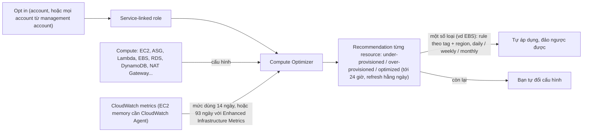

# AWS Compute Optimizer

> **TL;DR:** AWS Compute Optimizer so **cấu hình** của resource compute với **mức sử dụng thật** (metric CloudWatch) rồi đưa **recommendation cho từng resource**: **under-provisioned** (có thể gây vấn đề hiệu năng), **over-provisioned** (thừa capacity, tốn tiền) hay **optimized**. Phần lõi **miễn phí**, phân tích **14 ngày** gần nhất, refresh hằng ngày; bản trả phí **Enhanced Infrastructure Metrics** nâng lên **93 ngày** cho EC2, Auto Scaling Group và RDS. Phải **opt in** ở mức account (hoặc cho mọi account từ management account của Organization). Một số recommendation (ví dụ EBS volume) **tự áp dụng** được theo lịch và **đảo ngược** được. Khác [[AWS Trusted Advisor|Trusted Advisor]] (chỉ báo chung chung "instance underutilized") và Cost Explorer (góc nhìn tiết kiệm, RI / Savings Plans).

## 🖼️ Sơ đồ
![[AWS Compute Optimizer.excalidraw]]
*Mở bằng plugin Excalidraw để chỉnh sửa · ảnh tĩnh: [[AWS Compute Optimizer.svg]]*

## Khái niệm cốt lõi
- Mục tiêu: **tối ưu cấu hình compute** trong account, xét **cách resource được provision** so với **thực tế sử dụng**, để **tránh vấn đề hiệu năng** hoặc **giảm chi phí**.
- **Miễn phí** phần lõi: phân tích **14 ngày** hiệu năng gần nhất, recommendation **refresh hằng ngày**.
- **Enhanced Infrastructure Metrics** (trả phí): tăng cửa sổ phân tích từ **14 lên 93 ngày** cho recommendation của **EC2, Auto Scaling Group và RDS**.
  - Ví dụ của bài: EC2 chạy báo cáo cuối tháng. Chỉ nhìn 14 ngày thì giữa tháng instance rất rảnh, Compute Optimizer gợi ý downsize; tới cuối tháng instance lại quá nhỏ. Cửa sổ dài hơn tránh được chuyện này.
- **Opt in** ở mức account qua console, CLI hoặc API. Khi opt in, một **service-linked role** được tạo tự động với quyền đọc cấu hình và đưa recommendation.
  - Dùng **[[AWS Organizations]]**: bật cho **mọi account** từ **management account**, có **một dashboard** cho mọi account và mọi region.
- Phạm vi: danh sách dịch vụ lớn và ngày càng dài, từ **EC2** và **[[Lambda]]** tới **DynamoDB**, **NAT Gateway**...
- Dựa vào **metric do [[CloudWatch Basics|CloudWatch]] thu thập** để biết mức dùng thật.
- Kết luận cho mỗi resource:
  - **Under-provisioned**: thiếu tài nguyên, có thể gây vấn đề hiệu năng.
  - **Over-provisioned**: cấu hình nhiều capacity hơn mức dùng.
  - **Optimized** ("vừa khít", kiểu Goldilocks): không cần đổi.

### Áp dụng recommendation
- Với một số loại, ví dụ **EBS volume**, Compute Optimizer **tự áp dụng thay đổi**: làm tay hoặc **tự động theo lịch**. Việc này cũng cần service-linked role có quyền phù hợp.
- Các loại còn lại: Compute Optimizer chỉ đưa recommendation, **bạn tự đổi cấu hình**.
- **Rule tự động áp dụng**: lọc theo **tag** và **region** (chỉ tự sửa resource gắn tag nhất định), lịch **daily, weekly hoặc monthly**.
- Thay đổi tự động **không bị khóa cứng**: **đảo ngược được** ngay trong console Compute Optimizer nếu không như ý.

### Lưu ý
- **EC2 cần [[CloudWatch Agent]]** để báo **memory utilization**. Không có agent thì Compute Optimizer vẫn chạy cho EC2, nhưng recommendation **không thấy mức dùng memory**, nên kém chính xác hơn.
- Finding có thể mất **tới 24 giờ** mới hiện ra.

## Cách hoạt động / Kiến trúc

## Bảng so sánh / số liệu
| Thông số | Giá trị |
|---|---|
| Giá phần lõi | Miễn phí |
| Cửa sổ phân tích | 14 ngày (miễn phí); 93 ngày với Enhanced Infrastructure Metrics (trả phí) cho EC2, ASG, RDS |
| Refresh | Hằng ngày; finding mới có thể mất tới 24 giờ |
| Kích hoạt | Opt in theo account (console / CLI / API), hoặc mọi account từ management account |
| Tự áp dụng | Một số loại (vd EBS); rule theo tag + region; daily / weekly / monthly; đảo ngược được |

| Công cụ | Góc nhìn |
|---|---|
| **Compute Optimizer** | Recommendation **từng resource**, so cấu hình với mức dùng thật, tự áp dụng được |
| [[AWS Trusted Advisor]] | Check best practice tổng quát; về utilization chỉ báo chung (vd instance underutilized), **không nói đổi sang type nào**, **không tự áp dụng** |
| Cost Explorer ([[AWS Cost Management]]) | Báo phần **tiết kiệm chi phí** trong các recommendation này, thêm **ngữ cảnh billing**; nghiêng về câu hỏi nên mua **Reserved Instances** hay **Savings Plans** |

## 🎯 Mẹo thi SAA-C03
- **Rightsizing** dựa trên mức dùng thật, gợi ý **instance type / size cụ thể** cho EC2, ASG, Lambda, EBS... → **Compute Optimizer**.
- Workload có chu kỳ dài (cuối tháng) → cần **Enhanced Infrastructure Metrics** (93 ngày) để không bị gợi ý downsize sai.
- Muốn recommendation EC2 tính cả **memory** → cài **CloudWatch Agent**.
- Nhiều account → bật từ **management account** của Organization, một dashboard chung.
- Trusted Advisor chỉ báo "underutilized" chung chung; Cost Explorer thiên về RI / Savings Plans và billing.

## Liên kết
- Tiên quyết: [[CloudWatch Basics]], [[EC2 Instance Types]]
- Liên quan: [[CloudWatch Agent]], [[Auto Scaling Groups]], [[EBS Volume Types]], [[Lambda]], [[Reserved Instances and Savings Plans]], [[AWS Organizations]], [[Service-linked Roles and PassRole]]
- Phân biệt với: [[AWS Trusted Advisor]], [[AWS Cost Management]]
- MOC: [[_MOC 18 Security Deployment and Operations]]
