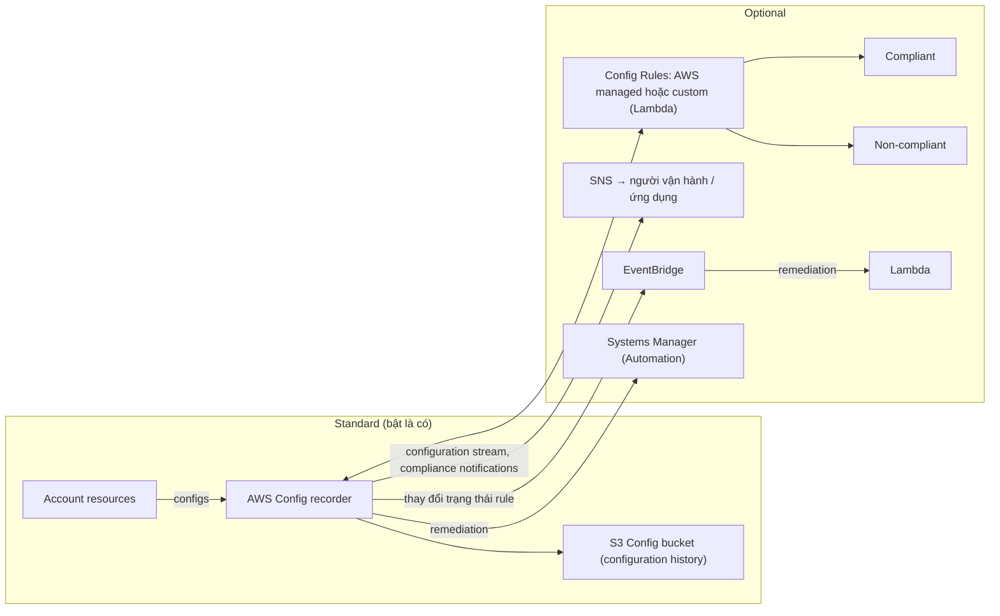

# AWS Config

> **TL;DR:** AWS Config **ghi lại lịch sử thay đổi cấu hình** của resource trong account (mỗi thay đổi tạo một **configuration item**) và **đánh giá compliance** bằng **Config Rules**. Nó **không ngăn chặn** thay đổi; nó phát hiện, ghi nhận và có thể kích hoạt **remediation tự động** qua EventBridge/Lambda hoặc SSM.

## 🖼️ Sơ đồ
![[AWS Config.excalidraw]]
*Mở bằng plugin Excalidraw để chỉnh sửa · ảnh tĩnh: [[AWS Config.svg]]*

## Khái niệm cốt lõi
- Hai nhiệm vụ chính:
  1. **Ghi lại thay đổi theo thời gian** của resource (chức năng chính, chuẩn).
  2. **Kiểm tra compliance** theo tiêu chuẩn tổ chức đặt ra (tùy chọn, qua Config Rules).
- Khi bật, cấu hình mọi resource được hỗ trợ trong account được theo dõi liên tục. Mỗi thay đổi tạo **Configuration Item (CI)** lưu:
  - **Cấu hình** của resource tại một thời điểm.
  - **Relationship** với resource khác.
  - **Ai** thực hiện thay đổi.
- Tập hợp mọi CI của một resource gọi là **configuration history**, lưu trong **S3 config bucket** theo định dạng thống nhất. Truy cập trực tiếp từ bucket hoặc qua **AWS Config API**.
- Ví dụ: thêm rule vào [[Security Groups|Security Group]] đang gắn vào EC2 → Config lưu trạng thái trước, trạng thái sau, việc ai đã đổi và việc SG đó gắn với instance nào.
- **Không phải sản phẩm phân quyền hay bảo vệ**: không chặn thay đổi. Ví dụ quy định chỉ cho phép một số port trong SG; nếu ai đó mở thêm port, Config **không ngăn** nhưng sẽ **đánh dấu non-compliant**.
- **Regional service**: theo dõi trong một region của một account; có thể cấu hình **aggregation cross-region và cross-account**.
- Gửi **notification qua [[SNS]]** và **event qua [[EventBridge]]** (→ [[Lambda]]) khi trạng thái compliance thay đổi → dùng cho **automatic remediation**.

## Cách hoạt động / Kiến trúc

- **Phần standard**: bật Config = bật **recorder**, ghi cấu hình resource vào config bucket. Chỉ cần thế đã đủ để xem lại mọi thay đổi theo thời gian.
- **Phần optional (sức mạnh thật)**: **Config Rules**
  - **AWS managed rules** hoặc **custom rules dùng [[Lambda]]** (Lambda tự đánh giá theo logic bạn code rồi trả kết quả về Config).
  - Resource được đánh giá là **compliant** hoặc **non-compliant**.
- **Remediation**:
  - [[SNS]]: stream thay đổi hoặc thông báo compliance tới người/ứng dụng.
  - [[EventBridge]]: mỗi khi rule đổi trạng thái compliant/non-compliant → event → gọi Lambda sửa tự động. (Về bản chất đây là EventBridge chuyển event của Config tới target, không hẳn là tính năng của Config.)
  - **Systems Manager (SSM)**: Config tích hợp với SSM để áp dụng bản sửa. **Lambda linh hoạt hơn cho việc cấp account**; **SSM hiệu quả cho cấu hình bên trong instance**.

## Bảng so sánh: Config vs dịch vụ dễ nhầm

| Dịch vụ | Trả lời câu hỏi | Ngăn chặn? |
|---|---|---|
| **AWS Config** | Resource **đã được cấu hình thế nào** theo thời gian, có **compliant** không | Không (chỉ phát hiện + remediation sau đó) |
| [[CloudTrail]] | **Ai gọi API gì**, khi nào | Không |
| [[Service Control Policies]] / IAM | Ai **được phép** làm gì | **Có** (chặn trước) |
| [[GuardDuty]] | Có **hoạt động độc hại/bất thường** không | Không |
| [[Inspector]] | Instance/container/Lambda có **lỗ hổng** không | Không |

## 🎯 Mẹo thi SAA-C03
- Đề nói **audit thay đổi cấu hình**, **lịch sử cấu hình resource**, "cấu hình SG trông thế nào vào tuần trước", **compliance với tiêu chuẩn tổ chức** → AWS Config.
- **Bẫy**: Config **không prevent** thay đổi. Nếu đề yêu cầu **ngăn** hành động → IAM policy / [[Service Control Policies|SCP]], không phải Config.
- **Tự động khắc phục** resource non-compliant → Config Rules + EventBridge + Lambda, hoặc Config remediation bằng SSM Automation.
- Config là **regional**; dùng **aggregator** để có cái nhìn cross-region, cross-account.
- Custom rule viết bằng **Lambda**.
- Phân biệt với [[CloudTrail]]: CloudTrail ghi **API call**; Config ghi **trạng thái cấu hình** và quan hệ giữa resource.

## Liên kết
- Tiên quyết: [[CloudTrail]], [[S3 Basics]]
- Liên quan: [[EventBridge]], [[Lambda]], [[SNS]], [[Security Groups]], [[AWS Organizations]], [[AWS Control Tower]], [[Event-Driven Architecture]]
- Phân biệt với: [[CloudTrail]], [[GuardDuty]], [[Inspector]], [[Service Control Policies]]
