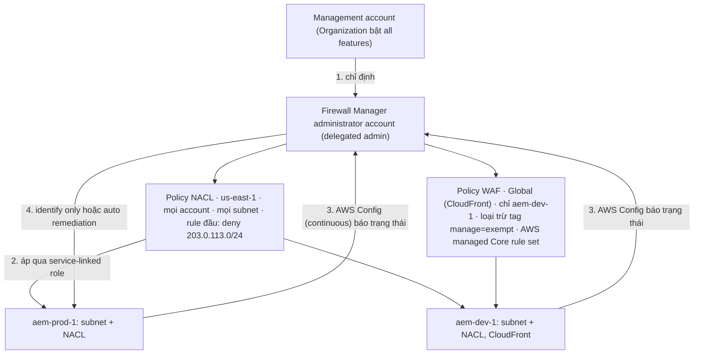

# AWS Firewall Manager

> **TL;DR:** AWS Firewall Manager **không phải firewall**: nó **quản lý tập trung** các dịch vụ firewall của AWS **trên nhiều account và region trong một AWS Organization**. Bạn định nghĩa cấu hình **một lần** trong **Firewall Manager administrator account**, Firewall Manager kiểm tra resource ở member account có đúng cấu hình không và (tùy chọn) **tự khắc phục**. Quản lý được **WAF web ACL, Network Firewall, Security Group, NACL, Shield Advanced protection, Route 53 Resolver DNS Firewall** và firewall bên thứ ba từ Marketplace. Điều kiện: Organization bật **all features**, và mọi member account bật **AWS Config recording liên tục** ở mọi region có policy.

## 🖼️ Sơ đồ
![[AWS Firewall Manager.excalidraw]]
*Mở bằng plugin Excalidraw để chỉnh sửa · ảnh tĩnh: [[AWS Firewall Manager.svg]]*

## Khái niệm cốt lõi
- **Quản lý firewall** tập trung **xuyên account và region trong một Organization**. Bản thân nó không lọc traffic.
- Định nghĩa cấu hình mong muốn **một lần**; Firewall Manager giúp **xác định** resource nào khớp hay không khớp, và **tùy chọn tự remediate** resource non-compliant.
- **Dịch vụ quản lý được**:
  - **[[WAF]] web ACL**;
  - **[[AWS Network Firewall]]**;
  - **[[Security Groups]]** và **[[NACL|network ACL]]** của VPC;
  - **[[Shield]] Advanced** protection;
  - **Route 53 Resolver DNS Firewall**;
  - firewall **bên thứ ba từ AWS Marketplace**.
- Riêng **Security Group** có ba loại policy:
  - **Common**: đẩy một bộ rule chính xác xuống.
  - **Content audit**: đánh dấu hoặc gỡ rule nằm ngoài phạm vi cho phép.
  - **Usage audit**: dọn Security Group không dùng hoặc thừa.

### Điều kiện và thiết lập
- Cần **[[AWS Organizations]]** bật **all features** (chỉ consolidated billing thì không đủ).
- Từ **management account**, chỉ định một account làm **Firewall Manager administrator account**. Đây chỉ là một setting; phía sau, account đó thành **delegated administrator** của organization cho Firewall Manager.
- **Policy luôn tạo trong administrator account**, không bao giờ trong member account. Có thể thêm administrator account khác, mỗi cái giới hạn theo account, region hoặc loại policy.
- Firewall Manager dùng **service-linked role** để thao tác trong member account; bạn không cần đăng nhập vào member account.
- **AWS Config recording** phải bật ở **mỗi member account, ở mọi region mà policy áp dụng**, và phải là **continuous recording**, không phải daily. **[[AWS Config]] theo dõi resource và báo trạng thái**; **Firewall Manager quyết định và sửa**.

### Firewall Manager policy
- **Policy type**: loại resource quản lý (NACL, WAF, Security Group...).
- **Region**: policy là **regional**; muốn phủ region khác thì tạo policy khác ở region đó. Ngoại lệ: **WAF cho CloudFront** là policy **global** (WAF cho ALB thì vẫn là policy regional).
- **Scope**: account nào (mọi account, OU, hoặc account cụ thể) và resource nào; hỗ trợ **tag exclusion** (ví dụ bỏ qua resource có tag `manage = exempt`).
- **Rules**:
  - **NACL**: rule viết thẳng trong policy; Firewall Manager **chỉ sở hữu rule đầu và rule cuối** của mỗi NACL, chủ account vẫn quản lý các rule ở giữa.
  - **WAF, Network Firewall, DNS Firewall, Security Group**: policy **tham chiếu object có sẵn**, ví dụ rule group (AWS managed hoặc tự tạo trong administrator account).
- **Action**:
  - **Identify only** (mặc định, AWS khuyên bắt đầu bằng cái này): chỉ đánh dấu compliant / non-compliant.
  - **Automatic remediation**: Firewall Manager tự sửa cấu hình qua service-linked role. Config chỉ báo cáo; **Firewall Manager mới là bên sửa**.
- Account **mới gia nhập** organization nằm trong scope cũng tự nhận policy.

## Cách hoạt động / Kiến trúc
Ví dụ của bài (organization của Aus-E-Mart, hai member account `aem-prod-1` và `aem-dev-1`):

- Policy NACL phủ **mọi subnet ở cả hai account** (và account mới vào sau).
- Policy WAF chỉ phủ **một CloudFront distribution** của `aem-dev-1`: distribution còn lại có tag `manage = exempt` nên bị loại.

## Bảng so sánh / số liệu
| Loại policy | Region | Rule nằm ở đâu |
|---|---|---|
| NACL | Regional | Viết trong policy; Firewall Manager giữ rule đầu và rule cuối |
| Security Group | Regional | Tham chiếu object có sẵn; 3 kiểu: common, content audit, usage audit |
| WAF cho ALB | Regional | Tham chiếu rule group |
| WAF cho CloudFront | **Global** | Tham chiếu rule group (vd AWS managed Core rule set) |
| Network Firewall, DNS Firewall | (bài không nói riêng) | Tham chiếu object có sẵn |

| Thành phần | Vai trò |
|---|---|
| AWS Organizations (all features) | Bắt buộc |
| Firewall Manager administrator account | Nơi tạo mọi policy (delegated admin) |
| Service-linked role | Thao tác trong member account |
| AWS Config (continuous, mọi region có policy) | Theo dõi và báo trạng thái resource |

## 🎯 Mẹo thi SAA-C03
- Quản lý **WAF / Security Group / NACL / Network Firewall / Shield Advanced** **tập trung cho nhiều account trong Organization**, account mới tự được áp → **AWS Firewall Manager**.
- Điều kiện: **Organizations all features** + **AWS Config bật (continuous) ở mọi member account và region**.
- Firewall Manager **không phải firewall**; WAF, Network Firewall, SG, NACL mới lọc traffic.
- Shield Advanced có thể bật protection qua **Firewall Manager policy** (xem [[Shield]]).
- Policy **regional**; riêng WAF cho CloudFront là **global**.
- Mặc định **identify only**; bật **auto remediation** thì Firewall Manager tự sửa (Config chỉ báo).

## Liên kết
- Tiên quyết: [[AWS Organizations]], [[AWS Config]], [[WAF]], [[Security Groups]], [[NACL]]
- Liên quan: [[AWS Network Firewall]], [[Shield]], [[Service-linked Roles and PassRole]], [[CloudFront Architecture]], [[AWS Security Hub]]
- Phân biệt với: [[WAF]], [[AWS Network Firewall]], [[Service Control Policies]]
- MOC: [[_MOC 18 Security Deployment and Operations]]
