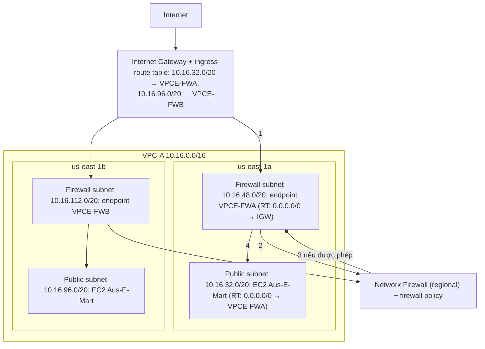
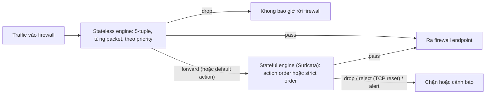

# AWS Network Firewall

> **TL;DR:** AWS Network Firewall là firewall **managed, regional** đặt **trên đường đi của traffic vào / ra VPC**, mạnh hơn nhiều so với [[NACL]] và [[Security Groups]]. Bạn tạo **firewall subnet** riêng ở mỗi AZ chứa **firewall endpoint** (một VPC endpoint), rồi sửa **route table** (cả **ingress route table** gắn vào Internet Gateway) để traffic đi vòng qua endpoint. Cấu hình lọc nằm trong **firewall policy** (một firewall có đúng một policy, một policy dùng cho nhiều firewall) gồm **rule group stateless** (5-tuple, xử lý từng packet, pass / drop / forward) và **stateful** (chuẩn mở **Suricata**, pass / drop / reject / alert, **domain list** theo HTTP header hoặc SNI, rule **IPS**). Không inspect được traffic VPC peering, Global Accelerator, hay DNS do Amazon cung cấp cho EC2.

## 🖼️ Sơ đồ
![[AWS Network Firewall.excalidraw]]
*Mở bằng plugin Excalidraw để chỉnh sửa · ảnh tĩnh: [[AWS Network Firewall.svg]]*

## Khái niệm cốt lõi
- Hoàn thiện bộ sản phẩm bảo mật mạng của AWS, nhiều tính năng hơn NACL và Security Group.
- **Regional**. Thành phần nằm trong AZ là **firewall endpoint**: một **VPC endpoint** chạy trong một subnet cụ thể. Muốn HA thì đặt **một endpoint mỗi AZ** đang dùng.
- **Firewall subnet**: subnet riêng chỉ chứa firewall endpoint.
  - Cần subnet riêng vì **một subnet chỉ có một default route**; phải tách để chuyển hướng traffic qua firewall mà các subnet khác vẫn chạy bình thường.
  - Endpoint **không lọc được traffic vào / ra chính subnet chứa nó**, nên **không đặt gì khác** trong firewall subnet.
- **Giới hạn**: firewall **không inspect** được traffic **[[VPC Peering]]**, traffic **[[Global Accelerator]]**, và **DNS do Amazon cung cấp** cho EC2 instance.
- Triển khai thực tế có thể phức tạp hơn: có [[NAT Gateway]], nhiều VPC dùng **VPC endpoint association** để đặt endpoint ở VPC khác, hoặc gắn firewall thẳng vào **[[Transit Gateway]]**.

### Routing (ví dụ của bài: VPC-A 10.16.0.0/16, us-east-1a và 1b)
- Bình thường public subnet có default route tới Internet Gateway và IGW đưa traffic thẳng vào subnet; chỉ lọc được bằng NACL / SG.
- **Inbound**: gắn **ingress route table** vào **Internet Gateway**: `10.16.32.0/20 → VPCE-FWA`, `10.16.96.0/20 → VPCE-FWB`. Traffic tới instance Aus-E-Mart bị đẩy qua firewall endpoint cùng AZ → firewall xử lý → nếu được phép thì quay lại endpoint ("sạch") → route table của firewall subnet đưa tới instance.
- **Outbound** (ngược lại): route table của public subnet có `local` cho CIDR của VPC và **default route `0.0.0.0/0` → firewall endpoint cùng AZ** → firewall → endpoint → route table của firewall subnet `0.0.0.0/0 → IGW` → Internet.
- Hai firewall subnet có cùng route thì dùng chung một route table cũng được.

### Thành phần
- **Firewall**: tên, mô tả, **VPC** được bảo vệ, **subnet** đặt endpoint, **firewall policy**, logging, tag.
- **Firewall policy**: đơn vị cấu hình, nơi định nghĩa hành vi lọc. **Một firewall có đúng một policy**; **một policy dùng được cho nhiều firewall**. Policy chọn rule group stateless và stateful nào được dùng, thứ tự xử lý và default action.
- **Rule group**: chứa rule; rule do **bạn tạo**, **AWS managed**, hoặc từ **AWS Marketplace**.
  - Khai báo **type** (stateless hoặc stateful, quyết định engine nào chạy) và **capacity** (giới hạn xử lý cho mọi rule trong group).
  - **Không đổi được type hay capacity** sau khi tạo.

### Stateless engine ("củ khoai tây", không thông minh)
- Xét **từng packet riêng lẻ**, không biết packet là request hay response; khớp theo **5-tuple**: protocol, source / destination IP (CIDR range), source / destination port.
- Giống [[NACL]]: request và response là hai luồng khác nhau, inbound và outbound tách riêng → một instance có thể cần **bốn bộ rule** (request vào / ra, response vào / ra). Nhiều admin overhead hơn stateful.
- Action: **pass, drop, forward** (chuyển sang stateful engine), cộng **custom action** tùy chọn.
- Rule xử lý **theo thứ tự**, gặp khớp là dừng; mặc định theo **priority**, **số nhỏ nhất ưu tiên cao nhất**.
- **Default action** cho traffic không khớp rule: pass, drop hoặc forward. Firewall đơn giản có thể chỉ dùng stateless: pass thì đi tiếp ra endpoint, **drop thì không bao giờ rời firewall**.

### Stateful engine
- Dùng chuẩn mở **Suricata**. Action: **pass**, **drop**, **reject** (drop và gửi **TCP reset** để client **fail fast**, chỉ cho TCP), **alert**.
- Thứ tự đánh giá, chọn khi tạo policy và **không đổi được về sau**:
  - **Action order** (mặc định): pass → drop → reject → alert; traffic không khớp rule nào **được pass**.
  - **Strict order** (**AWS khuyên dùng**): bạn tự đặt trình tự, tự chọn một hoặc nhiều default action cho traffic không khớp.
- Định dạng rule:
  - **Suricata format**: dùng được cho mọi loại rule; **rule IPS bắt buộc** dùng định dạng tương thích Suricata.
  - **Simple rule**: 5-tuple **có state awareness**, giống cách [[Security Groups]] hoạt động.
  - **Domain list**: danh sách domain tốt / xấu (có wildcard) theo protocol, dựa vào **HTTP header** hoặc **SNI** của HTTPS. Ví dụ: chỉ cho instance gọi tới server cập nhật phần mềm và dịch vụ AWS, chặn phần còn lại.

## Cách hoạt động / Kiến trúc

## Bảng so sánh / số liệu
| | Stateless rule group | Stateful rule group |
|---|---|---|
| Cách xét | Từng packet, không biết request / response | Có state (chuẩn Suricata) |
| Khớp theo | 5-tuple | Suricata rule, simple rule (5-tuple có state), domain list (HTTP header / SNI), IPS rule |
| Action | Pass, drop, forward (+ custom action) | Pass, drop, reject (TCP reset, chỉ TCP), alert |
| Thứ tự | Priority, số nhỏ nhất trước; khớp là dừng | Action order (mặc định: pass → drop → reject → alert, không khớp thì pass) hoặc strict order (AWS khuyên); cố định khi tạo policy |
| Giống | [[NACL]] | [[Security Groups]] (simple rule) |

| | NACL | Security Group | **Network Firewall** |
|---|---|---|---|
| Vị trí | Subnet | ENI | Firewall endpoint trong firewall subnet, chuyển hướng bằng route table |
| State | Stateless | Stateful | Cả hai engine |
| Lọc domain / IPS | Không | Không | **Có** (domain list, Suricata IPS) |

## 🎯 Mẹo thi SAA-C03
- Cần lọc traffic vào / ra VPC **mạnh hơn NACL / SG**: **lọc theo domain** (có wildcard), **IPS / Suricata**, kiểm tra stateful có quản lý → **AWS Network Firewall**.
- Kiến trúc: **firewall subnet riêng mỗi AZ** + **ingress route table trên IGW** trỏ tới endpoint; public subnet default route trỏ tới **endpoint cùng AZ**.
- Firewall endpoint **không lọc traffic của chính subnet chứa nó**.
- Không inspect: **VPC peering**, **Global Accelerator**, **Amazon-provided DNS** của EC2.
- **Một firewall ↔ một policy**, một policy ↔ nhiều firewall; type và capacity của rule group **không đổi được**; thứ tự stateful (action / strict) **cố định khi tạo policy**.
- Quản lý Network Firewall cho nhiều account trong Organization → [[AWS Firewall Manager]]. Lọc HTTP Layer 7 (SQLi, XSS) cho CloudFront / ALB → [[WAF]].

## Liên kết
- Tiên quyết: [[VPC Routing and Internet Gateway]], [[VPC Subnets]], [[Stateful vs Stateless Firewalls]], [[NACL]], [[Security Groups]]
- Liên quan: [[AWS Firewall Manager]], [[Gateway Load Balancer]], [[Transit Gateway]], [[NAT Gateway]], [[Interface VPC Endpoints]], [[Layer 7 Firewall]], [[SSL and TLS]]
- Phân biệt với: [[WAF]], [[Compare - Security Groups vs NACL]], [[Gateway Load Balancer]]
- MOC: [[_MOC 18 Security Deployment and Operations]]
