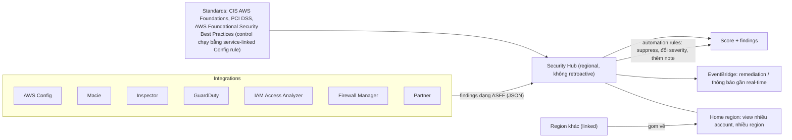

# AWS Security Hub

> **TL;DR:** **AWS Security Hub CSPM** (cloud security posture management) là khả năng của AWS Security Hub **kiểm tra môi trường so với chuẩn bảo mật**: **CIS AWS Foundations, PCI DSS, AWS Foundational Security Best Practices**, cho ra **score** và **findings**. Security Hub là **điểm gom** (consolidation point) cho các dịch vụ bảo mật khác (Config, Macie, Inspector, GuardDuty, IAM Access Analyzer, Firewall Manager, cả partner): một chỗ duy nhất để quản lý và khắc phục, dữ liệu theo chuẩn JSON **ASFF**. Dịch vụ **regional**, **không retroactive**, phần lớn control chạy bằng **service-linked AWS Config rule** (phải bật Config recording). Có kiến trúc **administrator + member** riêng và **home region** để gom nhiều account, nhiều region.

## 🖼️ Sơ đồ
![[AWS Security Hub.excalidraw]]
*Mở bằng plugin Excalidraw để chỉnh sửa · ảnh tĩnh: [[AWS Security Hub.svg]]*

## Khái niệm cốt lõi
- **Security Hub CSPM** = **cloud security posture management**, một trong các khả năng của **AWS Security Hub**: phần **so môi trường với security standard**. Mọi kỳ thi AWS đều cần biết tới nó.
- **Consolidation point**: thay vì làm việc với từng dịch vụ bảo mật, chúng **cắm vào Security Hub**; thông tin được gom lại, xem ở **một nơi** cho mọi việc quản lý và khắc phục bảo mật.
- **Regional**: muốn compliance đầy đủ thì **bật ở mọi region** để bắt sự kiện của mọi dịch vụ ở mọi region.
- Truy cập qua **console** hoặc **Security Hub API** (tích hợp vào hệ thống sẵn có).
- **Không retroactive**: chỉ hoạt động **từ lúc bật**; sự kiện bảo mật có từ trước **không** được ghi nhận.
- **Standards**: so account với **CIS AWS Foundations Benchmark**, **PCI DSS**, **AWS Foundational Security Best Practices** → **score** và **findings** cần xử lý.
- **Remediation tự động** qua **[[EventBridge]]**: khắc phục hoặc thông báo gần real-time.
- **Automation rules** có sẵn: dựa trên tiêu chí bạn đặt, **suppress** finding, **đổi severity** hoặc **thêm note**.
- **Phần lớn control chạy bằng service-linked [[AWS Config]] rule**: phải **bật AWS Config, có resource recording**, ở **mọi account và mọi region** bật CSPM.

### Multi-account, multi-region
- Security Hub có kiến trúc **administrator + member account riêng**, **khác** management / member account của AWS Organizations.
- Một account thành **Security Hub administrator** theo một trong hai cách:
  1. **Mời** account khác; account chấp nhận thành **member**, account mời thành **administrator**.
  2. **Management account của [[AWS Organizations]] chỉ định** một account làm Security Hub administrator. Account này **bật bất kỳ account nào trong organization** làm member, và vẫn **mời** được account ngoài organization.
- **Home region**: mỗi region có dữ liệu riêng, nhưng bạn định nghĩa một **home region nhận dữ liệu từ các linked region**, có cái nhìn **gộp nhiều account, nhiều region** cho toàn bộ "security estate".

### Integrations và ASFF
- Security Hub hoạt động **nhờ integration**: gom dữ liệu từ dịch vụ AWS như **[[AWS Config]], [[Macie]], [[Inspector]], [[GuardDuty]], IAM Access Analyzer, [[AWS Firewall Manager]]** (chỉ là vài ví dụ), và từ **partner**.
- **AWS Security Finding Format (ASFF)**: chuẩn **JSON** cho mọi thứ Security Hub nhận vào hoặc sinh ra, bớt việc xử lý nhiều định dạng và cách truy cập khác nhau.

## Cách hoạt động / Kiến trúc

## Bảng so sánh / số liệu
| Đặc điểm | Security Hub |
|---|---|
| Vai trò | Gom findings + CSPM so với chuẩn |
| Standards | CIS AWS Foundations, PCI DSS, AWS Foundational Security Best Practices |
| Phạm vi | Regional; home region gom dữ liệu linked region |
| Retroactive | **Không** |
| Phụ thuộc | AWS Config bật resource recording ở mọi account và region |
| Định dạng | ASFF (JSON) |
| Multi-account | Administrator + member riêng của Security Hub (mời, hoặc chỉ định qua Organizations) |

| Dịch vụ | Làm gì |
|---|---|
| **Security Hub** | Gom và chấm điểm tư thế bảo mật theo chuẩn |
| [[GuardDuty]] | Phát hiện mối đe dọa từ log |
| [[Inspector]] | Quét lỗ hổng EC2, ECR image, Lambda |
| [[Macie]] | Dữ liệu nhạy cảm trong S3 |
| [[AWS Config]] | Lịch sử cấu hình, Config rule |
| [[Amazon Detective]] | Điều tra, lần theo sự kiện |

## 🎯 Mẹo thi SAA-C03
- Một chỗ **gom findings** của GuardDuty, Inspector, Macie, Config, Firewall Manager... và **so với CIS / PCI DSS / AWS Foundational Security Best Practices** → **Security Hub**.
- Security Hub **không retroactive** và **regional**: bật ở mọi region; dùng **home region** để gom view.
- Cần **AWS Config** (resource recording) ở mọi account và region, vì control chạy bằng service-linked Config rule.
- Administrator / member của Security Hub **khác** cấu trúc của Organizations (dù có thể chỉ định qua management account).
- Tự động phản ứng với finding → **EventBridge**; xử lý hàng loạt (suppress, đổi severity) → **automation rules**.
- **ASFF** = định dạng JSON chung của findings.

## Liên kết
- Tiên quyết: [[AWS Config]], [[GuardDuty]], [[Inspector]], [[Macie]]
- Liên quan: [[AWS Firewall Manager]], [[Amazon Detective]], [[EventBridge]], [[AWS Organizations]]
- Phân biệt với: [[GuardDuty]], [[Amazon Detective]], [[AWS Trusted Advisor]]
- MOC: [[_MOC 18 Security Deployment and Operations]]
