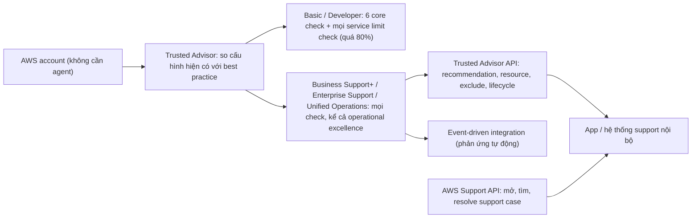

# AWS Trusted Advisor

> **TL;DR:** AWS Trusted Advisor đưa ra **hướng dẫn real-time** để bạn provision resource theo **best practice của AWS**: so cái bạn đang có với cái nên có. Dịch vụ ở **mức account**, không cần agent, kiểm tra theo **6 nhóm**: cost optimization, performance, security, fault tolerance, service limits, operational excellence. Trusted Advisor **gắn với support plan**, không mua riêng được: gói **Basic / Developer** chỉ có **6 core check + toàn bộ service limit check**; muốn **mọi check** (kể cả nhóm operational excellence), **Trusted Advisor API** và **tích hợp event-driven** thì cần gói trả phí (**Business Support+, Enterprise Support, Unified Operations**).

## 🖼️ Sơ đồ
![[AWS Trusted Advisor.excalidraw]]
*Mở bằng plugin Excalidraw để chỉnh sửa · ảnh tĩnh: [[AWS Trusted Advisor.svg]]*

## Khái niệm cốt lõi
- **Real-time guidance** theo best practice của AWS: so cấu hình hiện có với cấu hình nên có.
- **Account-level**, **không cần agent**: bật là chạy.
- **6 nhóm check**: **cost optimization**, **performance**, **security**, **fault tolerance**, **service limits**, **operational excellence**.
- **Không miễn phí trọn vẹn**: Trusted Advisor **gắn với AWS support plan** của account, **không trả tiền riêng** cho nó được (xem [[AWS Accounts]] về support plan).

### Bản miễn phí: Basic và Developer support plan
**6 core check** cộng **toàn bộ service limit check** (đề có thể hỏi những check này đi kèm gói nào):
1. **S3 bucket permissions**: bucket có quyền mở (xét bucket ACL và bucket policy), kết quả còn phụ thuộc **Block Public Access**; bucket chỉ "xanh" (OK) khi bật **đầy đủ** Block Public Access.
2. **Security groups – specific ports unrestricted**: inbound rule cho phép truy cập không giới hạn (`0.0.0.0/0`) tới resource trong VPC. Chỉ xét rule **IPv4**; rule IPv6 không giới hạn không hiện ở check này.
3. **STS global endpoint usage**: workload gọi **STS global endpoint** (ở N. Virginia) từ region khác, khiến việc lấy credential phụ thuộc một region, nên bị đánh dấu là **rủi ro resilience**.
4. **MFA on root account**: cảnh báo nếu root user chưa bật **[[MFA]]**; "xanh" khi đã bật.
5. **EBS public snapshots**: snapshot EBS đặt public. Nếu **block public access cho EBS snapshot** đặt ở mức chặn mọi chia sẻ thì snapshot không public và không hiện trong check này.
6. **RDS public snapshots**: tương tự cho snapshot RDS.
- **Service limit checks**: báo khi dùng **quá 80%** một service limit của account (xem [[Service Quotas]]).

### Gói trả phí: Business Support+, Enterprise Support, Unified Operations
- Vẫn có các check trên, cộng thêm **hàng trăm check** khác (không cần nhớ con số, AWS thêm và bỏ check liên tục). Mở **mọi nhóm check**, kể cả **operational excellence** mà bản miễn phí không có.
- **AWS Trusted Advisor API** (API riêng của Trusted Advisor):
  - lấy danh sách check, liệt kê recommendation của account và chi tiết từng cái;
  - liệt kê **resource cụ thể** mà recommendation áp vào (bucket, snapshot, Security Group...);
  - **loại trừ** resource khỏi check;
  - cập nhật **lifecycle** của recommendation để theo dõi tới khi resolved.
  - Nhờ vậy bạn tự code ứng dụng hoặc tích hợp hệ thống support nội bộ với Trusted Advisor.
- **AWS Support API** nói chung: **mở support case** bằng code, liệt kê và xem chi tiết case, tìm case theo ngày và case ID, thêm trao đổi, tệp đính kèm, người nhận email, và **resolve** case.
- **Tích hợp event-driven**: định nghĩa phản ứng tự động khi Trusted Advisor phát hiện thay đổi.
- Trên console: **xanh** = không có vấn đề, **đỏ** = nên hành động (ví dụ trong demo: 1 trong 7 bucket cho phép truy cập toàn cục).

## Cách hoạt động / Kiến trúc

Ví dụ hay gặp trong đề: **tự động kiểm tra service limit** và **tự mở support case xin tăng limit** → Trusted Advisor (check service limit) + Support API, với **support plan trả phí**.

## Bảng so sánh / số liệu
| Hạng mục | Basic / Developer | Business Support+ / Enterprise Support / Unified Operations |
|---|---|---|
| Check | 6 core check + mọi service limit check | Core + hàng trăm check, **mọi nhóm** (có operational excellence) |
| Trusted Advisor API | Không | **Có** |
| Event-driven integration | Không | **Có** |

| | Trusted Advisor | [[AWS Compute Optimizer]] |
|---|---|---|
| Phạm vi | Best practice rộng (6 nhóm) | Cấu hình compute so với mức sử dụng thật |
| Về utilization | Chỉ finding rất chung (vd instance underutilized), không nói nên đổi sang type nào | Recommendation **từng resource** (type / size cụ thể) |
| Tự động áp dụng | Không | Có (một số loại, ví dụ EBS) |

## 🎯 Mẹo thi SAA-C03
- Thấy **S3 bucket permissions, SG port mở 0.0.0.0/0, MFA on root, EBS/RDS public snapshot, STS global endpoint, service limits** → nhớ đó là check **miễn phí** (Basic / Developer).
- Cần **mọi check**, nhóm **operational excellence**, **Trusted Advisor API** hoặc **event-driven integration** → phải có **support plan trả phí** (Business Support+, Enterprise Support, Unified Operations).
- **Tự động** theo dõi service limit và **mở support case xin tăng limit** → Trusted Advisor + **AWS Support API**, cần gói trả phí.
- Trusted Advisor **không mua riêng**: gắn với support plan của account.
- Cần **khuyến nghị đổi instance type cụ thể** dựa trên mức dùng thật → [[AWS Compute Optimizer]], không phải Trusted Advisor.

## Liên kết
- Tiên quyết: [[AWS Accounts]], [[Service Quotas]]
- Liên quan: [[AWS Compute Optimizer]], [[S3 Security]], [[Security Groups]], [[MFA]], [[EBS Snapshots]], [[AWS Cost Management]], [[EventBridge]]
- Phân biệt với: [[AWS Compute Optimizer]], [[AWS Security Hub]], [[AWS Config]]
- MOC: [[_MOC 18 Security Deployment and Operations]]
