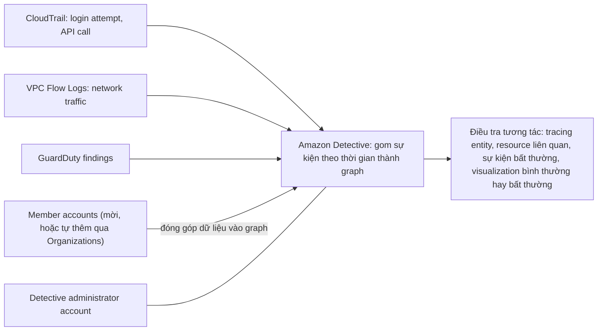

# Amazon Detective

> **TL;DR:** Amazon Detective là dịch vụ **điều tra bảo mật (security investigation)**. Nó tích hợp với dịch vụ AWS khác và gom các **sự kiện theo thời gian**: login và API call (từ **CloudTrail**), network traffic (từ **VPC Flow Logs**), **GuardDuty findings**, thành một "single pane of glass". Thay vì tự lục và nối các log rời rạc, bạn **khám phá và lần theo (tracing)** dữ liệu một cách tương tác qua một **đồ thị quan hệ** (giống nhảy giữa các bài liên quan trên Wikipedia), thấy sự kiện bất thường, resource liên quan và **visualization** cho biết điều gì là bình thường hay bất thường. Kiến trúc **administrator + member account**, hỗ trợ Organizations.

## 🖼️ Sơ đồ
![[Amazon Detective.excalidraw]]
*Mở bằng plugin Excalidraw để chỉnh sửa · ảnh tĩnh: [[Amazon Detective.svg]]*

## Khái niệm cốt lõi
- **Security investigation service**: dùng khi **điều tra hoạt động** ở một hoặc nhiều account với trọng tâm bảo mật.
- **Gom sự kiện theo thời gian (time-based events)** từ dịch vụ khác, tạo một **single pane of glass**:
  - **login attempt** và **API call**: lấy từ **[[CloudTrail]]**;
  - **network traffic** tới và từ resource: lấy từ **[[VPC Flow Logs]]**;
  - **[[GuardDuty]] findings**.
- Vấn đề nó giải quyết: các nguồn trên sinh ra rất nhiều dữ liệu, **khó đọc** và càng **khó nối với nhau** để rút ra thông tin.
- **Khám phá và tracing tương tác**: ví dụ thấy một lần login thất bại của một entity, lần theo xem entity đó còn làm gì khác, hoặc entity nào khác cũng login thất bại.
- Nhận diện **sự kiện bất thường**, **vấn đề bảo mật**, và mở xem **resource liên quan** tới sự kiện bạn quan tâm. Hình dung như Wikipedia: đọc một chủ đề rồi nhảy sang chủ đề liên quan trên một **đồ thị tri thức**; Detective làm việc đó cho dữ liệu bảo mật.
- **Tailored visualization**: với sự kiện hay mức tải trên hệ thống, cho thấy điều đó **bình thường hay bất thường** với môi trường của bạn.
- Giảng viên nhận xét: khá **niche**, nhưng rất giá trị khi cần cái nhìn tổng thể về bảo mật.

### Multi-account
- Kiến trúc **administrator account + member account**: account trở thành administrator khi **mời member account** đóng góp dữ liệu vào **graph**.
- Với **[[AWS Organizations]]**: **management account** ủy quyền (delegate) một account làm **Detective administrator account**; account này thêm được **mọi account** trong organization và có tùy chọn **tự thêm account mới** gia nhập organization.
- Kể cả khi dùng Organizations, administrator vẫn **mời thủ công** được account **ngoài** organization.

## Cách hoạt động / Kiến trúc

## Bảng so sánh / số liệu
| Dịch vụ | Câu hỏi nó trả lời | Đầu ra |
|---|---|---|
| [[GuardDuty]] | Có hoạt động **đáng ngờ** không? (phát hiện liên tục) | Finding |
| **Amazon Detective** | Finding / sự kiện này **bắt nguồn từ đâu, liên quan tới gì**? (điều tra) | Graph và visualization để lần theo |
| [[CloudTrail]] | Ai gọi API gì, khi nào? | Log thô |
| [[AWS Security Hub]] | Tình trạng bảo mật tổng thể, so với chuẩn (CIS, PCI DSS...) | Score + findings gom từ nhiều dịch vụ |

## 🎯 Mẹo thi SAA-C03
- Đề nói **điều tra (investigate)** một finding hay hoạt động đáng ngờ, **lần theo** login thất bại, API call, traffic qua nhiều nguồn log → **Amazon Detective**.
- **GuardDuty phát hiện**, **Detective điều tra**: Detective dùng GuardDuty findings làm một nguồn dữ liệu.
- Nguồn dữ liệu cần nhớ: **CloudTrail** (login, API), **VPC Flow Logs** (network), **GuardDuty findings**.
- Multi-account: **administrator + member**, qua lời mời hoặc **delegated administrator** từ Organizations (tự thêm account mới).

## Liên kết
- Tiên quyết: [[GuardDuty]], [[CloudTrail]], [[VPC Flow Logs]]
- Liên quan: [[AWS Security Hub]], [[AWS Organizations]], [[Macie]], [[Inspector]]
- Phân biệt với: [[GuardDuty]], [[CloudTrail]], [[AWS Config]]
- MOC: [[_MOC 18 Security Deployment and Operations]]
