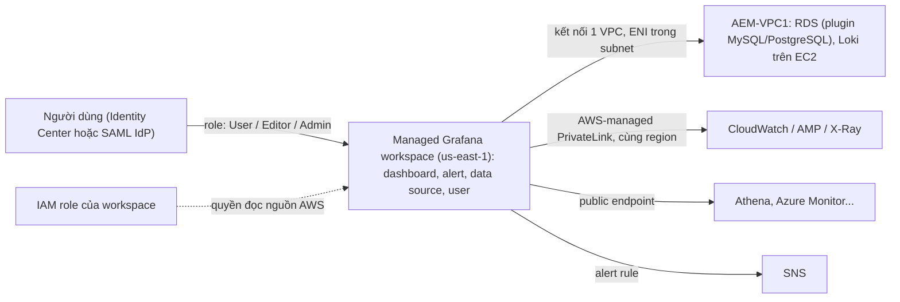

# Amazon Managed Grafana

> **TL;DR:** Amazon Managed Grafana là **Grafana (công cụ dashboard mã nguồn mở) do AWS quản lý hoàn toàn**: không server, không provisioning, scale hay patch. Grafana **không lưu dữ liệu vận hành**; nó **truy vấn dữ liệu tại nguồn** mỗi khi cần (lúc dashboard refresh) bằng ngôn ngữ truy vấn riêng của nguồn, qua plugin, nên không cần cài agent hay collector. Workspace chỉ lưu cấu hình: dashboard, alert rule, data source, user. Nguồn dữ liệu rất đa dạng: **CloudWatch, Amazon Managed Service for Prometheus (AMP), X-Ray, OpenSearch, Athena, Redshift**, cả nguồn ngoài AWS như **Azure Monitor, Google Cloud Monitoring, Loki, Graphite**. Chọn Managed Grafana thay [[CloudWatch Basics|CloudWatch]] khi đội đã quen Grafana hoặc cần xem dữ liệu CloudWatch không có.

## 🖼️ Sơ đồ
![[Amazon Managed Grafana.excalidraw]]
*Mở bằng plugin Excalidraw để chỉnh sửa · ảnh tĩnh: [[Amazon Managed Grafana.svg]]*

## Khái niệm cốt lõi
- **Grafana**: công cụ dashboard mã nguồn mở, được các đội vận hành dùng rộng rãi để giám sát từ ứng dụng tới Kubernetes cluster, kể cả cloud khác (Azure, Google).
- **Managed**: AWS lo toàn bộ hạ tầng; bạn không quản lý server.
- **Khi nào dùng thay CloudWatch**: nếu mọi thứ bạn giám sát đều nằm trong CloudWatch thì CloudWatch là đủ; chọn Managed Grafana khi **đội đã dùng Grafana** hoặc muốn giám sát những nguồn **CloudWatch không hỗ trợ**.
- **Không lưu dữ liệu**: việc chính của Grafana là **visualization**. Dữ liệu thuộc về nguồn; Grafana chỉ truy vấn khi cần, bằng **query language của chính nguồn** đó, nhờ **plugin**. Không phải cấu hình agent hay data collector.
- **Workspace** lưu: **cấu hình, dashboard, alert rule, định nghĩa data source**, user và licensing. Không lưu dữ liệu vận hành.
  - Có thể tạo **nhiều workspace** trong một account, kể cả cùng region, vì mỗi workspace **cô lập về logic**.
- **Data source**:
  - AWS: **CloudWatch, Amazon Managed Service for Prometheus (AMP), X-Ray, OpenSearch, Athena, Redshift**...
  - Bên thứ ba, mã nguồn mở, cloud khác: **Azure Monitor, Google Cloud Monitoring, Loki, Graphite**...
  - Nguồn thương mại như **Datadog, Splunk, ServiceNow, New Relic** cần **enterprise plugin**, là gói nâng cấp **trả phí riêng**.
  - **RDS không có plugin native**: dùng plugin **MySQL** hoặc **PostgreSQL**.
- **Alert rules**: chạy query theo lịch, gửi thông báo qua **[[SNS]]**.
- **Chi phí**: trả theo **active user**, tối thiểu **một editor license**.

### Kết nối tới nguồn dữ liệu (ba trường hợp)
1. **Nguồn nằm trong VPC** (ví dụ RDS, Loki trên EC2): phải **kết nối workspace với VPC** (outbound connection).
   - Một workspace chỉ kết nối được **một VPC**; cần resource ở VPC khác thì dùng [[VPC Peering]] hoặc cách tương tự.
   - Managed Grafana tạo **ENI trong các subnet** bạn chọn; truy cập data source đi qua các ENI này.
2. **CloudWatch, AMP, X-Ray**: đi qua **AWS-managed PrivateLink trong cùng region**, traffic **không ra Internet công cộng**. Bạn không phải tạo endpoint nào.
3. **Dịch vụ AWS khác (ví dụ Athena) và nguồn công cộng (ví dụ Azure Monitor)**: đi qua **public endpoint**.

### Bẫy: kết nối VPC đổi đường đi của MỌI traffic
- Khi workspace đã kết nối một VPC, **toàn bộ traffic của workspace đi qua VPC đó** qua các ENI.
- Đường PrivateLink miễn phí tới CloudWatch, AMP, X-Ray **không còn hoạt động như cũ**: muốn lại thì phải tạo **[[Interface VPC Endpoints|interface endpoint]]** cho chúng.
- Mọi nguồn trên Internet cũng phải ra từ VPC đó: ENI nằm trong **private subnet**, nên VPC cần **[[NAT Gateway]]**, route table và **Security Group** phù hợp.
- Grafana **không được deploy vào VPC**; chỉ có kết nối VPC làm đổi đường đi của traffic.

### Quyền
- **Truy cập data source**:
  - Nguồn **AWS**: workspace dùng một **IAM role** có quyền phù hợp.
  - Nguồn **ngoài AWS**: cấu hình xác thực và credential **ngay trong data source**.
- **Truy cập workspace**: **không** cấu hình user qua IAM. Có hai lựa chọn:
  - **[[IAM Identity Center]]**: workspace tin Identity Center; Identity Center có user trực tiếp hoặc federate ra directory khác. Identity Center **cần [[AWS Organizations]]**: account đứng riêng mà bật thì organization cũng được bật.
  - **SAML**: workspace tin thẳng IdP của bạn (Okta, Microsoft Entra ID, PingFederate...).
- Sau khi có identity, gán **role trong Managed Grafana**: **User** (chỉ xem), **Editor** (dựng dashboard và alert), **Admin** (quản lý cả workspace). Mỗi active user tính phí license.

## Cách hoạt động / Kiến trúc
Ví dụ của bài: workspace ở us-east-1 đọc dữ liệu từ VPC `AEM-VPC1` của Aus-E-Mart, từ dịch vụ AWS và từ nguồn công cộng.

- Workspace truy vấn nguồn **lúc cần** (refresh dashboard), dữ liệu không được copy vào workspace.
- Nếu đã kết nối VPC: cả nhánh PrivateLink và public đều phải đi qua VPC (cần interface endpoint, NAT Gateway, route table, Security Group).

## Bảng so sánh / số liệu
| Tiêu chí | Amazon Managed Grafana | [[CloudWatch Basics|CloudWatch]] dashboard |
|---|---|---|
| Khi nào chọn | Đội đã quen Grafana; cần nguồn ngoài AWS / ngoài CloudWatch | Mọi thứ giám sát đều nằm trong CloudWatch |
| Lưu dữ liệu | **Không**, truy vấn tại nguồn qua plugin | CloudWatch lưu metric / log |
| Nguồn | CloudWatch, AMP, X-Ray, OpenSearch, Athena, Redshift, Azure Monitor, Google Cloud Monitoring, Loki, Graphite... | Dữ liệu trong CloudWatch |
| Người dùng | IAM Identity Center hoặc SAML (không qua IAM) | IAM |
| Giá | Theo active user, tối thiểu 1 editor; enterprise plugin trả thêm | (bài không so sánh) |

| Đường tới nguồn | Cách đi |
|---|---|
| Nguồn trong VPC | Kết nối 1 VPC, ENI trong subnet |
| CloudWatch, AMP, X-Ray | AWS-managed PrivateLink cùng region (khi chưa kết nối VPC) |
| Dịch vụ AWS khác, nguồn công cộng | Public endpoint |
| Sau khi kết nối VPC | **Mọi** traffic qua VPC: cần interface endpoint, NAT Gateway, route table, SG |

## 🎯 Mẹo thi SAA-C03
- Đội vận hành **đã dùng Grafana**, muốn dashboard **không phải tự quản server** → **Amazon Managed Grafana**. Mọi thứ đã ở CloudWatch → CloudWatch dashboard là đủ.
- Grafana **không lưu dữ liệu**, truy vấn tại nguồn; không cần agent hay collector.
- **Kết nối VPC → mọi traffic đi qua VPC**: mất đường PrivateLink tới CloudWatch, AMP, X-Ray (phải tạo interface endpoint) và cần NAT Gateway để ra Internet.
- Một workspace chỉ kết nối **một VPC**.
- User vào workspace qua **IAM Identity Center** hoặc **SAML**, **không qua IAM**; quyền đọc nguồn AWS qua **IAM role** của workspace.
- Dashboard cho dữ liệu Prometheus lưu trong [[Amazon Managed Service for Prometheus|AMP]] → Managed Grafana (Grafana tự lo ký SigV4 khi gọi AMP).

## Liên kết
- Tiên quyết: [[CloudWatch Basics]], [[VPC Subnets]], [[IAM Roles]]
- Liên quan: [[Amazon Managed Service for Prometheus]], [[Interface VPC Endpoints]], [[NAT Gateway]], [[VPC Peering]], [[IAM Identity Center]], [[SAML 2.0 Identity Federation]], [[Athena]], [[SNS]]
- Phân biệt với: [[CloudWatch Basics]], [[CloudWatch Logs]]
- MOC: [[_MOC 18 Security Deployment and Operations]]
