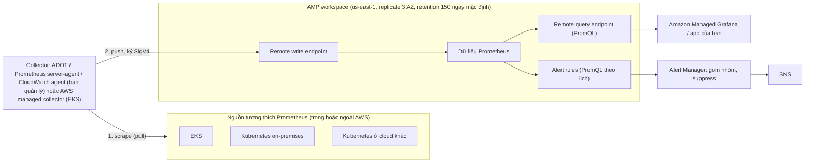

# Amazon Managed Service for Prometheus

> **TL;DR:** Amazon Managed Service for Prometheus (**AMP**) là dịch vụ **lưu trữ và truy vấn metric tương thích Prometheus** do AWS quản lý (scale, HA, bảo trì). Prometheus là chuẩn giám sát mã nguồn mở của **Kubernetes**, truy vấn bằng **PromQL**. Điểm mấu chốt cho đề thi: AMP **không thu thập dữ liệu**. Bạn phải tự dựng **collector** (ADOT, Prometheus server/agent, CloudWatch agent, hoặc AWS managed collector cho EKS) để **scrape** workload rồi **push** vào **remote write endpoint** của workspace; truy vấn qua **remote query endpoint**, thường bằng [[Amazon Managed Grafana]]. Chọn AMP khi đội đã có kinh nghiệm / server / dashboard Prometheus; nếu mọi thứ đã ở CloudWatch thì Container Insights hợp hơn.

## 🖼️ Sơ đồ
![[Amazon Managed Service for Prometheus.excalidraw]]
*Mở bằng plugin Excalidraw để chỉnh sửa · ảnh tĩnh: [[Amazon Managed Service for Prometheus.svg]]*

## Khái niệm cốt lõi
- **Prometheus**: chuẩn giám sát mã nguồn mở cho **[[Kubernetes]]**, cũng được nhiều dịch vụ chạy container khác dùng. Phần cốt lõi là truy vấn dữ liệu giám sát container bằng **PromQL**.
- **AMP** = lưu trữ + truy vấn dữ liệu giám sát **tương thích Prometheus**, **fully managed** (scaling, high availability, bảo trì do AWS lo).
- Giá trị lớn nhất khi đội **đã có kỹ năng Prometheus**; nhưng kể cả người mới, đây là chuẩn ngành và nhiều công cụ xoay quanh nó.
- Nguồn dữ liệu: **[[EKS]]**, **[[ECS]]**, và **bất kỳ nguồn tương thích Prometheus** nào, trong hay ngoài AWS (Kubernetes on-premises, Kubernetes managed ở cloud khác...).
- **"Service for Prometheus", không phải "Managed Prometheus"**: khác Prometheus tự dựng (có sẵn phần thu thập dữ liệu từ container host), **AMP không thu thập dữ liệu**. AMP chỉ **lưu và truy vấn**.

### Workspace và endpoint
- **Workspace** tạo **theo region**. Dữ liệu chỉ nằm trong region đó và được **replicate qua 3 AZ**.
- Workspace có hai **public endpoint**:
  - **Remote write endpoint**: nơi nhận dữ liệu giám sát tương thích Prometheus.
  - **Remote query endpoint**: nơi chạy **PromQL** trên dữ liệu.

### Collector (bạn tự cấu hình)
- Các cách AWS hỗ trợ: **AWS Distro for OpenTelemetry (ADOT)**, **Prometheus server hoặc agent**, **CloudWatch agent**. Bạn phải **tự cấu hình và quản lý** chúng.
- Ngoại lệ chính: **AWS managed collector** nếu dùng **EKS**.
- Collector **pull / scrape**: nó chủ động với tới workload lấy dữ liệu. Không phải workload tự gửi, cũng không phải workspace AMP đi lấy.
- Sau khi scrape, collector **push** dữ liệu tới **remote write endpoint**.

### Dùng dữ liệu
- Tự viết ứng dụng gọi **remote query endpoint** bằng PromQL (dashboard riêng, truy vấn một lần...).
- Muốn dashboard chia sẻ cho cả đội thì dùng **[[Amazon Managed Grafana]]** thay vì tự viết app.
- **Alert rules** trong workspace: chạy một PromQL query **theo lịch**; khi điều kiện đúng thì bắn alert vào **Alert Manager**.
  - Alert Manager **gom nhóm** alert giống nhau, **tạm ẩn (suppress)** alert trong maintenance window...
  - Rule **vẫn tiếp tục chạy**; Alert Manager chỉ quyết định bạn **được báo** những gì.
  - Muốn thông báo thì Alert Manager gọi **[[SNS]]**.

### Lưu ý khác
- **Chi phí** theo lượng dữ liệu **thu vào, lưu trữ và truy vấn**: càng nhiều metric, scrape càng dày thì càng tốn. **Không** tính theo số host được giám sát.
- **Bảo mật**: request tới remote write và query endpoint phải được ký **SigV4 (Signature Version 4)**. Managed Grafana tự lo việc này; Grafana tự quản, collector hay app của bạn thì phải tự cấu hình ký SigV4.
- **Retention** mặc định **150 ngày**, chỉnh được tới tối đa **1.095 ngày (3 năm)**.

## Cách hoạt động / Kiến trúc

## Bảng so sánh / số liệu
| Tiêu chí | AMP | CloudWatch Container Insights |
|---|---|---|
| Khi nào chọn | Đội có kinh nghiệm Prometheus, đã có Prometheus server hoặc dashboard Prometheus | Mọi việc giám sát đã dùng CloudWatch |
| Thu thập dữ liệu | **Không**: tự dựng collector (trừ AWS managed collector cho EKS) | (bài không so sánh chi tiết) |
| Truy vấn | PromQL qua remote query endpoint | (bài không so sánh chi tiết) |

| Thông số | Giá trị |
|---|---|
| Phạm vi workspace | Một region, replicate qua 3 AZ |
| Endpoint | Remote write (nạp dữ liệu), remote query (PromQL), đều là public endpoint |
| Xác thực | SigV4 (Managed Grafana tự lo) |
| Retention | Mặc định 150 ngày, tối đa 1.095 ngày (3 năm) |
| Tính phí | Dữ liệu thu vào, lưu trữ, truy vấn (không theo số host) |

## 🎯 Mẹo thi SAA-C03
- Đội đã dùng **Prometheus / PromQL**, muốn bỏ việc tự vận hành hạ tầng lưu metric → **AMP**. Mọi thứ đã ở CloudWatch → **Container Insights**.
- **AMP không thu thập dữ liệu**: cần collector (ADOT, Prometheus agent, CloudWatch agent; EKS có AWS managed collector). Collector **scrape** workload rồi **push** vào **remote write endpoint**.
- Dashboard trên dữ liệu AMP → **[[Amazon Managed Grafana]]**.
- Gọi endpoint AMP phải **ký SigV4**.
- Retention **150 ngày** mặc định, tối đa **3 năm**.
- Alert: alert rule (PromQL theo lịch) → **Alert Manager** (gom nhóm, suppress) → **SNS**.

## Liên kết
- Tiên quyết: [[Kubernetes]], [[EKS]], [[CloudWatch Basics]]
- Liên quan: [[Amazon Managed Grafana]], [[ECS]], [[CloudWatch Agent]], [[SNS]]
- Phân biệt với: [[CloudWatch Basics]] (Container Insights)
- MOC: [[_MOC 18 Security Deployment and Operations]]
