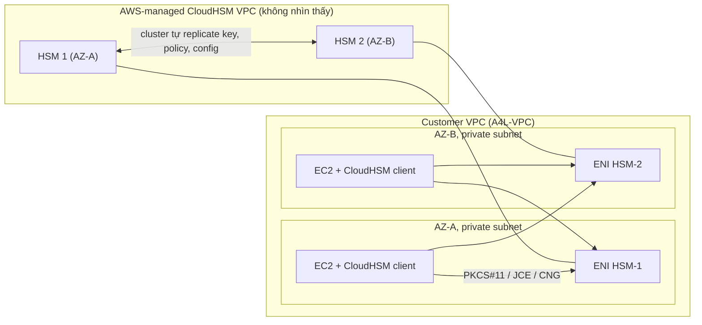

# CloudHSM

> **TL;DR:** CloudHSM là **Hardware Security Module (HSM) single-tenant** do AWS host, đạt **FIPS 140-2 Level 3** toàn phần. Khác [[KMS]] (dịch vụ dùng chung, API AWS, IAM), CloudHSM do **khách hàng toàn quyền quản lý key** (AWS không truy cập được), dùng **API chuẩn công nghiệp (PKCS#11, JCE, CNG)** và **không tích hợp native** với dịch vụ AWS.

## 🖼️ Sơ đồ
![[CloudHSM.excalidraw]]
*Mở bằng plugin Excalidraw để chỉnh sửa · ảnh tĩnh: [[CloudHSM.svg]]*

![[CloudHSM - chon.excalidraw]]
*Mở bằng plugin Excalidraw để chỉnh sửa · ảnh tĩnh: [[CloudHSM - chon.svg]]*

## Khái niệm cốt lõi
### Vì sao cần CloudHSM khi đã có KMS
- [[KMS]] tạo, quản lý key và tích hợp sâu với dịch vụ AWS, nhưng có một điểm đáng lo trong môi trường bảo mật rất khắt khe:
  - Là **shared service**: phần của bạn được cô lập nhưng hạ tầng bên dưới dùng chung với account khác.
  - AWS quản lý phần cứng và phần mềm của KMS nên có **một mức truy cập nhất định** vào sản phẩm.
- Phía sau, KMS dùng **HSM**: thiết bị phần cứng chuẩn công nghiệp chuyên quản lý key và thực hiện thao tác mật mã. Bạn cũng có thể tự chạy HSM on-premises.
- **CloudHSM = HSM single-tenant chạy trên AWS Cloud.** "HSM" trong đề có thể là CloudHSM hoặc HSM on-premises.

### Trách nhiệm và quyền truy cập
- AWS **provision** và **bảo trì phần cứng** (cập nhật phần mềm...), nhưng **không có quyền truy cập** vào vùng lưu và quản lý key: thiết bị **tamper-resistant**, được partition.
- Chỉ bạn (hoặc người bạn ủy quyền) tương tác được với vùng bảo mật.
- **Mất quyền truy cập HSM là hết**: có thể provision lại nhưng không có cách dễ để khôi phục dữ liệu/key.

### Ba điểm phân biệt với KMS (nhớ cho thi)
1. **FIPS 140-2 Level 3**: CloudHSM đạt Level 3 toàn phần; KMS (theo khóa học) **Level 2** tổng thể, một số phần đạt Level 3. Yêu cầu **FIPS 140-2 Level 3 overall** → CloudHSM (hoặc HSM on-prem). (Hiện nay HSM của KMS đã đạt FIPS 140-3 Level 3 và CloudHSM thế hệ mới cũng đạt FIPS 140-3 Level 3; nhưng trong đề, từ khóa "Level 3 + single-tenant + toàn quyền kiểm soát" vẫn chỉ tới CloudHSM.)
2. **Cách truy cập**: KMS dùng **AWS API** và quyền **IAM**; CloudHSM dùng **API chuẩn công nghiệp**: **PKCS#11**, **JCE (Java Cryptography Extensions)**, **CryptoNG (CNG, Microsoft)**.
3. **Tích hợp AWS**: KMS tích hợp native với dịch vụ AWS; CloudHSM mặc định **không**.

### Điểm giao nhau: KMS Custom Key Store
- KMS có tính năng **custom key store** dùng CloudHSM cluster làm nơi lưu key. Kết quả: có nhiều lợi ích của CloudHSM (key nằm trong HSM bạn kiểm soát) **kèm** khả năng tích hợp dịch vụ AWS của KMS.
- Trong đề vẫn phân định bằng từ khóa như ở trên.

## Cách hoạt động / Kiến trúc

- HSM **không nằm trong VPC của bạn**: chúng chạy trong **CloudHSM VPC do AWS quản lý**, bạn không thấy VPC này.
- Một HSM là thiết bị mạng vật lý trong **một AZ**, mặc định **không HA**. Muốn HA: tạo **cluster** gồm **ít nhất 2 HSM**, mỗi AZ bạn dùng một HSM.
- Các HSM trong cluster **tự đồng bộ** key, policy và cấu hình quan trọng; bạn không phải cấu hình việc này.
- HSM được **inject vào VPC của bạn qua ENI** (mỗi HSM một [[EC2 Network Interfaces IPs and DNS|ENI]]) trong subnet bạn chọn. Dịch vụ trong VPC dùng cluster qua các ENI này.
- HA thật sự: client phải được cấu hình **cân bằng tải qua mọi ENI**.
- EC2 phải cài **CloudHSM client** (tiến trình nền) mới truy cập được HSM, sau đó dùng PKCS#11, JCE, CNG.

## Bảng so sánh: KMS vs CloudHSM

| Tiêu chí | [[KMS]] | CloudHSM |
|---|---|---|
| Tenancy | Shared (multi-tenant) | **Single-tenant** |
| FIPS 140-2 (theo khóa học) | Level 2 tổng thể (một phần Level 3) | **Level 3** |
| Ai kiểm soát key | AWS vận hành, IAM + key policy | **Chỉ khách hàng**; AWS không truy cập được |
| API | AWS API | **PKCS#11, JCE, CNG** |
| Phân quyền | IAM | Người dùng/quản trị trong HSM (không phải IAM) |
| Tích hợp dịch vụ AWS (S3 SSE, EBS...) | **Native** | **Không** (trừ khi qua KMS custom key store) |
| HA | Có sẵn (regional) | Tự xây: cluster ≥ 2 HSM ở nhiều AZ |
| Vị trí | Public service | AWS-managed VPC, ENI trong VPC của bạn |

## Use cases
- **Không có tích hợp AWS native**: ví dụ **không dùng được với S3 SSE**. Có thể dùng cho **client-side encryption** (mã hóa object bằng thư viện ở máy local trước khi upload lên S3), nhưng đó không phải tích hợp với S3. Xem [[S3 Encryption]].
- **Offload SSL/TLS processing** cho web server: web server không phải làm thao tác mật mã, và HSM có phần cứng chuyên dụng tăng tốc nên hiệu quả, kinh tế hơn so với làm trên EC2 thường. KMS **không** làm được việc này. (Xem [[SSL and TLS]].)
- **Oracle TDE (Transparent Data Encryption)**: Oracle DB dùng CloudHSM để quản lý key và mã hóa; AWS **không thể giải mã** dữ liệu. Hợp với môi trường quy định nghiêm ngặt. (Hiện nay kiểu này áp dụng cho Oracle tự chạy trên EC2; RDS for Oracle dùng TDE với key do RDS/KMS quản lý.)
- **Bảo vệ private key của Certificate Authority (CA)** tự vận hành.

## 🎯 Mẹo thi SAA-C03
- **FIPS 140-2 Level 3 (overall)** → CloudHSM (hoặc HSM on-prem). Đây là từ khóa quan trọng nhất.
- **PKCS#11, JCE, CryptoNG/CNG**, "industry standard APIs" → CloudHSM.
- **Tích hợp với dịch vụ AWS** (S3 SSE-KMS, EBS encryption...) → KMS.
- **Single-tenant**, "AWS không được có quyền truy cập key", "khách hàng toàn quyền kiểm soát key" → CloudHSM.
- **SSL/TLS offload cho web server, Oracle TDE, private key của CA** → CloudHSM.
- **HA**: cần **cluster nhiều HSM ở nhiều AZ**; một HSM đơn lẻ không HA.
- Muốn vừa key trong HSM single-tenant vừa tích hợp dịch vụ AWS → **KMS custom key store** dựa trên CloudHSM.

## Liên kết
- Tiên quyết: [[KMS]], [[Encryption Fundamentals]], [[VPC Subnets]]
- Liên quan: [[S3 Encryption]], [[SSL and TLS]], [[SSL Offload and Session Stickiness]], [[EC2 Network Interfaces IPs and DNS]], [[HA vs FT vs DR]], [[Secrets Manager]]
- Phân biệt với: [[KMS]], [[ACM]]
