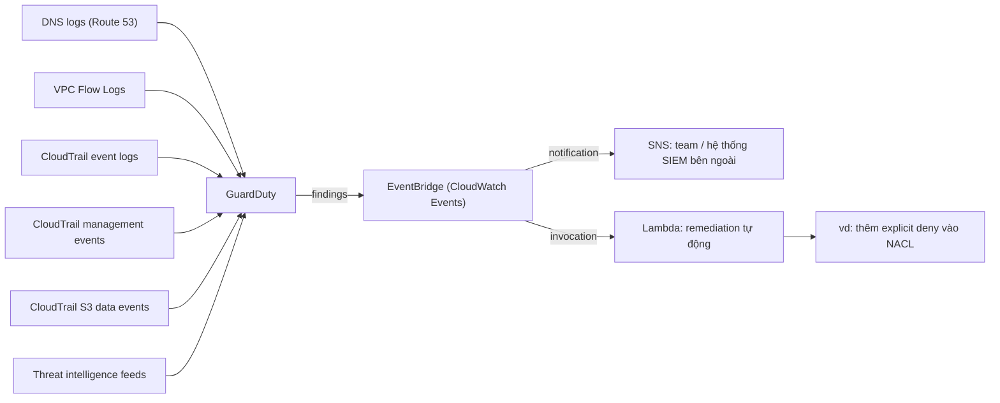

# GuardDuty

> **TL;DR:** Amazon GuardDuty là dịch vụ **giám sát bảo mật liên tục (continuous security monitoring)**: đọc log từ các nguồn được hỗ trợ (DNS, VPC Flow Logs, CloudTrail), kết hợp **AI/ML** và **threat intelligence feeds** để phát hiện hoạt động **bất thường hoặc trái phép** trong account, rồi phát **findings** sang EventBridge để thông báo hoặc tự động khắc phục.

## 🖼️ Sơ đồ
![[GuardDuty.excalidraw]]
*Mở bằng plugin Excalidraw để chỉnh sửa · ảnh tĩnh: [[GuardDuty.svg]]*

![[GuardDuty - phan biet.excalidraw]]
*Mở bằng plugin Excalidraw để chỉnh sửa · ảnh tĩnh: [[GuardDuty - phan biet.svg]]*

## Khái niệm cốt lõi
- **Continuous**: bật một lần là chạy liên tục, không phải chạy theo đợt như assessment của [[Inspector]].
- Mục tiêu: phát hiện **unexpected / unauthorised activity** trong account.
- **Tự học hành vi bình thường**: bạn không phải định nghĩa thế nào là "normal". GuardDuty dùng **machine learning** để học pattern hoạt động thường ngày, và dùng **threat intelligence feeds** (danh sách IP/domain độc hại đã biết...) để nhận ra hành vi đáng ngờ khi nó xảy ra.
- Có thể **tác động** vào cách đánh giá, ví dụ **whitelist IP** (trusted IP list) để coi một số hành vi là bình thường.
- Khi phát hiện vấn đề → tạo một **finding**. Finding có thể kích hoạt thông báo hoặc **quy trình bảo vệ/khắc phục hướng sự kiện** (event-driven remediation).
- **Multi-account**: account bật GuardDuty trở thành account quản lý (khóa học gọi là **master**, nay AWS gọi là **administrator**); account đó **mời** account khác, account nào chấp nhận thành **member**. Kết quả: một nơi quản lý tập trung cho nhiều account. (Hiện nay còn có thể chỉ định **delegated administrator** qua [[AWS Organizations]].)

### Nguồn dữ liệu (theo bài giảng)
| Nguồn | Cho GuardDuty biết gì |
|---|---|
| **DNS logs** (từ Route 53 resolver) | Các DNS request, ví dụ instance truy vấn domain độc hại / C&C |
| **[[VPC Flow Logs]]** | Metadata của traffic đi qua VPC (IP, port, bytes...) |
| **[[CloudTrail]] event logs** | Các API call trong account |
| **CloudTrail management events** | Sự kiện mức **control plane** |
| **CloudTrail S3 data events** | Tương tác với **object trong S3** |

> Ghi chú cập nhật: khóa học liệt kê 5 nguồn ở trên. Hiện nay GuardDuty còn có các protection plan bổ sung: **EKS Protection** (audit logs), **Runtime Monitoring** (EKS/ECS/EC2), **Malware Protection** (EBS volume và S3), **RDS Protection** (login activity của Aurora/RDS), **Lambda Protection** (network activity). Bạn **không cần tự bật** VPC Flow Logs hay CloudTrail trail; GuardDuty lấy luồng dữ liệu độc lập.

## Cách hoạt động / Kiến trúc

- Findings gửi tới **[[EventBridge]]** (trước đây là CloudWatch Events).
- EventBridge → **[[SNS]]**: báo cho thành viên team hoặc hệ thống quản lý bảo mật bên ngoài.
- EventBridge → **[[Lambda]]**: gọi API AWS để **tự động khắc phục**, ví dụ thêm rule **explicit deny** vào [[NACL]] khi có dấu hiệu xâm nhập từ một IP.

## 🎯 Mẹo thi SAA-C03
- Đề nói **phát hiện mối đe dọa liên tục**, **hoạt động bất thường/trái phép trong account**, **threat detection dùng ML + threat intelligence** → **GuardDuty**.
- Nhớ các nguồn: **DNS logs, VPC Flow Logs, CloudTrail** (management events + S3 data events). Đề hỏi "phân tích VPC Flow Logs, DNS logs và CloudTrail để tìm mối đe dọa" → GuardDuty.
- **Tự động phản ứng với finding** → GuardDuty → **EventBridge** → Lambda (remediation) / SNS (thông báo). Đây là mẫu [[Event-Driven Architecture|event-driven security]] lặp lại với [[Macie]] và [[AWS Config]].
- Nhiều account quản lý tập trung → **administrator (master) + member** (mời hoặc qua Organizations).
- Phân biệt:
  - [[Inspector]]: quét **lỗ hổng** (CVE, CIS) trên EC2/container.
  - [[Macie]]: tìm **dữ liệu nhạy cảm** trong S3.
  - [[AWS Config]]: **lịch sử cấu hình và compliance**, không phát hiện tấn công.
  - [[Shield]] / [[WAF]]: **chặn** DDoS và tấn công Layer 7; GuardDuty chỉ **phát hiện**, không tự chặn (việc chặn do Lambda remediation làm).
  - [[CloudTrail]]: chỉ **ghi log** API call; GuardDuty **phân tích** log đó.

## Liên kết
- Tiên quyết: [[CloudTrail]], [[VPC Flow Logs]], [[Route 53 Fundamentals]], [[DNS Fundamentals]]
- Liên quan: [[EventBridge]], [[SNS]], [[Lambda]], [[NACL]], [[AWS Organizations]], [[Event-Driven Architecture]]
- Phân biệt với: [[Inspector]], [[Macie]], [[AWS Config]], [[Shield]], [[WAF]]
