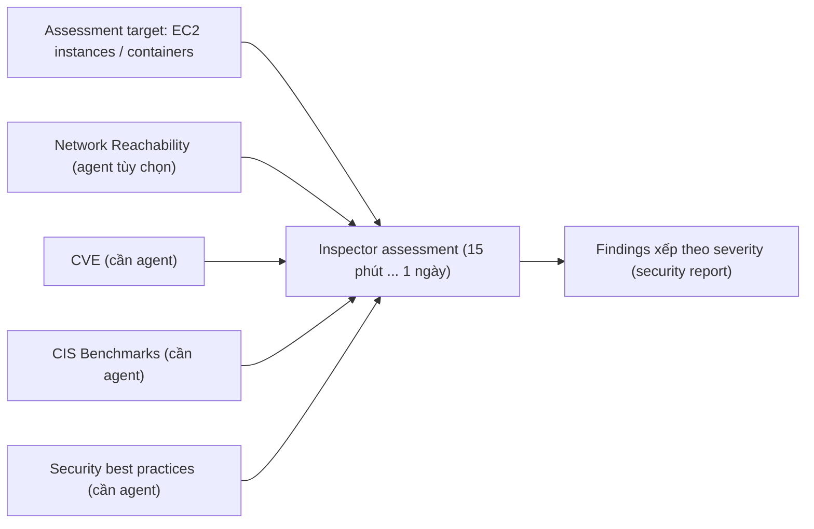

# Inspector

> **TL;DR:** Amazon Inspector kiểm tra **EC2 instance, hệ điều hành bên trong và container workload** để tìm **lỗ hổng (vulnerability)** và **sai lệch so với best practice**, rồi trả về một báo cáo findings xếp theo **mức độ nghiêm trọng (severity)**. Trong đề thi, thấy **CVE, CIS Benchmarks, "security report" cho EC2** là nghĩ ngay tới Inspector.

## 🖼️ Sơ đồ
![[Inspector.excalidraw]]
*Mở bằng plugin Excalidraw để chỉnh sửa · ảnh tĩnh: [[Inspector.svg]]*

## Khái niệm cốt lõi
- Đối tượng kiểm tra: **[[EC2 Basics|EC2 instances]]**, **OS** chạy trên đó, **container workload** và các thành phần mạng liên quan tới instance.
- Chạy một **assessment** có độ dài tùy chọn: **15 phút, 1 giờ, 8 giờ, 12 giờ hoặc 1 ngày** (Inspector Classic). Trong thời gian đó nó tìm traffic hoặc cấu hình bất thường khiến ứng dụng, instance hay container gặp rủi ro.
- Kết quả: **danh sách findings sắp theo severity**.
- Hai kiểu assessment:
  - **Network assessment**: chạy được **không cần agent**; thêm agent thì thông tin phong phú hơn.
  - **Host assessment**: xem lỗ hổng ở **mức OS**, cần nhìn vào bên trong instance nên **bắt buộc có Inspector agent**.
- **Rules packages** quyết định Inspector kiểm tra cái gì (xem bảng bên dưới).

### Network Reachability (agent tùy chọn)
- Kiểm tra **khả năng truy cập end-to-end** từ mạng public vào một instance hoặc nhóm instance: instance bị phơi ra Internet tới mức nào.
- Phân tích gần như mọi thành phần trên đường đi: EC2, [[Elastic Load Balancer|ALB/ELB]], [[Direct Connect]], [[EC2 Network Interfaces IPs and DNS|ENI]], [[VPC Routing and Internet Gateway|Internet Gateway và route table]], [[NACL]], [[Security Groups]], cấu hình subnet và VPC, [[Site-to-Site VPN|Virtual Private Gateway]], [[VPC Peering]].
- Các loại finding:
  - **Recognized port with listener**: port quen thuộc (well-known) bị lộ ra mạng public **và** OS đang listen trên port đó.
  - **Recognized port, no listener**: port bị lộ ra Internet nhưng không có gì listen.
  - **Recognized port, no agent**: port bị lộ nhưng **không có agent** nên không biết OS có listen hay không. Đây là lý do có agent luôn cho nhiều thông tin hơn.
  - **Unrecognized port with listener**: port lạ bị lộ và có process đang listen.

### Host assessment packages (bắt buộc agent)
- **Common Vulnerabilities and Exposures (CVE)**: CVE là cơ sở dữ liệu công khai các lỗ hổng bảo mật đã biết, mỗi lỗ hổng có một **CVE ID**. Báo cáo của Inspector liệt kê CVE ID tìm thấy trên instance/container.
- **Center for Internet Security (CIS) Benchmarks**: bộ best practice bảo mật mang tính đồng thuận, trung lập của tổ chức CIS. Inspector đối chiếu cấu hình OS với benchmark này.
- **Security best practices for Amazon Inspector**: bộ best practice do AWS soạn, ví dụ:
  - tắt **root login qua SSH**,
  - chỉ dùng **phiên bản SSH hiện đại**,
  - kiểm tra **độ phức tạp mật khẩu**,
  - kiểm tra **permission** trên một số thư mục.

## Cách hoạt động / Kiến trúc

## Bảng so sánh / số liệu
| Rules package | Loại | Cần agent? | Kiểm tra gì |
|---|---|---|---|
| Network Reachability | Network | Không (agent cho thêm thông tin) | Instance có bị lộ ra mạng public không, port nào, có listener không |
| CVE | Host | Có | Lỗ hổng đã biết theo CVE ID |
| CIS Benchmarks | Host | Có | Cấu hình OS so với CIS benchmark |
| Security best practices | Host | Có | Root SSH, phiên bản SSH, password complexity, folder permission |

> Ghi chú cập nhật: khóa học mô tả **Inspector Classic** (assessment có thời hạn, rules packages, Inspector agent). Từ cuối 2021, **Amazon Inspector (v2)** quét **liên tục và tự động**, dùng **SSM Agent** thay cho agent riêng (và có chế độ quét EC2 agentless), phủ thêm **container image trong [[ECR]]** và **[[Lambda]] function**, chấm điểm rủi ro theo ngữ cảnh. Inspector Classic đã ngừng hoạt động. Khi đi thi, các từ khóa CVE / CIS / network reachability vẫn trỏ về Inspector.

## 🎯 Mẹo thi SAA-C03
- Đề nhắc **"security report"**, **đánh giá lỗ hổng trên EC2/OS/container** → **Inspector**.
- Thấy **CVE** → Inspector. Thấy **CIS Benchmarks** → Inspector. Thấy các best practice kiểu **"disable root login over SSH"** → Inspector.
- Đề hỏi công cụ phân tích **instance có bị lộ ra Internet không / port nào mở ra public** → Inspector **Network Reachability**; câu này **không cần agent**.
- Kiểm tra **bên trong OS** (CVE, CIS, best practices) → **cần agent**. Đề có thể hỏi agent có bắt buộc hay không: network = không, host = có.
- Phân biệt: Inspector = **lỗ hổng trên workload** (EC2, container); [[GuardDuty]] = **phát hiện hoạt động bất thường liên tục** từ log; [[Macie]] = **dữ liệu nhạy cảm trong S3**; [[AWS Config]] = **lịch sử cấu hình và compliance** của resource.
- Adrian nhấn mạnh đây là bài "keyword": không cần chi tiết sâu, nhưng mất điểm vì không nhận ra CVE/CIS thì rất phí.

## Liên kết
- Tiên quyết: [[EC2 Basics]], [[Containers Fundamentals]], [[Shared Responsibility Model]]
- Liên quan: [[Security Groups]], [[NACL]], [[VPC Routing and Internet Gateway]], [[ECR]], [[EKS]]
- Phân biệt với: [[GuardDuty]], [[Macie]], [[AWS Config]], [[Shield]]
