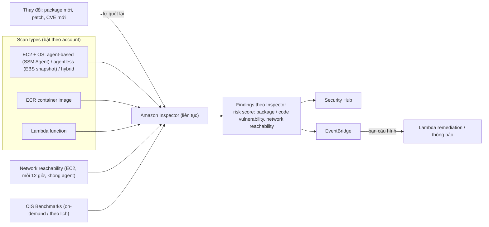

# Inspector

> **TL;DR:** Amazon Inspector là dịch vụ **vulnerability management**: quét **EC2 instance và OS bên trong**, **container image trong ECR** và **Lambda function** để tìm **lỗ hổng phần mềm** và **network exposure ngoài ý muốn**. Inspector **chạy liên tục, tự quét lại** khi có thay đổi (không phải lên lịch như Inspector Classic), xếp findings theo **Inspector risk score** và gửi sang Security Hub, EventBridge. Trong đề thi, thấy **CVE, CIS Benchmarks, vulnerability findings** là nghĩ ngay tới Inspector.

## 🖼️ Sơ đồ
![[Inspector.excalidraw]]
*Mở bằng plugin Excalidraw để chỉnh sửa · ảnh tĩnh: [[Inspector.svg]]*

## Khái niệm cốt lõi
- Đối tượng kiểm tra: **[[EC2 Basics|EC2 instances]]** và **OS** chạy trên đó, **container image trong [[ECR]]**, **[[Lambda]] function**.
- Tìm: **software vulnerabilities** và **unintended network exposure**.
- **Chạy liên tục**: không có gì để lên lịch (khác Inspector Classic phải đặt lịch assessment). Inspector **tự quét lại khi có thay đổi**: cài package mới, áp patch, hoặc có **CVE mới** được công bố ảnh hưởng tới resource.
- **Findings** xếp theo **severity** bằng **Inspector risk score** đã **điều chỉnh theo môi trường** của bạn.
  - Finding **tự đóng** khi bạn đã khắc phục.
  - Finding được publish sang **[[AWS Security Hub|Security Hub]]** và **[[EventBridge]]** dưới dạng event; thông báo hay remediation tự động (ví dụ EventBridge gọi Lambda) là phần **bạn tự cấu hình**.
  - Inspector **chỉ phát hiện, không tự sửa** lỗ hổng.

### Scan types (bật / tắt theo từng account)
- Scan type bạn kích hoạt quyết định cái gì được quét: **EC2**, **ECR container image**, **Lambda function**.
- Với EC2 có hai cách quét:
  - **Agent-based**: dùng **SSM Agent** thu thập software inventory từ bên trong instance.
  - **Agentless**: chụp **EBS snapshot** rồi phân tích, **không cần agent** trên instance.
  - Mặc định account dùng **hybrid mode** (kết hợp cả hai), đổi được bất cứ lúc nào.

### Network reachability (chỉ EC2, không bao giờ cần agent)
- Inspector tự chạy kiểm tra **mỗi 12 giờ**.
- Tìm các đường **TCP/UDP đang mở** tới instance từ **rìa VPC**: Internet qua **Internet Gateway**, từ **VPC peering**, hoặc qua **VPN / Virtual Private Gateway**.
- Kiểm tra **end-to-end**, nên gián tiếp xét hầu hết thành phần trên đường đi: EC2, [[Elastic Load Balancer|ALB/ELB]], [[Direct Connect]], [[EC2 Network Interfaces IPs and DNS|ENI]], [[VPC Routing and Internet Gateway|Internet Gateway]], [[NACL]], [[Security Groups]]...
- Đề có thể hỏi sản phẩm nào làm loại phân tích này, hoặc có cần agent không: **không cần agent**.

### Finding types (từ khóa thi)
- **Package vulnerability**: dựa trên **CVE (Common Vulnerabilities and Exposures)**, cơ sở dữ liệu công khai các lỗ hổng đã biết, mỗi lỗ hổng có một **CVE ID**. Finding liệt kê CVE ID tìm thấy trên instance, container image hoặc Lambda function.
- **Code vulnerability**: lỗ hổng trong code (bài chỉ nêu tên loại finding).
- **Network reachability**: chỉ ra cấu hình **quá mở** (Security Group, NACL, Internet Gateway...) để bạn siết lại.
- **CIS Benchmarks** (Center for Internet Security): bộ best practice bảo mật của ngành; Inspector so OS của EC2 với CIS Benchmarks. Đây là **targeted scan chạy on-demand hoặc theo lịch**. Từ khóa: **"scheduled CIS benchmark scanning cho EC2"** → Inspector.

### Inspector Classic (bản khóa cũ nêu, bài mới không nói)
- Chạy **assessment** có độ dài chọn trước: **15 phút, 1 giờ, 8 giờ, 12 giờ hoặc 1 ngày**; kết quả là danh sách findings theo severity.
- **Rules packages** quyết định kiểm tra gì:
  - **Network assessment / Network Reachability**: chạy được **không cần agent**; thêm agent thì biết thêm OS có listen trên port hay không. Các finding: *recognized port with listener*, *recognized port, no listener*, *recognized port, no agent*, *unrecognized port with listener*.
  - **Host assessment** (bắt buộc **Inspector agent**): **CVE**, **CIS Benchmarks**, **Security best practices for Amazon Inspector** (tắt root login qua SSH, chỉ dùng SSH bản hiện đại, kiểm tra độ phức tạp mật khẩu, permission trên một số thư mục).
- Inspector Classic đã ngừng hoạt động (bổ sung, bài không nói); bài mới chỉ nhắc nó để so sánh "Classic phải lên lịch".

## Cách hoạt động / Kiến trúc

## Bảng so sánh / số liệu
| Hạng mục | Inspector (bài mới) | Inspector Classic (bản khóa cũ) |
|---|---|---|
| Cách chạy | **Liên tục**, tự quét lại khi có thay đổi | Assessment theo lịch, 15 phút đến 1 ngày |
| Đối tượng | EC2 + OS, **ECR image**, **Lambda** | EC2, OS, container workload |
| Agent cho EC2 | **SSM Agent** (agent-based) hoặc **agentless** (EBS snapshot); mặc định hybrid | Inspector agent riêng, bắt buộc cho host assessment |
| Network reachability | Chỉ EC2, **không agent**, tự chạy **mỗi 12 giờ** | Không cần agent; agent cho thêm thông tin |
| CIS Benchmarks | Targeted scan on-demand hoặc theo lịch | Rules package, cần agent |
| Xếp hạng | Inspector risk score theo môi trường; finding tự đóng khi đã sửa | Severity |

## 🎯 Mẹo thi SAA-C03
- Đề nhắc **vulnerability findings**, **đánh giá lỗ hổng trên EC2 / container image ECR / Lambda** → **Inspector**.
- Thấy **CVE** → Inspector. Thấy **CIS Benchmarks** (nhất là **quét CIS theo lịch cho EC2**) → Inspector.
- Đề hỏi công cụ phân tích **instance có đường TCP/UDP mở từ Internet, VPC peering, VPN** → Inspector **network reachability**; **không bao giờ cần agent**.
- EC2 không muốn cài agent → **agentless scanning** (EBS snapshot); agent-based dùng **SSM Agent**.
- Inspector **không tự sửa**: muốn tự động khắc phục thì EventBridge → Lambda.
- Phân biệt: Inspector = **lỗ hổng trên workload**; [[GuardDuty]] = **phát hiện hoạt động bất thường liên tục** từ log; [[Macie]] = **dữ liệu nhạy cảm trong S3**; [[AWS Config]] = **lịch sử cấu hình và compliance** của resource; [[AWS Security Hub|Security Hub]] = **gom findings** từ Inspector, GuardDuty, Macie...
- Giảng viên nhấn mạnh đây là bài "keyword": không cần chi tiết sâu, nhưng mất điểm vì không nhận ra CVE/CIS thì rất phí.

## Liên kết
- Tiên quyết: [[EC2 Basics]], [[Containers Fundamentals]], [[Shared Responsibility Model]]
- Liên quan: [[Security Groups]], [[NACL]], [[VPC Routing and Internet Gateway]], [[ECR]], [[EKS]], [[Lambda]], [[EBS Snapshots]], [[AWS Security Hub]]
- Phân biệt với: [[GuardDuty]], [[Macie]], [[AWS Config]], [[Shield]]
