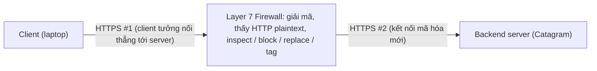

# Layer 7 Firewall

> **TL;DR:** Firewall Layer 7 (application layer firewall) hiểu được **giao thức ứng dụng** như HTTP, nên nhìn thấy header, host, nội dung... chứ không chỉ IP/port. Nhờ đó nó chặn được tấn công đặc thù của giao thức, lọc/thay thế nội dung, chặn ứng dụng cụ thể, trong khi vẫn giữ mọi khả năng của firewall Layer 3/4/5. Trên AWS, khái niệm này được hiện thực bằng [[WAF]].

## 🖼️ Sơ đồ
![[Layer 7 Firewall.excalidraw]]
*Mở bằng plugin Excalidraw để chỉnh sửa · ảnh tĩnh: [[Layer 7 Firewall.svg]]*

## Khái niệm cốt lõi
Nhắc lại các tầng của [[OSI Model]] mà firewall có thể "hiểu":

- **Firewall Layer 3/4** (xem [[Layer 3 Network]], [[Layer 4 Transport]]): thấy packet và segment, **IP address, port, flag**. Request (laptop → server) và response (server → laptop) bị coi là **hai luồng riêng, không liên quan**, nên cần hai rule. Đây là kiểu [[Stateful vs Stateless Firewalls|stateless]], giống [[NACL]].
- **Firewall có thêm Layer 5 (session)**: hiểu request và response thuộc **cùng một session**, nên:
  - Giảm admin overhead: một rule thay vì hai.
  - Bảo mật theo ngữ cảnh: traffic response được xử lý khác với traffic cùng chiều nhưng không phải response. Tương tự cách [[Security Groups]] hoạt động (stateful).
- **Hạn chế chung của hai loại trên**: không hiểu gì **phía trên** tầng nó hoạt động. Dữ liệu Layer 7 (HTTP header, nội dung...) là **opaque**: ảnh mèo, ảnh chó hay malware đều như nhau. Điều này mở ra nhiều hướng tấn công.

### Layer 7 firewall thêm được gì
- **Hiểu giao thức Layer 7** cụ thể (ví dụ HTTP): kiến trúc, cách truyền dữ liệu, header, host, data...
- **Nhận diện request bình thường và bất thường**, từ đó chặn được **protocol-specific attacks**.
- Dữ liệu L7 có thể bị **inspected, blocked, replaced hoặc tagged**: lọc nội dung người lớn, spam, off-topic, malware, exploit. Thậm chí **thay thế** nội dung (ví dụ ảnh không phù hợp được thay bằng ảnh mèo con).
- **Nhận diện, chặn, điều chỉnh từng ứng dụng cụ thể** (ví dụ chặn Facebook, chặn dữ liệu doanh nghiệp bị đẩy lên Dropbox, tức có tính chất DLP).
- **Giữ toàn bộ tính năng L3, L4, L5** và thêm khả năng phản ứng theo phần tử L7: **DNS name, rate (số kết nối/giây), content, header**...
- Phạm vi giao thức tùy phần mềm firewall: có loại chỉ hiểu HTTP, có loại hiểu cả **SMTP** (email)...

## Cách hoạt động / Kiến trúc
Với kết nối **HTTPS**, firewall L7 phải **terminate (giải mã)** kết nối thì mới nhìn được HTTP bên trong:

- Kết nối HTTPS từ client **kết thúc tại firewall**; lớp mã hóa bị gỡ, còn lại HTTP thuần.
- Firewall phân tích HTTP plaintext khi traffic đi qua, rồi tạo **kết nối HTTPS mới** tới backend.
- Với client và server, quá trình này **trong suốt** (transparent).
- Giữa hai đầu HTTPS, firewall thấy toàn bộ luồng HTTP chưa mã hóa, nên có thể áp dụng rule chi tiết theo nội dung.

## Bảng so sánh

| Đặc điểm | L3/L4 | L3/L4 + L5 (session) | Layer 7 |
|---|---|---|---|
| Thấy IP, port, flag | Có | Có | Có |
| Hiểu request/response là một session | Không (2 luồng riêng) | Có | Có |
| Thấy header/nội dung HTTP | Không | Không | **Có** |
| Chặn tấn công đặc thù giao thức, lọc nội dung, chặn app | Không | Không | **Có** |
| Ví dụ AWS | [[NACL]] (stateless) | [[Security Groups]] (stateful) | [[WAF]] |

## 🎯 Mẹo thi SAA-C03
- Đề nói lọc theo **HTTP header, URL/path, nội dung request, SQL injection, XSS, chặn ứng dụng** → cần khả năng Layer 7, tức [[WAF]]. [[Security Groups]] và [[NACL]] **không** nhìn thấy những thứ này.
- Firewall L7 muốn kiểm tra HTTPS thì phải **giải mã** traffic (terminate TLS), tương tự cách [[SSL Offload and Session Stickiness|SSL offload]] ở load balancer.
- Bài này là nền lý thuyết; cách AWS hiện thực xem [[WAF]] (gắn với [[CloudFront Architecture|CloudFront]], ALB, [[API Gateway]]...).

## Liên kết
- Tiên quyết: [[OSI Model]], [[Stateful vs Stateless Firewalls]], [[SSL and TLS]]
- Liên quan: [[WAF]], [[Shield]], [[Elastic Load Balancer]], [[Gateway Load Balancer]]
- Phân biệt với: [[Security Groups]], [[NACL]], [[Compare - Security Groups vs NACL]]
