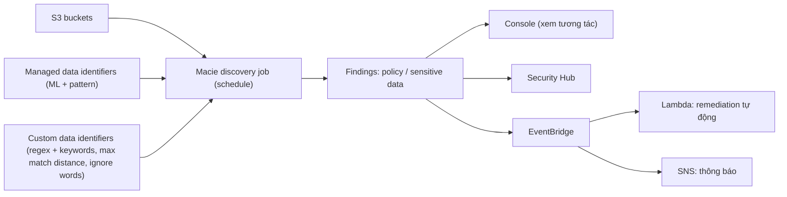

# Macie

> **TL;DR:** Amazon Macie là dịch vụ **data security và data privacy** cho **S3**: dùng machine learning và pattern matching để **khám phá, phân loại, giám sát** dữ liệu nhạy cảm (PII, PHI, dữ liệu tài chính, credential) trong bucket, đồng thời cảnh báo khi cấu hình bucket bị nới lỏng. Findings đẩy sang EventBridge để thông báo hoặc remediation tự động.

## 🖼️ Sơ đồ
![[Macie.excalidraw]]
*Mở bằng plugin Excalidraw để chỉnh sửa · ảnh tĩnh: [[Macie.svg]]*

## Khái niệm cốt lõi
- Bối cảnh: [[S3 Basics|S3]] chứa lượng dữ liệu khổng lồ, có thể bị public do cấu hình sai và từ lâu là nguồn rò rỉ dữ liệu. Muốn kiểm soát bảo mật dữ liệu thì phải biết **dữ liệu ở đâu và chứa gì**.
- Macie **discover, monitor, protect** dữ liệu trong S3 bucket (của một hoặc nhiều account).
- Loại dữ liệu nhận diện được:
  - **PII** (Personally Identifiable Information): tên, địa chỉ, ngày sinh, số hộ chiếu, bằng lái, số bảo hiểm xã hội/national insurance...
  - **PHI** (Personal Health Information): số bảo hiểm y tế, mã định danh y tế...
  - **Financial**: số thẻ tín dụng, ngày hết hạn, số tài khoản ngân hàng...
  - **Credentials**: AWS access key, SSH key, PGP key...
- Việc đầu tiên của Macie: **nhận diện và lập inventory** dữ liệu nhạy cảm (có gì, chứa gì, ở đâu).

### Data identifiers
Là các "rule" để đánh giá object và nội dung của nó:
- **Managed data identifiers**: do AWS xây và quản lý, dùng **machine learning + pattern matching**, phủ hầu hết loại dữ liệu nhạy cảm phổ biến cho nhiều quốc gia/khu vực.
- **Custom data identifiers**: do bạn tạo, dành cho dữ liệu đặc thù doanh nghiệp (mã nhân viên, báo cáo đánh giá, biển số xe theo định dạng riêng...). Nền tảng là **regex**, ví dụ `[A-Z]-\d{8}` (một chữ cái, gạch ngang, 8 chữ số). Có các **refiner**:
  - **Keywords**: từ khóa phải xuất hiện gần chỗ regex khớp.
  - **Maximum match distance**: khoảng cách tối đa giữa keyword và chỗ khớp.
  - **Ignore words**: nếu có từ này thì bỏ qua dù regex khớp.

### Discovery jobs
- Bạn tạo **sensitive data discovery job**: chọn bucket, đặt **schedule** (chạy một lần hoặc định kỳ), chọn bộ managed và custom identifiers.
- Job phân tích object để phát hiện và phân loại dữ liệu → sinh **findings**.

### Findings
Hai loại:
1. **Policy findings**: khi policy/setting của bucket bị thay đổi theo hướng **giảm bảo mật**, **sau khi** Macie được bật. Ví dụ:
   - `Policy:IAMUser/S3BlockPublicAccessDisabled`: tắt Block Public Access.
   - `Policy:IAMUser/S3BucketEncryptionDisabled`: tắt default encryption.
   - `Policy:IAMUser/S3BucketPublic`: bucket policy/ACL làm bucket public.
   - `Policy:IAMUser/S3BucketSharedExternally`: bucket chia sẻ cho account ngoài Macie organization.
2. **Sensitive data findings**: khi phát hiện dữ liệu nhạy cảm trong object. Ví dụ:
   - `SensitiveData:S3Object/Credentials`: SSH key, AWS access key bị lộ.
   - `SensitiveData:S3Object/CustomIdentifier`: khớp custom identifier.
   - `SensitiveData:S3Object/Financial`: thẻ tín dụng, tài khoản ngân hàng.
   - `SensitiveData:S3Object/Personal`: PII, PHI hoặc kết hợp.
   - `SensitiveData:S3Object/Multiple`: nhiều loại cùng lúc.
- Findings xem trực tiếp trên console, tích hợp với **AWS Security Hub**, hoặc thành **event gửi tới [[EventBridge]]** để remediation tự động.

### Multi-account
- Một **administrator account** quản lý Macie ở các **member account**.
- Thiết lập qua **[[AWS Organizations]]** hoặc **mời account** tường minh. Sau đó bucket ở mọi account trong "Macie organization" được đánh giá như nhau.

## Cách hoạt động / Kiến trúc

## Demo / Lab
Mini project (us-east-1):
1. Tạo bucket, upload dữ liệu mẫu: `cc.txt` (thẻ tín dụng), `employees.txt` (thông tin nhân viên), `keys.txt` (credential), `plates.txt` (biển số xe kiểu Úc), cùng một ảnh mèo (không nhạy cảm).
2. Bật Macie → chọn bucket → tạo **one-time job**, managed identifiers = **All**, chưa dùng custom identifier. Job có thể mất tới khoảng **20 phút**.
3. Kết quả: findings cho **personal**, **credentials**, **financial** ở đúng các file tương ứng. **`plates.txt` không bị phát hiện** vì biển số Úc không thuộc managed identifier.
4. Tạo **SNS topic** (`macie-alerts`, subscription email) và **EventBridge rule**: event pattern từ dịch vụ Macie, event type **Macie Finding** → target là SNS topic.
5. Tạo **custom data identifier** "LicensePlates" bằng regex định dạng biển số Úc, chạy job mới với managed (All) + custom identifier → xuất hiện finding mức **medium** cho `plates.txt`; email thông báo dạng JSON được gửi qua EventBridge → SNS.
6. Dọn dẹp: xóa SNS topic/subscription, disable Macie (nếu bật cho lab), xóa EventBridge rule, empty và xóa bucket.

Bài học: managed identifiers không phủ mọi định dạng riêng theo vùng/doanh nghiệp; **custom identifier + job định kỳ + EventBridge** tạo ra bảo mật hướng sự kiện (event-driven security).

## 🎯 Mẹo thi SAA-C03
- Đề nói **phát hiện / phân loại / discover dữ liệu nhạy cảm (PII, PHI, thẻ tín dụng) trong S3** → **Macie**.
- "Phản ứng tự động khi phát hiện dữ liệu nhạy cảm" → Macie findings → **EventBridge** → Lambda/SNS.
- Macie **chỉ cho S3**. Lỗ hổng phần mềm trên EC2 → [[Inspector]]; hoạt động độc hại trong account → [[GuardDuty]]; cấu hình resource có compliant không → [[AWS Config]].
- Dữ liệu đặc thù tổ chức (mã nhân viên...) → **custom data identifier** (regex).
- Policy findings chỉ phát hiện thay đổi **sau khi Macie được bật**.
- Multi-account: administrator account + member accounts (qua Organizations hoặc invitation).

## Liên kết
- Tiên quyết: [[S3 Basics]], [[S3 Security]]
- Liên quan: [[S3 Encryption]], [[EventBridge]], [[SNS]], [[Lambda]], [[AWS Organizations]], [[Event-Driven Architecture]]
- Phân biệt với: [[GuardDuty]], [[Inspector]], [[AWS Config]], [[Comprehend]]
