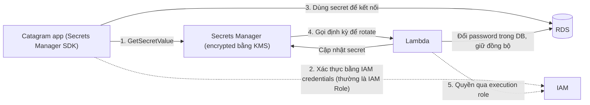

# Secrets Manager

> **TL;DR:** AWS Secrets Manager là dịch vụ chuyên lưu trữ và **tự động xoay vòng (rotate)** secret như password, API key. Nó trùng một phần chức năng với [[SSM Parameter Store]] (SecureString), nhưng điểm khác biệt là **automatic rotation bằng Lambda** và **tích hợp trực tiếp với một số dịch vụ AWS như RDS**, để mật khẩu trong DB luôn khớp với secret.

## 🖼️ Sơ đồ
![[Secrets Manager.excalidraw]]
*Mở bằng plugin Excalidraw để chỉnh sửa · ảnh tĩnh: [[Secrets Manager.svg]]*

## Khái niệm cốt lõi
- **Trùng chức năng với Parameter Store**: cả hai đều lưu được thông tin nhạy cảm đã mã hóa. Trong một số tình huống dùng cái nào cũng được, nên đừng lo nếu có câu khó phân định.
- **Thiết kế riêng cho secrets**: password, API key, thông tin đăng nhập DB...
- Truy cập qua **Console, CLI, API, SDK**. Kiến trúc của nó hướng tới việc **nhúng vào ứng dụng** (ứng dụng gọi SDK để lấy secret lúc chạy), đây là use case phổ biến nhất.
- **Automatic rotation**: dùng **Lambda function** được gọi định kỳ để đổi secret.
- **Tích hợp trực tiếp với một số dịch vụ AWS** (tiêu biểu là **RDS**): khi Lambda rotate secret, mật khẩu thật bên trong RDS instance cũng được đổi theo, nên hai bên luôn **đồng bộ**. Chỉ một tập giới hạn dịch vụ hỗ trợ kiểu tích hợp này.
- **Bảo mật**:
  - Secret được **mã hóa at rest bằng [[KMS]]**, nên không lo rò rỉ do ai đó tiếp cận phần cứng vật lý của AWS.
  - Kiểm soát truy cập bằng **IAM permissions**.
  - KMS tạo ra **role separation**: muốn đọc và giải mã secret cần quyền cả với Secrets Manager **và** với KMS key.

## Cách hoạt động / Kiến trúc
Ví dụ ứng dụng web Catagram cần lấy credential của database:

1. Ứng dụng tích hợp **Secrets Manager SDK** để lấy DB credential.
2. SDK xác thực bằng **IAM credentials**: lý tưởng là [[IAM Roles|IAM Role]] (ví dụ [[EC2 Instance Roles|instance role]]); dùng [[IAM Access Keys and AWS CLI|access key]] cũng được nhưng kém hơn.
3. Ứng dụng dùng secret vừa lấy để kết nối an toàn tới database.
4. Secrets Manager **định kỳ gọi [[Lambda]]** để rotate secret. Với dịch vụ được hỗ trợ như [[RDS Architecture|RDS]], thông tin xác thực trong DB cũng được cập nhật cùng lúc.
5. Lambda lấy quyền từ **execution role** (IAM role) để vừa cập nhật secret vừa cập nhật DB.

Đến bước 3, mọi thứ [[SSM Parameter Store]] đều làm được (SecureString). Phần tạo khác biệt là bước 4–5: rotation **end-to-end**, tức Secrets Manager đổi credential và đổi luôn ở dịch vụ dùng credential đó. Chỉ cần ứng dụng luôn lấy secret từ Secrets Manager thay vì hard-code là nó luôn có bản mới nhất.

## Bảng so sánh: Secrets Manager vs SSM Parameter Store

| Tiêu chí | Secrets Manager | [[SSM Parameter Store]] |
|---|---|---|
| Mục đích chính | Secrets: password, API key, DB credential | Cấu hình + secret: String, StringList, SecureString, cấu trúc hierarchical |
| Mã hóa | Luôn mã hóa bằng KMS | SecureString mã hóa bằng KMS (tùy chọn) |
| Automatic rotation | **Có**, qua Lambda | Không có sẵn |
| Tích hợp đổi password trong dịch vụ (RDS...) | **Có** | Không |
| Use case điển hình | Credential DB rotate định kỳ, API key | Cấu hình ứng dụng, config CloudWatch Agent, AMI ID, license key... |

## 🎯 Mẹo thi SAA-C03
- Làm **keyword analysis**:
  - Đề nhắc **secrets / password / API key** → nghiêng về Secrets Manager.
  - Đề nhắc **rotation / rotate credentials** → Secrets Manager.
  - Đề nhắc **rotation + RDS** (hoặc dịch vụ tích hợp) → gần như chắc chắn là Secrets Manager.
- Phần lớn câu hỏi chỉ đưa **một trong hai** (Secrets Manager hoặc Parameter Store) vào đáp án; hiếm khi có cả hai. Khi có cả hai thì tìm ba dấu hiệu: **secrets, rotation, integration (RDS)**.
- Nếu cần lưu thứ **không phải secret**, như cấu hình dạng phân cấp (hierarchical) hoặc config cho [[CloudWatch Agent]], thì chọn [[SSM Parameter Store]].
- Rotation chạy bằng **Lambda**; Lambda cần **execution role** có quyền phù hợp.
- Ứng dụng nên dùng **IAM Role** để lấy secret, đừng nhúng access key.
- Nhớ rằng đọc secret cần cả quyền IAM với Secrets Manager **và** quyền dùng KMS key (role separation).

## Liên kết
- Tiên quyết: [[KMS]], [[IAM Roles]], [[Lambda]]
- Liên quan: [[RDS Security]], [[RDS Architecture]], [[EC2 Instance Roles]], [[CloudHSM]]
- Phân biệt với: [[SSM Parameter Store]]
