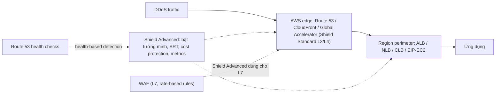

# Shield

> **TL;DR:** AWS Shield bảo vệ tài nguyên kết nối Internet khỏi [[DDoS]]. **Shield Standard** miễn phí, tự động, chống tấn công L3/L4 ở biên mạng. **Shield Advanced** trả phí ($3000/tháng/organization, cam kết 1 năm), bảo vệ thêm nhiều loại resource, **phải bật thủ công**, có bảo vệ L7 qua [[WAF]], **cost protection**, đội **SRT** và **health-based detection**.

## 🖼️ Sơ đồ
![[Shield.excalidraw]]
*Mở bằng plugin Excalidraw để chỉnh sửa · ảnh tĩnh: [[Shield.svg]]*

![[Shield - compare.excalidraw]]
*Mở bằng plugin Excalidraw để chỉnh sửa · ảnh tĩnh: [[Shield - compare.svg]]*

## Khái niệm cốt lõi
### Ba loại DDoS mà Shield chống (xem [[DDoS]])
| Loại | Tầng OSI | Mô tả |
|---|---|---|
| **Network volumetric** | L3 | Dồn càng nhiều dữ liệu thô càng tốt vào mục tiêu để làm nghẽn. |
| **Network protocol** (ví dụ **SYN flood**) | L4 | Mở hàng loạt kết nối từ IP giả mạo rồi bỏ ngỏ. CPU/RAM của mục tiêu vẫn ổn nhưng hết khả năng phục vụ kết nối thật (giống tổng đài bị gọi rồi để im máy). Có thể kết hợp với volumetric nhưng mặc định coi là hai loại riêng. |
| **Application layer** (ví dụ **web request flood**) | L7 | Gửi request rẻ với kẻ tấn công nhưng tốn kém với hệ thống (ví dụ query search mất 2–3 giây). Dùng ứng dụng "đúng cách" để làm sập nó. |

### Shield Standard
- **Miễn phí** cho mọi khách hàng AWS, bảo vệ **tự động**, không cần làm gì.
- Bảo vệ tại **perimeter**: trong region (khi traffic đi vào VPC) hoặc tại **edge** nếu dùng [[CloudFront Architecture|CloudFront]] hay [[Global Accelerator]].
- Chống tấn công phổ biến ở **L3/L4** (network/transport).
- Bảo vệ tốt nhất khi dùng **[[Route 53 Fundamentals|Route 53]], CloudFront, Global Accelerator**.
- Gần như **không có khả năng proactive** hay cấu hình bảo vệ chủ động; chỉ chạy nền.

### Shield Advanced
- **Chi phí**: **US$3000/tháng mỗi organization** (không phải mỗi account). Các account trong cùng [[AWS Organizations|AWS Organization]] dùng chung một khoản đầu tư. Cam kết **1 năm** → $36,000/năm, cộng thêm phí **data out**.
- **Phạm vi bảo vệ rộng hơn**: CloudFront, Route 53, Global Accelerator, mọi thứ gắn **Elastic IP** (ví dụ EC2), **ALB, CLB, NLB**.
- **Không tự động**: phải **bật protection tường minh** cho từng resource trong Shield Advanced, hoặc qua **AWS Firewall Manager** với Shield Advanced policy. (Câu thi có thể hỏi bảo vệ cần cấu hình hay chạy nền.)
- **Cost protection**: nếu phát sinh chi phí do tấn công lẽ ra Shield Advanced phải giảm thiểu mà không làm được (ví dụ EC2 scale out vì tải độc hại), AWS bù lại. Điều kiện: resource thuộc loại được hỗ trợ **và** đã bật protection cho nó.
- **Proactive engagement + SRT (Shield Response Team)**:
  - SRT **chủ động liên hệ** khi availability/performance của ứng dụng bị ảnh hưởng bởi tấn công, có thể bắt đầu troubleshoot **trước khi** liên lạc được với bạn.
  - Phải cung cấp thông tin liên lạc trước và bật tính năng.
  - Bạn cũng có thể mở ticket với SRT; SLA tùy [[AWS Accounts|support plan]] (ví dụ 1 giờ hoặc 15 phút).
- **WAF integration**: Shield Advanced dùng **[[WAF]]** để chống tấn công **L7**; subscription đã **bao gồm phí WAF cơ bản** (Web ACL, rule, web request).
- **Real-time metrics và report** về DDoS event/attack, xem qua Shield console, API, và [[CloudWatch Basics|CloudWatch]].
- **Health-based detection**: dùng [[R53 Health Checks|Route 53 health checks]] làm health check riêng cho ứng dụng → giảm false positive, phát hiện và giảm thiểu nhanh hơn. **Bắt buộc phải có** nếu muốn dùng proactive engagement team.
- **Protection groups**: nhóm các resource được bảo vệ, định nghĩa tiêu chí thành viên để **resource mới tự được thêm**; quản lý bảo vệ theo nhóm thay vì từng resource → giảm admin overhead.

## Cách hoạt động / Kiến trúc

## Bảng so sánh: Standard vs Advanced

| Tiêu chí | Shield Standard | Shield Advanced |
|---|---|---|
| Giá | Miễn phí | $3000/tháng/**organization**, cam kết 1 năm, + data out |
| Kích hoạt | Tự động | **Phải bật tường minh** (Shield hoặc Firewall Manager) |
| Tầng bảo vệ | L3/L4 | L3/L4 + **L7 (qua WAF)** |
| Resource | Perimeter chung; tốt nhất với R53, CloudFront, GA | CloudFront, R53, GA, EIP (EC2), ALB, CLB, NLB |
| Cost protection | Không | **Có** |
| SRT / proactive engagement | Không | **Có** (cần health-based detection) |
| Metrics/report thời gian thực | Không | Có |
| Phí WAF cơ bản | Trả riêng | **Đã bao gồm** |
| Protection groups | Không | Có |

## 🎯 Mẹo thi SAA-C03
- "DDoS protection miễn phí, không cần làm gì" → **Shield Standard**.
- "Cần đội ngũ chuyên gia hỗ trợ 24/7 khi bị DDoS", "bồi hoàn chi phí scale do DDoS", "visibility thời gian thực về tấn công" → **Shield Advanced**.
- Shield Advanced **không tự bảo vệ**: phải bật cho từng resource hoặc qua Firewall Manager.
- Giá tính **theo organization**, không theo account; nhiều account cùng Organization dùng chung.
- DDoS **L7 / HTTP flood** → [[WAF]] (rate-based rule); Shield Advanced cũng dựa vào WAF cho L7.
- Kiến trúc chống DDoS tốt: đặt **CloudFront / Global Accelerator / Route 53** ở phía trước để hấp thụ ở edge.
- Health-based detection dùng **Route 53 health checks** và là điều kiện để dùng proactive engagement.

## Liên kết
- Tiên quyết: [[DDoS]], [[OSI Model]], [[Layer 7 Firewall]]
- Liên quan: [[WAF]], [[CloudFront Architecture]], [[Global Accelerator]], [[Route 53 Fundamentals]], [[R53 Health Checks]], [[Elastic Load Balancer]], [[AWS Organizations]]
- Phân biệt với: [[GuardDuty]] (phát hiện mối đe dọa, không chặn DDoS), [[WAF]]
