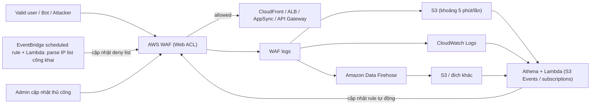

# WAF

> **TL;DR:** AWS WAF (Web Application Firewall) là cách AWS hiện thực [[Layer 7 Firewall]]: hiểu HTTP/HTTPS và lọc request theo IP, header, URI, query string, body, quốc gia... Đơn vị cấu hình là **Web ACL** (chứa **rule group** và **rule**), gắn vào [[CloudFront Architecture|CloudFront]], ALB, API Gateway, AppSync để chặn SQL injection, XSS, HTTP flood, bot, IP xấu.

## 🖼️ Sơ đồ
![[WAF.excalidraw]]
*Mở bằng plugin Excalidraw để chỉnh sửa · ảnh tĩnh: [[WAF.svg]]*

![[WAF - logging.excalidraw]]
*Mở bằng plugin Excalidraw để chỉnh sửa · ảnh tĩnh: [[WAF - logging.svg]]*

## Khái niệm cốt lõi
- WAF bảo vệ các **web resource được hỗ trợ**:
  - **Global**: CloudFront.
  - **Regional**: **Application Load Balancer**, **API Gateway**, **AppSync**. Bài mới nói **còn nhiều dịch vụ khác** hỗ trợ WAF (ví dụ Cognito user pool, App Runner, Verified Access, Amplify; bổ sung, bài không kể tên).
  - **Không** gắn trực tiếp vào NLB, EC2, hay AWS Outposts.
- **Web ACL (Web Access Control List)** là đơn vị cấu hình chính; chính Web ACL được associate với resource.
- Bên trong Web ACL có **rule groups** và **rules**: AWS Managed Rules, allow list / deny list, SQL injection, XSS (cross-site scripting), HTTP flood, IP reputation, known botnet...
- **Logging**: log có thể gửi tới **S3**, **CloudWatch Logs** hoặc **Amazon Data Firehose** (tên cũ Kinesis Data Firehose, xem [[Kinesis Data Firehose]]).
  - Log vào S3 được giao theo lô **khoảng mỗi 5 phút**, nên không hợp để phản ứng nhanh.
  - Firehose có thể đẩy tiếp tới mọi đích nó hỗ trợ (kể cả S3).

### Web ACL
- **Default action**: **ALLOW** hoặc **BLOCK** cho mọi traffic **không khớp rule nào**. Chọn theo mô hình:
  - Mặc định ALLOW, rule chặn exploit cụ thể (deny list).
  - Mặc định BLOCK, rule chỉ cho traffic đã biết là tốt (allow list).
- Tạo cho **CloudFront (global)** hoặc **regional** (khi đó phải chọn **region trùng với region của resource**).
- Web ACL rỗng thì không làm gì; phải thêm rule/rule group. Rule được **xử lý theo thứ tự**, có thể sắp xếp lại.
- **WCU (Web ACL Capacity Units)**: thước đo độ phức tạp (compute) của rule. Giá gốc của Web ACL đã gồm **1500 WCU**; cần thêm thì dùng được tới **hard limit 5000 WCU**, phần vượt tính thêm phí theo **bậc 500 WCU**. (Bản khóa cũ nói tối đa 1500 WCU, tăng qua support ticket.) Đừng nhầm với **WCU của DynamoDB** (Write Capacity Unit, xem [[DynamoDB Operations and Performance]]).
- **Quan hệ**: **một resource chỉ có một Web ACL**, nhưng **một Web ACL gắn được cho nhiều resource**.
- Web ACL của CloudFront **không** gắn được cho resource regional và ngược lại.
- **Association mất thời gian** tùy dịch vụ (CloudFront phải cập nhật distribution và đẩy ra edge location). **Sửa một Web ACL đã gắn sẵn thì nhanh hơn**.

### Rule groups
- Là **nhóm rule** để quản trị theo nhóm; **không có default action** (default action thuộc về Web ACL).
- Nguồn rule group:
  - **AWS Managed**: phần lớn **miễn phí** cho khách WAF; riêng **Bot Control**, **Fraud Control Account Takeover Prevention (ATP)**, **Fraud Control Account Creation Fraud Prevention (ACFP)** và **anti-DDoS managed rule group** tính phí thêm.
  - **Marketplace vendor**: thường có phí subscription.
  - **Của bạn** (tự tạo).
  - **Service-owned**: ví dụ do [[Shield]] hoặc [[AWS Firewall Manager|Firewall Manager]] quản lý.
- **Tái sử dụng** được ở nhiều Web ACL; một Web ACL tham chiếu một hoặc nhiều rule group.
- Khi tạo rule group phải **khai báo trước WCU capacity**, **không đổi được về sau**, tối đa **5000 WCU** (bản khóa cũ nói mặc định tối đa 1500). Con số này giúp người dùng biết nó "nặng" thế nào khi ghép vào Web ACL.

### Rules = Type + Statement + Action
**Type**
- **Regular**: khớp khi điều kiện xảy ra.
- **Rate-based**: khớp khi điều kiện xảy ra **với tần suất vượt ngưỡng**. Ví dụ bài giảng: ai đó gọi URL **/login** tới **5000 lần trong 5 phút** gợi ý brute force (còn regular rule thì ví dụ: cho phép request tới **/admin** từ một IP nhất định). (Bổ sung, bài không nói: cửa sổ đánh giá chọn được 1, 2, 5 hoặc 10 phút.)

**Statement** (phần chính: rule kiểm tra cái gì)
- Regular: "cái gì" khớp, ví dụ request có header nào đó.
- Rate-based: dùng **aggregation key**, tức cách WAF gom request thành nhóm để đếm; ngưỡng áp cho **từng nhóm**.
  - Mặc định và phổ biến nhất là **source IP**; cũng gom được theo thuộc tính khác của request hoặc **kết hợp** nhiều thuộc tính.
  - Có thể chỉ đếm request khớp điều kiện, ví dụ 5000 request **tới /login** trong 5 phút.
- Tiêu chí match: **origin country, IP address, label, header, cookie, query parameter, URI path, query string, body, HTTP method**.
- **Body: WAF chỉ kiểm tra tới một giới hạn kích thước**, không xem được toàn bộ body. Bản khóa cũ nêu con số **8,192 byte (8 KB) đầu tiên**; bài mới không nêu số. (Bổ sung, bài không nói: hiện nay với CloudFront, API Gateway, Cognito, App Runner, Verified Access mặc định 16 KB và tăng được tới 64 KB; ALB và AppSync vẫn 8 KB.)
- Kiểu match: exact match, starts with, ends with, contains, **regex**...
- Có thể kết hợp **nhiều statement** bằng **AND / OR / NOT**.

**Action**
- Regular rule: **ALLOW, BLOCK, COUNT, CAPTCHA, CHALLENGE**.
- Rate-based rule: **BLOCK, COUNT, CAPTCHA, CHALLENGE** — **không có ALLOW** (vì ý nghĩa của rate-based là làm gì đó khi vượt ngưỡng, "cho phép" thì vô nghĩa).
- **COUNT**: chỉ đếm và ghi nhận. **CAPTCHA**: giải đúng thì coi như count, ghi nhận và tiếp tục xử lý; giải sai thì block và dừng.
- **CHALLENGE**: hoạt động giống CAPTCHA nhưng **im lặng**: WAF chạy một **kiểm tra JavaScript ngầm** thay vì bắt người dùng giải câu đố.
  - Cả CAPTCHA và CHALLENGE dùng **token** để nhớ client đã vượt qua, nên client không bị hỏi lại liên tục.
- **Custom response** (tùy chọn):
  - BLOCK: custom response.
  - ALLOW / COUNT / CAPTCHA / CHALLENGE: chỉ custom header.
  - Custom header có tiền tố **`x-amzn-waf-`**, giúp ứng dụng nhận biết và phản ứng với traffic đã khớp rule.
- **Labels**: nhãn nội bộ của WAF, cho phép luồng nhiều bước (rule A gắn label, rule B chạy hay không tùy label). Chỉ tồn tại trong **một Web ACL**, không ra ngoài.
- **ALLOW / BLOCK là terminating**: khớp là dừng xử lý request đó trên Web ACL. **COUNT / CAPTCHA không dừng**, nên label thường đi cùng hai action này để rule phía sau xử lý tiếp.

## Cách hoạt động / Kiến trúc
Kiến trúc nâng cao có **event-driven security response**, tạo vòng phản hồi từ log về Web ACL:

- Cập nhật Web ACL **thủ công** khi con người phát hiện rủi ro.
- Tự động đơn giản: [[EventBridge]] scheduled rule gọi [[Lambda]] để parse danh sách IP xấu công khai rồi cập nhật deny list.
- Tự động nâng cao: phân tích log bằng [[S3 Events]], Lambda, [[Athena]], EventBridge → rút ra thông tin hành động được → cập nhật Web ACL **không cần người**.

## Bảng so sánh / số liệu

Giá dưới đây do bản khóa cũ nêu, bài mới không nói (có thể đã thay đổi):

| Mục | Giá trị |
|---|---|
| Web ACL | **$5/tháng** mỗi Web ACL (tái sử dụng được cho nhiều resource) |
| Rule trên Web ACL | **$1/tháng** mỗi rule |
| Request | **$0.60 / 1 triệu request** mỗi Web ACL (càng gắn nhiều resource càng nhiều request) |
| Rule group / managed rule group | Phí tháng riêng cho mỗi group thêm vào |
| Bot Control | $10/tháng + $1 / 1 triệu request |
| CAPTCHA | $0.40 / 1000 challenge attempts |
| Fraud Control / Account Takeover | $10/tháng + $1 / 1000 login attempts |
| Marketplace rule groups | Phí thêm |
| WCU của Web ACL (bài mới) | 1500 trong giá gốc; hard limit 5000, phần vượt tính theo bậc 500 |
| WCU của rule group (bài mới) | Khai báo khi tạo, không đổi được, tối đa 5000 |
| Body inspect | Có giới hạn; bản khóa cũ nêu 8,192 byte đầu |

## 🎯 Mẹo thi SAA-C03
- WAF = **Layer 7**. Đề nói chặn **SQL injection, XSS, chặn theo quốc gia (geo match), theo IP, theo header/URI, rate limiting HTTP request, bot** → WAF.
- Nhớ danh sách resource gắn được: **CloudFront, ALB, API Gateway, AppSync** (+ Cognito, App Runner...). **NLB không** gắn WAF; nếu đề có NLB + yêu cầu L7 thì phải đổi sang ALB hoặc đặt CloudFront phía trước.
- **Một resource ↔ một Web ACL**, một Web ACL ↔ nhiều resource. Web ACL CloudFront tạo ở phạm vi global (thực tế ở us-east-1), Web ACL regional phải cùng region với resource.
- **Rate-based rule không có ALLOW**: chỉ BLOCK / COUNT / CAPTCHA / CHALLENGE. Rate-based đếm theo **aggregation key** (mặc định source IP).
- **WCU**: Web ACL có 1500 WCU trong giá gốc, tối đa 5000 (trả thêm); WCU của rule group cố định khi tạo.
- **Body chỉ inspect tới một giới hạn kích thước** (bản khóa cũ nhấn mạnh con số 8 KB đầu).
- **WCU** của WAF ≠ WCU của DynamoDB.
- Muốn phản ứng gần thời gian thực với log WAF thì **đừng dựa vào log trực tiếp vào S3** (trễ khoảng 5 phút); dùng CloudWatch Logs hoặc Amazon Data Firehose.
- DDoS L3/L4 → [[Shield]]; DDoS L7 (HTTP flood) → WAF (rate-based rule), và Shield Advanced dùng WAF cho L7.
- WAF chỉ xử lý **HTTP/HTTPS**, không lọc SSH. (Bản khóa cũ minh họa regular/rate-based bằng ví dụ "rule cho SSH"; bài mới dùng ví dụ URL /admin và /login.)

## Liên kết
- Tiên quyết: [[Layer 7 Firewall]], [[OSI Model]]
- Liên quan: [[Shield]], [[CloudFront Architecture]], [[Elastic Load Balancer]], [[API Gateway]], [[EventBridge]], [[Lambda]], [[Athena]], [[Kinesis Data Firehose|Amazon Data Firehose]], [[CloudWatch Logs]], [[DDoS]]
- Phân biệt với: [[Security Groups]], [[NACL]], [[Compare - ALB vs NLB]], [[GuardDuty]], [[AWS Network Firewall]]
