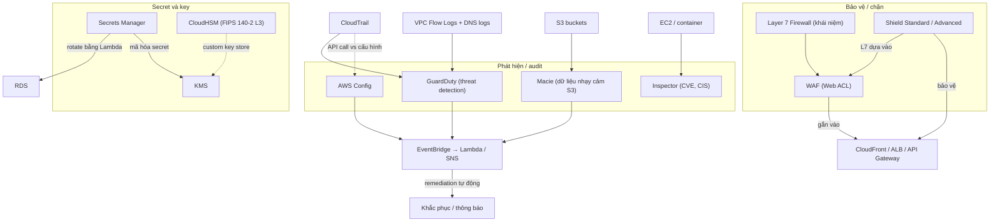

# 18 Security Deployment and Operations

Section này gom các dịch vụ bảo mật và vận hành mà đề SAA-C03 hay hỏi theo kiểu từ khóa: quản lý secret, firewall Layer 7 và chống DDoS, quản lý key bằng HSM, theo dõi compliance cấu hình, và bộ ba phát hiện (Macie, Inspector, GuardDuty). Nó dựa trên nền mã hóa, KMS, CloudTrail đã học ở các section trước và bổ sung lớp bảo vệ cho kiến trúc HA, serverless, CloudFront đã dựng.

← [[00 Home]] · Trước: [[_MOC 17 Hybrid and Migration]] · Sau: [[_MOC 19 CloudFormation]]

## Lộ trình học
1. [[Secrets Manager]] — lưu secret và **tự động rotate bằng Lambda**, tích hợp RDS; khác SSM Parameter Store ở rotation.
2. [[Layer 7 Firewall]] — firewall hiểu giao thức ứng dụng (HTTP header, path, nội dung), nền lý thuyết cho WAF.
3. [[WAF]] — Web ACL lọc HTTP/HTTPS (SQLi, XSS, geo, IP, rate limit), gắn CloudFront, ALB, API Gateway, AppSync.
4. [[Shield]] — chống DDoS: Standard miễn phí L3/L4; Advanced trả phí, có SRT, cost protection, L7 qua WAF.
5. [[CloudHSM]] — HSM single-tenant FIPS 140-2 Level 3, khách hàng toàn quyền key, API chuẩn PKCS#11/JCE/CNG.
6. [[AWS Config]] — ghi lịch sử cấu hình resource và đánh giá compliance bằng Config Rules; phát hiện, không ngăn chặn.
7. [[Macie]] — khám phá và phân loại dữ liệu nhạy cảm (PII, PHI, credential) trong S3 bằng ML và pattern matching.
8. [[Inspector]] — quét lỗ hổng (CVE, CIS Benchmarks) và network reachability cho EC2, OS, container.
9. [[GuardDuty]] — threat detection liên tục từ DNS logs, VPC Flow Logs, CloudTrail bằng ML + threat intelligence.

## Bản đồ khái niệm

## Liên kết sang section khác
- [[KMS]] — dịch vụ key dùng chung, đối chiếu với CloudHSM và nền cho Secrets Manager.
- [[SSM Parameter Store]] — lưu config/SecureString, phân biệt với Secrets Manager.
- [[CloudTrail]] — ghi API call; nguồn log cho GuardDuty, phân biệt với AWS Config.
- [[VPC Flow Logs]] — nguồn log cho GuardDuty.
- [[Event-Driven Architecture]] — mẫu findings → EventBridge → Lambda/SNS lặp lại ở Config, Macie, GuardDuty.
- [[CloudFront Architecture]] — điểm gắn WAF và hấp thụ DDoS ở edge.
- [[Compare - ALB vs NLB]] — NLB không gắn được WAF.
- [[DDoS]] — kiến thức nền về các loại tấn công DDoS.
- [[Service Control Policies]] — dùng khi cần **ngăn** hành động, việc Config không làm được.
- [[Security Groups]] — firewall L4, không nhìn thấy nội dung HTTP.

## 🎯 Top mẹo thi của section
- **Secrets + rotation + RDS** → Secrets Manager; config phân cấp, không phải secret → Parameter Store ([[Secrets Manager]]).
- Lọc theo **HTTP header, URI, SQLi, XSS** → cần Layer 7, tức WAF; SG và NACL không thấy những thứ này ([[Layer 7 Firewall]]).
- WAF gắn được **CloudFront, ALB, API Gateway, AppSync**; **NLB không** → đổi sang ALB hoặc đặt CloudFront phía trước ([[WAF]]).
- Rate-based rule của WAF chỉ **BLOCK / COUNT / CAPTCHA**, không có ALLOW; HTTP flood (L7) → WAF rate-based rule ([[WAF]]).
- DDoS miễn phí, tự động → **Shield Standard**; cần đội SRT 24/7, bồi hoàn chi phí scale, visibility → **Shield Advanced** ($3000/tháng/organization, phải bật thủ công) ([[Shield]]).
- **FIPS 140-2 Level 3**, PKCS#11/JCE/CNG, single-tenant, AWS không truy cập key → **CloudHSM**; tích hợp dịch vụ AWS → KMS ([[CloudHSM]]).
- CloudHSM muốn HA phải dựng **cluster nhiều HSM ở nhiều AZ** ([[CloudHSM]]).
- "Cấu hình resource tuần trước thế nào", audit thay đổi cấu hình, compliance → **AWS Config**; nhưng Config **không prevent** ([[AWS Config]]).
- Dữ liệu nhạy cảm **trong S3** (PII, PHI, thẻ tín dụng) → **Macie**; dữ liệu đặc thù dùng custom data identifier ([[Macie]]).
- **CVE / CIS Benchmarks / security report cho EC2** → **Inspector**; network reachability không cần agent, kiểm tra trong OS cần agent ([[Inspector]]).
- Phân tích **DNS logs + VPC Flow Logs + CloudTrail** để tìm hành vi bất thường → **GuardDuty**; GuardDuty chỉ phát hiện, việc chặn do Lambda remediation làm ([[GuardDuty]]).
- Tự động phản ứng với finding → dịch vụ phát hiện → **EventBridge** → Lambda/SNS ([[GuardDuty]], [[Macie]], [[AWS Config]]).
